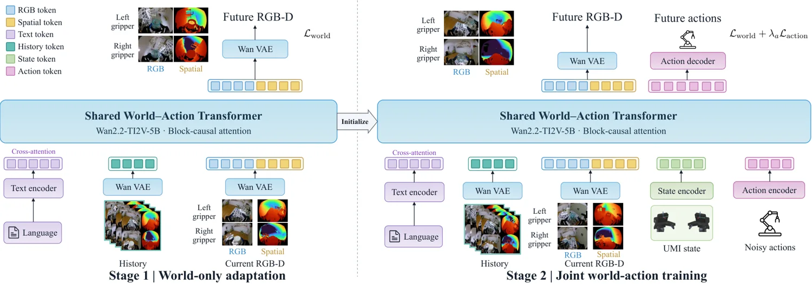

<!-- Generated by scripts/generate.py; edit data/works.json and data/media.json. -->

[← Back to the Awesome index](../../../README.md) · [Interactive website](https://chang-xinhai.github.io/Awesome-RGBDT-Manipulation/?collection=policy&item=spatial-umi-dream#library)

# Spatial-UMI-Dream

Spatial-UMI-Dream: Scaling World Action Models with Metric Geometry for UMI Manipulation

**2026-11-04 · Preprint · University of Southern California**

**[Paper](https://arxiv.org/abs/2611.07229)** · [Project](https://weiduoyuan.com/spatial-umi-dream/) · [Code](https://github.com/Yewandou7/spatial_umi_dream) · [Data](https://github.com/ZeYuan06/RoboTwin-UMI) · [Weights](https://huggingface.co/Yewandou/spatial-umi-dream)

A world-action model predicts future observations and actions from stereo-derived metric geometry in UMI demonstrations.

*Spatial-UMI-Dream authors · [Figure source](https://weiduoyuan.com/spatial-umi-dream/) · Original rights retained.*

| Field | Reported value and source scope |
| :-- | :-- |
| Record type | policy |
| Policy family | RGB-D world-action policy [1](https://arxiv.org/html/2611.07229v1)  |
| Base model and architecture | See original paper [1](https://arxiv.org/html/2611.07229v1)  |
| Model size and component | Not reported [1](https://arxiv.org/html/2611.07229v1)  |
| Deployment inputs | Dual-gripper RGB and stereo-estimated metric depth with observation history and instruction. [1](https://arxiv.org/html/2611.07229v1)  |
| Action outputs and horizon | Future RGB-D predictions and robot action sequences. [1](https://arxiv.org/html/2611.07229v1)  |
| Training method | Two-stage world-only and joint world-action pretraining. [1](https://arxiv.org/html/2611.07229v1)  |
| Training data | See original paper [1](https://arxiv.org/html/2611.07229v1)  |
| Training duration | Not reported [1](https://arxiv.org/html/2611.07229v1)  |
| Training hardware | Not reported [1](https://arxiv.org/html/2611.07229v1)  |
| Inference and control rates | Not reported [1](https://arxiv.org/html/2611.07229v1)  |
| Evaluation scope | RoboTwin-UMI simulated benchmark and six real-world manipulation tasks. [1](https://arxiv.org/html/2611.07229v1)  |
| Observations / modalities | RGB · Depth · Proprioception · Language |
| Evaluation domain | Simulation · Real world |
| Embodiment |  |
| Release: code | Available — model training, depth generation and deployment source [2](https://github.com/Yewandou7/spatial_umi_dream) [3](https://huggingface.co/Yewandou/spatial-umi-dream) [4](https://github.com/ZeYuan06/RoboTwin-UMI)  |
| Release: weights | Available — pretrained and RoboTwin-UMI checkpoints [2](https://github.com/Yewandou7/spatial_umi_dream) [3](https://huggingface.co/Yewandou/spatial-umi-dream) [4](https://github.com/ZeYuan06/RoboTwin-UMI)  |
| Release: data | RoboTwin-UMI training data and benchmark provided separately; 605-hour UMI dataset release not verified [2](https://github.com/Yewandou7/spatial_umi_dream) [3](https://huggingface.co/Yewandou/spatial-umi-dream) [4](https://github.com/ZeYuan06/RoboTwin-UMI)  |
| Release: license | Apache-2.0 code; upstream models and datasets have separate terms. [2](https://github.com/Yewandou7/spatial_umi_dream) [3](https://huggingface.co/Yewandou/spatial-umi-dream) [4](https://github.com/ZeYuan06/RoboTwin-UMI)  |
| Release: notes | Repository and official checkpoint listing inspected; complete UMI pretraining data availability is not established. [2](https://github.com/Yewandou7/spatial_umi_dream) [3](https://huggingface.co/Yewandou/spatial-umi-dream) [4](https://github.com/ZeYuan06/RoboTwin-UMI)  |

**Scope and qualifications**

- Depth is reconstructed from stereo, not a separate active depth sensor; external task-suite videos are for visualization.
- Released benchmark data and model checkpoints do not establish that the 605-hour UMI pretraining corpus is public.

**Primary evidence**

1. [Author paper and first submission](https://arxiv.org/html/2611.07229v1)
2. [Official training and depth-generation source](https://github.com/Yewandou7/spatial_umi_dream)
3. [Official model checkpoints](https://huggingface.co/Yewandou/spatial-umi-dream)
4. [Official benchmark repository and training-data instructions](https://github.com/ZeYuan06/RoboTwin-UMI)
