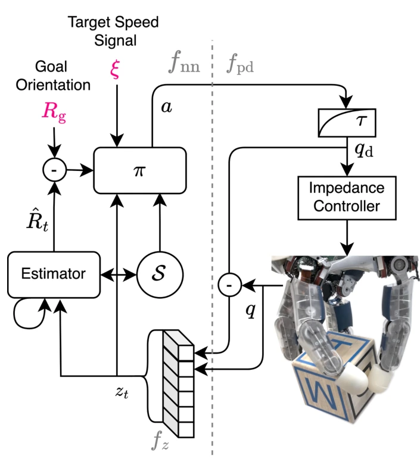

<!-- Generated by scripts/generate.py; edit data/works.json and data/media.json. -->

[← Back to the Awesome index](../../../README.md) · [Interactive website](https://chang-xinhai.github.io/Awesome-RGBDT-Manipulation/?collection=policy&item=speed-adjustable-tactile#library)

# Speed-Adjustable Tactile Manipulation

Learning Time-Optimal and Speed-Adjustable Tactile In-Hand Manipulation

**2024-11-20 · Preprint · German Aerospace Center (DLR)**

**[Paper](https://arxiv.org/abs/2411.13148)**

Speed-conditioned estimator-coupled RL accelerates tactile goal reorientation while preserving force closure.

*Learning Time-Optimal and Speed-Adjustable Tactile In-Hand Manipulation authors · [Figure source](https://arxiv.org/abs/2411.13148) · Original rights retained.*

| Field | Reported value and source scope |
| :-- | :-- |
| Record type | policy |
| Policy family | RL [1](https://arxiv.org/abs/2411.13148)  |
| Base model and architecture | PPO policy and learned object pose estimator; speed-conditioned training objective. [1](https://arxiv.org/abs/2411.13148)  |
| Model size and component | Not reported [1](https://arxiv.org/abs/2411.13148)  |
| Deployment inputs | Joint position/control error history, estimated object pose, goal and speed target. [1](https://arxiv.org/abs/2411.13148)  |
| Action outputs and horizon | Hand joint targets filtered for impedance execution. [1](https://arxiv.org/abs/2411.13148)  |
| Training method | Estimator-coupled RL and time-optimal/speed-adjustable objectives. [1](https://arxiv.org/abs/2411.13148)  |
| Training data | GPU-parallel Isaac simulation with domain randomization. [1](https://arxiv.org/abs/2411.13148)  |
| Training duration | Under 24 h reported for configurable-speed cuboid agent. [1](https://arxiv.org/abs/2411.13148)  |
| Training hardware | Single NVIDIA T4. [1](https://arxiv.org/abs/2411.13148)  |
| Inference and control rates | 20 Hz policy/estimator;1000 Hz impedance controller. [1](https://arxiv.org/abs/2411.13148)  |
| Evaluation scope | DLR Hand II cuboid reorientation at configurable speeds. [1](https://arxiv.org/abs/2411.13148)  |
| Observations / modalities | Force/Torque · Proprioception |
| Evaluation domain | Simulation · Real world |
| Embodiment | Dexterous hand |
| Release: code | Not verified |
| Release: weights | Not verified |
| Release: data | Not verified |
| Release: license | Not verified |
| Release: notes | Original paper reviewed; claimed future releases are not treated as currently available. |

**Scope and qualifications**

- Torque-derived contact feedback isnot a fingertip cutaneous sensor.

**Primary evidence**

1. [Original paper and supplementary implementation details](https://arxiv.org/abs/2411.13148) — Primary full text reviewed; dataset, deployment modalities and training-only privileges are scoped separately.
