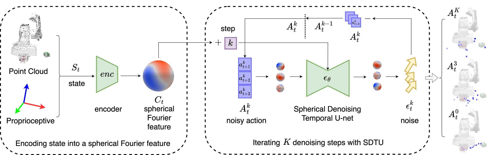

<!-- Generated by scripts/generate.py; edit data/works.json and data/media.json. -->

[← Back to the Awesome index](../../../README.md) · [Interactive website](https://chang-xinhai.github.io/Awesome-RGBDT-Manipulation/?collection=policy&item=spherical-diffusion-policy#library)

# Spherical Diffusion Policy (SDP)

SE(3)-Equivariant Diffusion Policy in Spherical Fourier Space

**2025-07-02 · ICML 2025 · Northeastern University; Amazon; collaborating authors**

**[Paper](https://arxiv.org/abs/2507.01723)** · [Code](https://github.com/amazon-science/Spherical_Diffusion_Policy)

End-to-end SE(3)-equivariant diffusion control embeds scene, actions and denoising in spherical Fourier space.

*Spherical Diffusion Policy (SDP) authors · [Figure source](https://arxiv.org/html/2507.01723) · Original rights retained.*

| Field | Reported value and source scope |
| :-- | :-- |
| Record type | policy |
| Policy family | Diffusion [1](https://arxiv.org/abs/2507.01723)  |
| Base model and architecture | Equiformer-style scene encoding, spherical FiLM and spherical denoising temporal U-Net. [1](https://arxiv.org/abs/2507.01723)  |
| Model size and component | Not reported in the inspected primary-source sections [1](https://arxiv.org/abs/2507.01723)  |
| Deployment inputs | RGB-D-derived point clouds and end-effector/gripper state histories. [1](https://arxiv.org/abs/2507.01723)  |
| Action outputs and horizon | SE(3) end-effector and gripper action trajectories. [1](https://arxiv.org/abs/2507.01723)  |
| Training method | Equivariant behavior cloning with diffusion denoising. [1](https://arxiv.org/abs/2507.01723)  |
| Training data | MimicGen and physical manipulation demonstrations; per-task budgets in manuscript. [1](https://arxiv.org/abs/2507.01723)  |
| Training duration | Not reported in the inspected primary-source sections [1](https://arxiv.org/abs/2507.01723)  |
| Training hardware | Not reported in the inspected primary-source sections [1](https://arxiv.org/abs/2507.01723)  |
| Inference and control rates | Not reported in the inspected primary-source sections [1](https://arxiv.org/abs/2507.01723)  |
| Evaluation scope | Twenty simulation tasks and five physical tasks with single-/dual-arm robots. [1](https://arxiv.org/abs/2507.01723)  |
| Observations / modalities | RGB · Depth · Point cloud · Proprioception |
| Evaluation domain | Simulation · Real world |
| Embodiment | Parallel-jaw gripper · Bimanual |
| Release: code | Available [2](https://github.com/amazon-science/Spherical_Diffusion_Policy) [4](https://github.com/amazon-science/Spherical_Diffusion_Policy/tree/main)  |
| Release: weights | Not verified [2](https://github.com/amazon-science/Spherical_Diffusion_Policy)  |
| Release: data | Not verified [2](https://github.com/amazon-science/Spherical_Diffusion_Policy)  |
| Release: license | MIT for repository code; pretrained models, data and figure rights remain separate [2](https://github.com/amazon-science/Spherical_Diffusion_Policy) [3](https://github.com/amazon-science/Spherical_Diffusion_Policy/blob/main/LICENSE)  |
| Release: notes | Code, data and weights are checked independently; an upstream pretrained model is not a released task policy. [2](https://github.com/amazon-science/Spherical_Diffusion_Policy)  |

**Scope and qualifications**

- Rigid-transform equivariance can be disturbed by gravity, visibility changes and task constraints.

**Primary evidence**

1. [Original manuscript and first submission history](https://arxiv.org/abs/2507.01723) — Full author HTML method/evaluation/appendix inspected; depth observations, pseudo-labels and generated outputs retain distinct roles.
2. [Official implementation and release scope](https://github.com/amazon-science/Spherical_Diffusion_Policy) — Availability of research implementation does not establish public task-policy checkpoints.
3. [Actual license file in released source](https://github.com/amazon-science/Spherical_Diffusion_Policy/blob/main/LICENSE) — Only source code covered by this file; not a blanket license for paper figures or upstream weights.
4. [Actual repository content inventory](https://github.com/amazon-science/Spherical_Diffusion_Policy/tree/main) — 256 tracked paths inspected; code release is distinguished from a README/project/figure-only repository.
