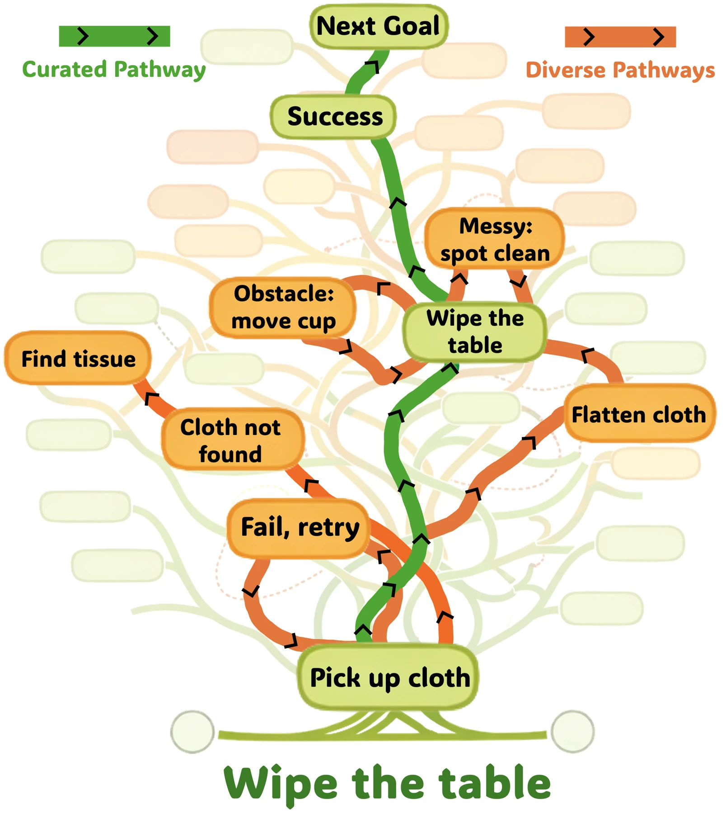

<!-- Generated by scripts/generate.py; edit data/works.json and data/media.json. -->

[← Back to the Awesome index](../../../README.md) · [Interactive website](https://chang-xinhai.github.io/Awesome-RGBDT-Manipulation/?collection=policy&item=spirit-v15#library)

# Spirit v1.5

Spirit-v1.5: Clean Data Is the Enemy of Great Robot Foundation Models

**2026-01-11 · Official project / technical release · Spirit AI**

**[Project](https://www.spirit-ai.com/en/blog/spirit-v1-5)** · [Code](https://github.com/Spirit-AI-Team/spirit-v1.5) · [Weights](https://huggingface.co/Spirit-AI-robotics/Spirit-v1.5)

Uses diverse, uncontrolled robot interaction data with a Qwen-based diffusion-transformer controller.

*Spirit AI · [Figure source](https://www.spirit-ai.com/en/blog/spirit-v1-5) · Original rights retained.*

| Field | Reported value and source scope |
| :-- | :-- |
| Record type | policy |
| Policy family | VLA [1](https://www.spirit-ai.com/en/blog/spirit-v1-5)  |
| Base model and architecture | Qwen3-VL-4B-Instruct backbone with DiT action head [1](https://www.spirit-ai.com/en/blog/spirit-v1-5)  |
| Model size and component | 4B VLM backbone; full DiT-inclusive total not reported [1](https://www.spirit-ai.com/en/blog/spirit-v1-5)  |
| Deployment inputs | Multi-view RGB, task language and proprioceptive state [1](https://www.spirit-ai.com/en/blog/spirit-v1-5) [2](https://github.com/Spirit-AI-Team/spirit-v1.5)  |
| Action outputs and horizon | Continuous action chunks through DiT; released robot-specific layouts/normalization [1](https://www.spirit-ai.com/en/blog/spirit-v1-5) [2](https://github.com/Spirit-AI-Team/spirit-v1.5)  |
| Training method | VLA pretraining on diverse interaction data, followed by task-specific fine-tuning [1](https://www.spirit-ai.com/en/blog/spirit-v1-5)  |
| Training data | Diverse robot interaction corpus emphasized; complete sample/hour totals and final mixture not disclosed [1](https://www.spirit-ai.com/en/blog/spirit-v1-5)  |
| Training duration | Not reported [1](https://www.spirit-ai.com/en/blog/spirit-v1-5)  |
| Training hardware | Not reported [1](https://www.spirit-ai.com/en/blog/spirit-v1-5)  |
| Inference and control rates | Not reported [1](https://www.spirit-ai.com/en/blog/spirit-v1-5)  |
| Evaluation scope | RoboChallenge Table 30 and official RoboDojo sim/real submissions; released move-objects-into-box example [1](https://www.spirit-ai.com/en/blog/spirit-v1-5)  |
| Observations / modalities | RGB · Proprioception · Language |
| Evaluation domain | Simulation · Real world |
| Embodiment | Parallel-jaw gripper · Bimanual |
| Release: code | Available [1](https://www.spirit-ai.com/en/blog/spirit-v1-5) [2](https://github.com/Spirit-AI-Team/spirit-v1.5)  |
| Release: weights | Available [1](https://www.spirit-ai.com/en/blog/spirit-v1-5)  |
| Release: data | Not verified [1](https://www.spirit-ai.com/en/blog/spirit-v1-5)  |
| Release: license | Apache-2.0 model card; exact repository and third-party component terms separate [1](https://www.spirit-ai.com/en/blog/spirit-v1-5)  |
| Release: notes | Public project and model release; undisclosed training details remain explicitly unknown. A manuscript is not required to identify the released policy. [1](https://www.spirit-ai.com/en/blog/spirit-v1-5)  |

**Scope and qualifications**

- Official blog provides data/benchmark figures but no verified policy-architecture figure; no results plot substituted.

**Primary evidence**

1. [Official model project / technical release](https://www.spirit-ai.com/en/blog/spirit-v1-5) — Research-report facts and current executable release are scoped separately; undated releases retain an unknown publication date.
2. [Official implementation / author-contributed adapter](https://github.com/Spirit-AI-Team/spirit-v1.5) — Actual deployment contract is checked; adapter presence alone is not evidence of benchmark participation.
