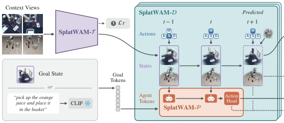

<!-- Generated by scripts/generate.py; edit data/works.json and data/media.json. -->

[← Back to the Awesome index](../../../README.md) · [Interactive website](https://chang-xinhai.github.io/Awesome-RGBDT-Manipulation/?collection=policy&item=splatwam#library)

# SplatWAM

SplatWAM: Splatting World Action Models for Real-Time 3D Imagination

**2026-11-24 · Preprint · CVSSP, University of Surrey; Locus Robotics**

**[Paper](https://arxiv.org/abs/2611.33467)**

Tokenizes unposed multi-view RGB into compact 3D Gaussians, predicts action-conditioned Gaussian transitions, and shares the representation with a flow-matching policy head.

*Frank Tsu-Fang Lu and coauthors · [Figure source](https://arxiv.org/html/2611.33467v1) · Original rights retained.*

| Field | Reported value and source scope |
| :-- | :-- |
| Record type | policy |
| Policy family | SplatWAM [1](https://arxiv.org/html/2611.33467v1)  |
| Base model and architecture | Not reported [1](https://arxiv.org/html/2611.33467v1)  |
| Model size and component | Not reported [1](https://arxiv.org/html/2611.33467v1)  |
| Deployment inputs | Unposed context RGB images, observed history and visual or text goal. Depth/normal targets from a frozen model are used for training, with simulator depth used for evaluation. [1](https://arxiv.org/html/2611.33467v1)  |
| Action outputs and horizon | Predicted Gaussian states, renderable views and a separate policy action chunk. [1](https://arxiv.org/html/2611.33467v1)  |
| Training method | Differentiable rendering and monocular geometry distillation for the tokenizer; latent shortcut dynamics and a continuous action head. [1](https://arxiv.org/html/2611.33467v1)  |
| Training data | Simulator frames, saved robot trajectories and OGBench Scene observations; distinct reconstruction, dynamics and offline-policy splits. [1](https://arxiv.org/html/2611.33467v1)  |
| Training duration | Not reported [1](https://arxiv.org/html/2611.33467v1)  |
| Training hardware | Not reported [1](https://arxiv.org/html/2611.33467v1)  |
| Inference and control rates | Paper reports about 80 FPS for single-GPU novel-view rendering on RTX 5090; measured action control rate not reported. [1](https://arxiv.org/html/2611.33467v1)  |
| Evaluation scope | Eight simulated task suites for control, plus novel-view geometry, prediction and rollout evaluations on OGBench Scene. [1](https://arxiv.org/html/2611.33467v1)  |
| Observations / modalities | RGB |
| Evaluation domain | Simulation |
| Embodiment | Embodiment-agnostic |
| Release: code | Not verified |
| Release: weights | Not verified |
| Release: data | Not verified |
| Release: license | Not verified |
| Release: notes | Public paper verified. Code, task weights and data are tracked separately. |

**Scope and qualifications**

- Runtime tokenization starts from RGB. 3D internal states, depth supervision and geometry evaluation do not constitute an RGB-D deployment stream.
- The executable policy uses the observed Gaussian-token history, not predicted rollouts.

**Primary evidence**

1. [Original author paper with methods, evaluation and scope](https://arxiv.org/html/2611.33467v1)
