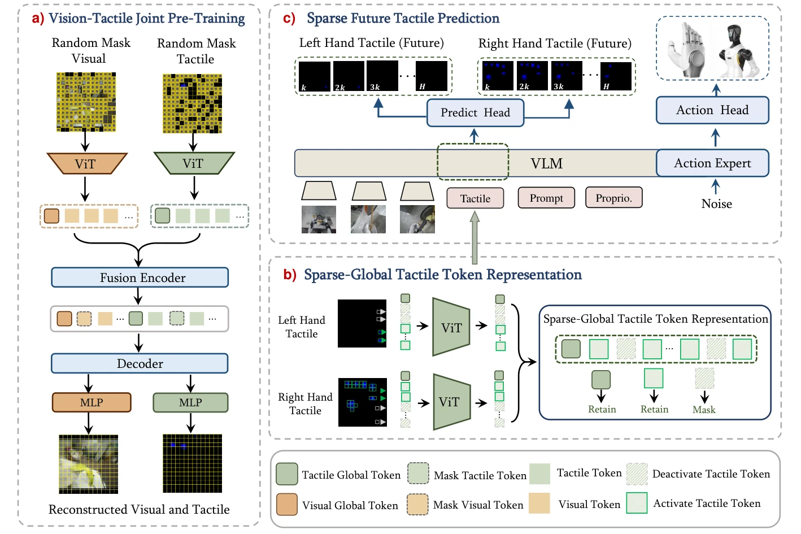

<!-- Generated by scripts/generate.py; edit data/works.json and data/media.json. -->

[← Back to the Awesome index](../../../README.md) · [Interactive website](https://chang-xinhai.github.io/Awesome-RGBDT-Manipulation/?collection=policy&item=star-vtla#library)

# STAR — sparse tactile VTLA

STAR: Sparse Tactile Representation Learning in Vision-Tactile-Language-Action Models for Dexterous Manipulation

**2026-09-11 · Preprint · Not reported**

**[Paper](https://arxiv.org/abs/2609.12549)**

Sparse-global tactile tokens and sparse future-touch supervision adapt a VLA to bimanual dexterous manipulation.

*STAR: Sparse Tactile Representation Learning in Vision-Tactile-Language-Action Models for Dexterous Manipulation authors · [Figure source](https://arxiv.org/abs/2609.12549) · Original rights retained.*

| Field | Reported value and source scope |
| :-- | :-- |
| Record type | policy |
| Policy family | VLA [1](https://arxiv.org/abs/2609.12549)  |
| Base model and architecture | π0.5: PaliGemma-2 B VLM, Gemma-300 M action expert; MAE tactile encoder initialized by visual-tactile joint pretraining. [1](https://arxiv.org/abs/2609.12549)  |
| Model size and component | Gemma-2 B VLM + Gemma-300 M action expert and tactile/vision encoders; total Not reported. [1](https://arxiv.org/abs/2609.12549)  |
| Deployment inputs | Three RGB views, language/discretized proprioception, bilateral 268-dimensional piezoresistive tactile measurements rendered as tactile images. [1](https://arxiv.org/abs/2609.12549)  |
| Action outputs and horizon | 50-step 64D padded action chunks;34 active dimensions: two 7D end-effector poses and two 10D hand joint vectors. [1](https://arxiv.org/abs/2609.12549)  |
| Training method | 15 k tactile-MAE iterations;6 epochs multitask fine-tuning;100 epochs task-specific post-training, with sparse future-touch prediction. [1](https://arxiv.org/abs/2609.12549)  |
| Training data | 200 h /10,576 trajectories /65 collected tasks; four evaluated tasks receive 100 task-specific post-training trajectories each. [1](https://arxiv.org/abs/2609.12549)  |
| Training duration | 6 multitask epochs +100 post-training epochs; wall-clock Not reported. [1](https://arxiv.org/abs/2609.12549)  |
| Training hardware | Not reported [1](https://arxiv.org/abs/2609.12549)  |
| Inference and control rates | 30 Hz control grid; tactile prediction budget distributed over 1.67 s. [1](https://arxiv.org/abs/2609.12549)  |
| Evaluation scope | Four real tasks: earbud flipping, stacked-book retrieval, postcard retrieval and multi-object grasping;20 trials/task with shared initial configurations. [1](https://arxiv.org/abs/2609.12549)  |
| Observations / modalities | RGB · Tactile · Proprioception |
| Evaluation domain | Real world |
| Embodiment | Dexterous hand · Bimanual |
| Release: code | Not verified |
| Release: weights | Not verified |
| Release: data | Not verified |
| Release: license | Not verified |
| Release: notes | Original paper reviewed; claimed future releases are not treated as currently available. |

**Scope and qualifications**

- 65 data-collection tasks are not 65 evaluated tasks. Evaluation objects are held out from pretraining but included in 100 post-training demos/task.
- This STAR is the sparse-tactile method, distinct from StarVLA.

**Primary evidence**

1. [Original paper and supplementary implementation details](https://arxiv.org/abs/2609.12549) — Primary full text reviewed; dataset, deployment modalities and training-only privileges are scoped separately.
