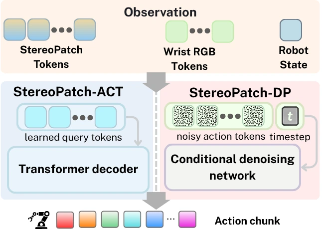

<!-- Generated by scripts/generate.py; edit data/works.json and data/media.json. -->

[← Back to the Awesome index](../../../README.md) · [Interactive website](https://chang-xinhai.github.io/Awesome-RGBDT-Manipulation/?collection=policy&item=stereopatch#library)

# StereoPatch

StereoPatch: Patch-Aligned RGB-Depth Fusion for Spatial Perception in Robot Manipulation

**2026-09-14 · arXiv preprint · University of Sydney, School of Computer Science / Australian Centre for Robotics**

**[Paper](https://arxiv.org/abs/2609.15509)** · [Project](https://aus.bot/stereopatch/)

Patch-aligned RGB-depth fusion binds measured metric geometry to the visual tokens used for action decoding.

*StereoPatch authors · [Figure source](https://arxiv.org/html/2609.15509) · Original rights retained.*

| Field | Reported value and source scope |
| :-- | :-- |
| Record type | policy |
| Policy family | Transformer / BC [1](https://arxiv.org/abs/2609.15509)  |
| Base model and architecture | Asymmetric cross-attention on a shared RGB/depth patch grid; policy-backbone-compatible representation. [1](https://arxiv.org/abs/2609.15509)  |
| Model size and component | Not reported in the inspected primary-source sections [1](https://arxiv.org/abs/2609.15509)  |
| Deployment inputs | Registered RGB and metric depth plus policy-specific proprioception. [1](https://arxiv.org/abs/2609.15509)  |
| Action outputs and horizon | Continuous manipulation actions from the conditioned downstream policy. [1](https://arxiv.org/abs/2609.15509)  |
| Training method | Imitation learning with patch-aligned cross-modal features; policy objective unchanged. [1](https://arxiv.org/abs/2609.15509)  |
| Training data | Task demonstrations across physical and three simulation suites. [1](https://arxiv.org/abs/2609.15509)  |
| Training duration | Not reported in the inspected primary-source sections [1](https://arxiv.org/abs/2609.15509)  |
| Training hardware | Not reported in the inspected primary-source sections [1](https://arxiv.org/abs/2609.15509)  |
| Inference and control rates | Not reported in the inspected primary-source sections [1](https://arxiv.org/abs/2609.15509)  |
| Evaluation scope | Six physical tasks plus simulation architecture/generalization/operating-limit studies. [1](https://arxiv.org/abs/2609.15509)  |
| Observations / modalities | RGB · Depth · Point cloud · Proprioception |
| Evaluation domain | Simulation · Real world |
| Embodiment | Parallel-jaw gripper |
| Release: code | Not verified [2](https://aus.bot/stereopatch/)  |
| Release: weights | Not verified [2](https://aus.bot/stereopatch/)  |
| Release: data | Not verified [2](https://aus.bot/stereopatch/)  |
| Release: license | Not verified [2](https://aus.bot/stereopatch/)  |
| Release: notes | Code, data and weights are checked independently; an upstream pretrained model is not a released task policy. [2](https://aus.bot/stereopatch/)  |

**Scope and qualifications**

- Requires registered RGB/depth; geometry-only and late-fusion baselines have distinct representation assumptions.

**Primary evidence**

1. [Original manuscript and first submission history](https://arxiv.org/abs/2609.15509) — Full author HTML method/evaluation/appendix inspected; depth observations, pseudo-labels and generated outputs retain distinct roles.
2. [Official author project](https://aus.bot/stereopatch/) — Public author-linked project; figure and downstream scope verified separately.
