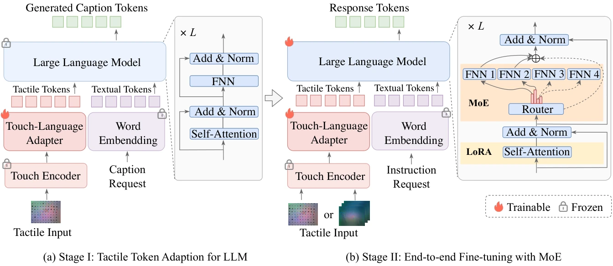

<!-- Generated by scripts/generate.py; edit data/works.json and data/media.json. -->

[← Back to the Awesome index](../../../README.md) · [Interactive website](https://chang-xinhai.github.io/Awesome-RGBDT-Manipulation/?collection=policy&item=stola#library)

# SToLa

SToLa: Self-Adaptive Touch-Language Framework with Tactile Commonsense Reasoning in Open-Ended Scenarios

**2025-05-07 · AAAI 2026 · Beijing Jiaotong University; Beijing University of Posts and Telecommunications**

**[Paper](https://arxiv.org/abs/2505.04201)** · [Project](https://cocacola-lab.github.io/SToLa-Page/) · [Code](https://github.com/cocacola-lab/STOLA) · [Publication](https://ojs.aaai.org/index.php/AAAI/article/view/38882)

Touch-language reasoning uses modality-adaptive mixture-of-experts processing, with instruction tuning and open-ended tactile question answering.

*SToLa authors · [Figure source](https://arxiv.org/abs/2505.04201) · Original rights retained.*

| Field | Reported value and source scope |
| :-- | :-- |
| Record type | model |
| Model role and downstream interface | Tactile commonsense reasoning [1](https://arxiv.org/abs/2505.04201)  |
| Model family | Tactile-language model [1](https://arxiv.org/abs/2505.04201)  |
| Model architecture | TLV-Link touch encoder, linear adapter and Vicuna-7B v1.5; LoRA attention tuning and replicated FFN mixture-of-experts layers. [1](https://arxiv.org/abs/2505.04201)  |
| Model size and component | Nominal 7B Vicuna backbone; total and active parameter counts after expert replication are not reported. [1](https://arxiv.org/abs/2505.04201)  |
| Model inputs | Tactile images or sampled video frames interleaved with textual instructions. [1](https://arxiv.org/abs/2505.04201)  |
| Model outputs | Free-form tactile descriptions and reasoning answers; no robot actions. [1](https://arxiv.org/abs/2505.04201)  |
| Training method | Stage I adapts touch tokens with frozen LLM; Stage II tunes adapter/LLM with LoRA and MoE while freezing touch encoder and word embeddings. [1](https://arxiv.org/abs/2505.04201)  |
| Training data and scale | Touch100k language-pair adaptation; PhysiCLeAR video instructions and 5K constructed touch-language instructions. Synthetic descriptions receive stated manual review. [1](https://arxiv.org/abs/2505.04201)  |
| Training duration | One epoch per training stage; wall-clock not reported. [1](https://arxiv.org/abs/2505.04201)  |
| Training hardware | One NVIDIA A100 80GB; batch size 16. [1](https://arxiv.org/abs/2505.04201)  |
| Inference setting and runtime | Not reported in the inspected primary manuscript [1](https://arxiv.org/abs/2505.04201)  |
| Downstream evaluation and scope | PhysiCLeAR and TactileBench tactile question answering, property comparison and commonsense reasoning; uses text metrics and language-model scoring. [1](https://arxiv.org/abs/2505.04201)  |
| Observations / modalities | Tactile · Language |
| Evaluation domain | Real robot |
| Embodiment |  |
| Release: code | Not released [2](https://cocacola-lab.github.io/SToLa-Page/) [3](https://github.com/cocacola-lab/STOLA/tree/main)  |
| Release: weights | Not verified [2](https://cocacola-lab.github.io/SToLa-Page/) [3](https://github.com/cocacola-lab/STOLA/tree/main)  |
| Release: data | Not verified [2](https://cocacola-lab.github.io/SToLa-Page/)  |
| Release: license | Not verified [2](https://cocacola-lab.github.io/SToLa-Page/) [3](https://github.com/cocacola-lab/STOLA/tree/main)  |
| Release: notes | Actual official repository contains only README.md and says updates are coming; no implementation, model checkpoint or dataset release was verified. [2](https://cocacola-lab.github.io/SToLa-Page/)  |

**Scope and qualifications**

- The model reasons about touch; it does not contribute an executable robot agent.
- Self-adaptive refers to trained MoE routing, not online weight updates or recursive self-improvement; ICL is used for synthetic-data generation.

**Primary evidence**

1. [Original manuscript and first public submission history](https://arxiv.org/abs/2505.04201) — Full author method, evaluation and appendix reviewed; downstream controller probes are distinguished from the reusable model.
2. [Official author project and current artifact destinations](https://cocacola-lab.github.io/SToLa-Page/) — A project button or advertised artifact does not establish a downloadable release; paper-version differences are retained.
3. [Actual public repository content inventory](https://github.com/cocacola-lab/STOLA/tree/main) — 1 tracked paths reviewed; representation code, action-policy code and README placeholders are distinguished.
4. [Official AAAI 2026 publication](https://ojs.aaai.org/index.php/AAAI/article/view/38882) — Official proceedings link the same model and its README-only repository.
