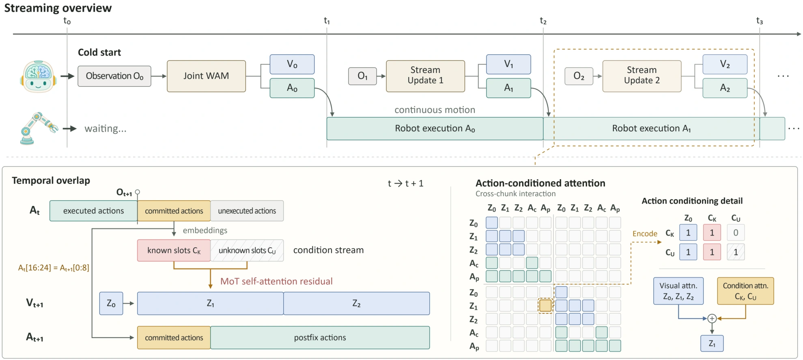

<!-- Generated by scripts/generate.py; edit data/works.json and data/media.json. -->

[← Back to the Awesome index](../../../README.md) · [Interactive website](https://chang-xinhai.github.io/Awesome-RGBDT-Manipulation/?collection=policy&item=streaming-wam#library)

# Streaming-WAM — action-conditioned

Streaming-WAM: Action-Conditioned World-Action Model for Asynchronous Robot Manipulation

**2026-09-24 · Preprint · Shanghai Jiao Tong University / Li Auto**

**[Paper](https://arxiv.org/abs/2609.28927)** · [Project](https://sjtu-deng-lab.github.io/Streaming-WAM/) · [Code](https://github.com/SJTU-DENG-Lab/Streaming-WAM) · [Weights](https://huggingface.co/SJTU-DENG-Lab/Streaming-WAM)

Conditions future visual prediction on actions already committed for asynchronous execution, then generates the remaining continuation.

*Streaming-WAM — action-conditioned authors · [Figure source](https://arxiv.org/html/2609.28927) · Original rights retained.*

| Field | Reported value and source scope |
| :-- | :-- |
| Record type | policy |
| Policy family | World-action model [1](https://arxiv.org/abs/2609.28927)  |
| Base model and architecture | Distilled Fast-WAM-Joint-style video/action experts with a shared-parameter condition-slot encoder [1](https://arxiv.org/abs/2609.28927)  |
| Model size and component | Base-model dependent; complete model count Not reported here [1](https://arxiv.org/abs/2609.28927)  |
| Deployment inputs | RGB, language, state and a committed action prefix from the running plan [1](https://arxiv.org/abs/2609.28927)  |
| Action outputs and horizon | 32-action chunks with an eight-action committed prefix and newly predicted continuation [1](https://arxiv.org/abs/2609.28927)  |
| Training method | Action-conditioned visual adaptation, continuation learning retaining visual endpoint loss, consistency distillation and cached asynchronous serving [1](https://arxiv.org/abs/2609.28927)  |
| Training data | LIBERO/RoboTwin/RoboCasa demonstrations and physical task demonstrations; no new aggregate scale claimed [1](https://arxiv.org/abs/2609.28927)  |
| Training duration | Two-stage visual adaptation/action continuation; wall-clock Not reported [1](https://arxiv.org/abs/2609.28927)  |
| Training hardware | Training Not reported; simulation inference one H100 per worker, physical one RTX 5090 [1](https://arxiv.org/abs/2609.28927)  |
| Inference and control rates | Physical execution is 30 Hz. The eight-action committed prefix provides an approximately 267 ms overlap window. Chunk-time measurements exclude initialization; episode time measures complete rollouts. [1](https://arxiv.org/abs/2609.28927)  |
| Evaluation scope | LIBERO, RoboTwin 2.0, RoboCasa, and physical stamp-paper and block manipulation; success, chunk inference time, and episode duration are reported. [1](https://arxiv.org/abs/2609.28927)  |
| Observations / modalities | RGB · Proprioception · Language |
| Evaluation domain | Simulation · Real world |
| Embodiment | Parallel-jaw gripper · Bimanual |
| Release: code | Available [2](https://github.com/SJTU-DENG-Lab/Streaming-WAM) [3](https://sjtu-deng-lab.github.io/Streaming-WAM/)  |
| Release: weights | Available [2](https://github.com/SJTU-DENG-Lab/Streaming-WAM) [3](https://sjtu-deng-lab.github.io/Streaming-WAM/)  |
| Release: data | Not verified [2](https://github.com/SJTU-DENG-Lab/Streaming-WAM) [3](https://sjtu-deng-lab.github.io/Streaming-WAM/)  |
| Release: license | Apache-2.0 code, verified from LICENSE. Backbone and checkpoint terms are separate. [2](https://github.com/SJTU-DENG-Lab/Streaming-WAM) [3](https://sjtu-deng-lab.github.io/Streaming-WAM/) [4](https://github.com/SJTU-DENG-Lab/Streaming-WAM/blob/main/LICENSE)  |
| Release: notes | Availability concerns author-linked artifacts; no training or installation reproduced. [2](https://github.com/SJTU-DENG-Lab/Streaming-WAM) [3](https://sjtu-deng-lab.github.io/Streaming-WAM/)  |

**Scope and qualifications**

- Distinct from the later staircase-flow StreamingWAM paper, arXiv: 2610.15585.
- Pause-free execution requires inference to meet the overlap deadline; measured no misses apply to reported physical trials.

**Primary evidence**

1. [Author manuscript and submission history](https://arxiv.org/abs/2609.28927) — Read full manuscript; first arXiv submission retained separately from current revision. Numeric costs and observations have setting-specific scope.
2. [Official implementation](https://github.com/SJTU-DENG-Lab/Streaming-WAM) — Author-linked code and artifact instructions; current release may differ from the original manuscript.
3. [Official project](https://sjtu-deng-lab.github.io/Streaming-WAM/) — Author project and links; scientific figure keeps original rights.
4. [Verified code license](https://github.com/SJTU-DENG-Lab/Streaming-WAM/blob/main/LICENSE)
