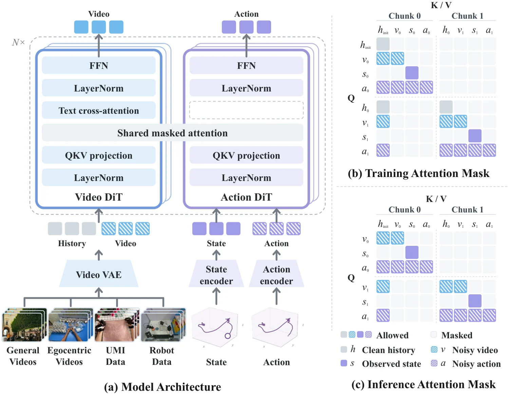

<!-- Generated by scripts/generate.py; edit data/works.json and data/media.json. -->

[← Back to the Awesome index](../../../README.md) · [Interactive website](https://chang-xinhai.github.io/Awesome-RGBDT-Manipulation/?collection=policy&item=swam#library)

# SWAM

SWAM: Scaling World Action Models with Cross-Modal Alignment

**2026-11-09 · Preprint · Shanghai Jiao Tong University**

**[Paper](https://arxiv.org/abs/2611.12870)** · [Project](https://char-lotte-xia.github.io/swam-official/) · [Code](https://github.com/shaaaaron/SWAM) · [Data](https://huggingface.co/datasets/FreDERicia/SWAM-Pretrain) · [Weights](https://huggingface.co/FreDERicia/SWAM)

A world-action model studies language–video alignment and multisource human/robot pretraining for manipulation.

*SWAM authors · [Figure source](https://arxiv.org/html/2611.12870) · Original rights retained.*

| Field | Reported value and source scope |
| :-- | :-- |
| Record type | policy |
| Policy family | Video world-action model [1](https://arxiv.org/abs/2611.12870)  |
| Base model and architecture | Video and action diffusion transformers with shared masked attention [1](https://arxiv.org/abs/2611.12870)  |
| Model size and component | Not reported [1](https://arxiv.org/abs/2611.12870)  |
| Deployment inputs | RGB video, instruction and robot state; deployment does not require a depth stream. [1](https://arxiv.org/abs/2611.12870)  |
| Action outputs and horizon | Video predictions and action chunks [1](https://arxiv.org/abs/2611.12870)  |
| Training method | Joint language–video and language–video–action pretraining, then task-specific post-training. [1](https://arxiv.org/abs/2611.12870)  |
| Training data | Approximately 47,000-hour multisource paper pool includes general, ego, UMI and robot video; public release is a subset. [1](https://arxiv.org/abs/2611.12870)  |
| Training duration | Not reported [1](https://arxiv.org/abs/2611.12870)  |
| Training hardware | Not reported [1](https://arxiv.org/abs/2611.12870)  |
| Inference and control rates | Not reported [1](https://arxiv.org/abs/2611.12870)  |
| Evaluation scope | RoboTwin clean/randomized conditions and three physical bimanual task families. [1](https://arxiv.org/abs/2611.12870)  |
| Observations / modalities | RGB · Language · Proprioception |
| Evaluation domain | Simulation · Real world |
| Embodiment |  |
| Release: code | Available — training and RoboTwin evaluation source [2](https://char-lotte-xia.github.io/swam-official/) [3](https://github.com/shaaaaron/SWAM) [4](https://huggingface.co/datasets/FreDERicia/SWAM-Pretrain)  |
| Release: weights | Available — pretraining and RoboTwin post-training checkpoints [2](https://char-lotte-xia.github.io/swam-official/) [3](https://github.com/shaaaaron/SWAM) [4](https://huggingface.co/datasets/FreDERicia/SWAM-Pretrain)  |
| Release: data | Partial — 27 public subsets; in-house UMI, Ego4D and EgoSuite excluded [2](https://char-lotte-xia.github.io/swam-official/) [3](https://github.com/shaaaaron/SWAM) [4](https://huggingface.co/datasets/FreDERicia/SWAM-Pretrain)  |
| Release: license | Apache-2.0 repository; upstream components and dataset sources have separate terms. [2](https://char-lotte-xia.github.io/swam-official/) [3](https://github.com/shaaaaron/SWAM) [4](https://huggingface.co/datasets/FreDERicia/SWAM-Pretrain)  |
| Release: notes | Official model repository lists separate pretraining/post-training bundles and safetensor shards. The full paper data pool is not public. [2](https://char-lotte-xia.github.io/swam-official/) [3](https://github.com/shaaaaron/SWAM) [4](https://huggingface.co/datasets/FreDERicia/SWAM-Pretrain)  |

**Scope and qualifications**

- The 47,000-hour paper pool and the public subset are not equivalent; in-house UMI data is excluded from the released subset.
- RGB-only action inference is not a measured RGB-D system.

**Primary evidence**

1. [Author paper and first submission](https://arxiv.org/abs/2611.12870)
2. [Official project and artifact scope](https://char-lotte-xia.github.io/swam-official/)
3. [Official code and artifact scope](https://github.com/shaaaaron/SWAM)
4. [Official data and artifact scope](https://huggingface.co/datasets/FreDERicia/SWAM-Pretrain)
5. [Author describes base and post-trained checkpoint separation](https://github.com/shaaaaron/SWAM#readme)
6. [Both public weight bundles with sharded safetensors](https://huggingface.co/FreDERicia/SWAM/tree/main)
