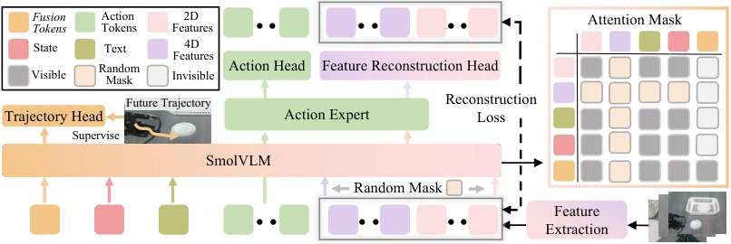

<!-- Generated by scripts/generate.py; edit data/works.json and data/media.json. -->

[← Back to the Awesome index](../../../README.md) · [Interactive website](https://chang-xinhai.github.io/Awesome-RGBDT-Manipulation/?collection=policy&item=swiftvla#library)

# SwiftVLA

SwiftVLA: Unlocking Spatiotemporal Dynamics for Lightweight VLA Models at Minimal Overhead

**2025-11-30 · arXiv preprint · GigaAI; Peking University; Moxin; Tsinghua University; collaborating authors**

**[Paper](https://arxiv.org/abs/2512.00903)** · [Project](https://swiftvla.github.io/) · [Code](https://github.com/GigaAI-research/SwiftVLA)

Compact VLA fusion tokens learn 4D geometric dynamics, allowing the auxiliary geometry branch to be omitted at inference.

*SwiftVLA authors · [Figure source](https://arxiv.org/html/2512.00903) · Original rights retained.*

| Field | Reported value and source scope |
| :-- | :-- |
| Record type | policy |
| Policy family | VLA [1](https://arxiv.org/abs/2512.00903)  |
| Base model and architecture | SmolVLM-based 450M VLA, cached 4D geometry transformer, fusion tokens and mask/reconstruction objective. [1](https://arxiv.org/abs/2512.00903)  |
| Model size and component | ~450M complete deployed VLA; ~100M action expert; optional frozen 4D branch counted separately [1](https://arxiv.org/abs/2512.00903)  |
| Deployment inputs | Current/history RGB and language; 4D features inferred from standard images, not extra sensors. [1](https://arxiv.org/abs/2512.00903)  |
| Action outputs and horizon | Robot action chunks. [1](https://arxiv.org/abs/2512.00903)  |
| Training method | Future-feature prediction and masked geometry reconstruction regularize action learning. [1](https://arxiv.org/abs/2512.00903)  |
| Training data | Robot manipulation demonstrations with RGB-derived geometric features. [1](https://arxiv.org/abs/2512.00903)  |
| Training duration | Stage 1: 100K steps; Stage 2: +50K; wall-clock not reported [1](https://arxiv.org/abs/2512.00903)  |
| Training hardware | Not reported in the inspected primary-source sections [1](https://arxiv.org/abs/2512.00903)  |
| Inference and control rates | Not reported in the inspected primary-source sections [1](https://arxiv.org/abs/2512.00903)  |
| Evaluation scope | LIBERO, real robots and edge-device latency/memory comparisons. [1](https://arxiv.org/abs/2512.00903)  |
| Observations / modalities | RGB · Language · Proprioception |
| Evaluation domain | Simulation · Real world |
| Embodiment | Parallel-jaw gripper |
| Release: code | Not released [2](https://swiftvla.github.io/) [3](https://github.com/GigaAI-research/SwiftVLA) [4](https://github.com/GigaAI-research/SwiftVLA/tree/main)  |
| Release: weights | Not verified [2](https://swiftvla.github.io/) [3](https://github.com/GigaAI-research/SwiftVLA)  |
| Release: data | Not verified [2](https://swiftvla.github.io/) [3](https://github.com/GigaAI-research/SwiftVLA)  |
| Release: license | Not verified [2](https://swiftvla.github.io/) [3](https://github.com/GigaAI-research/SwiftVLA)  |
| Release: notes | Code, data and weights are checked independently; an upstream pretrained model is not a released task policy. [2](https://swiftvla.github.io/) [3](https://github.com/GigaAI-research/SwiftVLA)  |

**Scope and qualifications**

- Full4D and branch-dropped variants have different compute/accuracy tradeoffs; neither implies measured depth input.

**Primary evidence**

1. [Original manuscript and first submission history](https://arxiv.org/abs/2512.00903) — Full author HTML method/evaluation/appendix inspected; depth observations, pseudo-labels and generated outputs retain distinct roles.
2. [Official author project](https://swiftvla.github.io/) — Public author-linked project; figure and downstream scope verified separately.
3. [Official current implementation linked by author project](https://github.com/GigaAI-research/SwiftVLA) — Actual runnable release and model artifacts checked independently.
4. [Actual repository content inventory](https://github.com/GigaAI-research/SwiftVLA/tree/main) — 1 tracked paths inspected; code release is distinguished from a README/project/figure-only repository.
