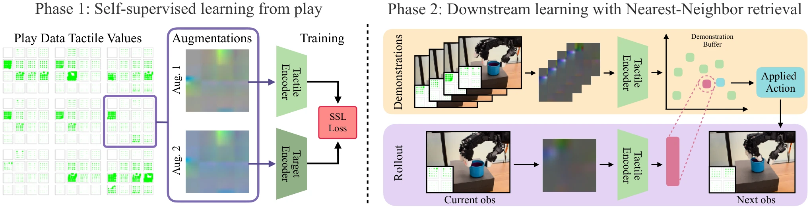

<!-- Generated by scripts/generate.py; edit data/works.json and data/media.json. -->

[← Back to the Awesome index](../../../README.md) · [Interactive website](https://chang-xinhai.github.io/Awesome-RGBDT-Manipulation/?collection=policy&item=t-dex#library)

# T-Dex

Dexterity from Touch: Self-Supervised Pre-Training of Tactile Representations with Robotic Play

**2023-03-21 · Preprint · New York University / Meta AI**

**[Paper](https://arxiv.org/abs/2303.12076)**

Self-supervised tactile play representations support few-demonstration nonparametric dexterous imitation.

*Dexterity from Touch: Self-Supervised Pre-Training of Tactile Representations with Robotic Play authors · [Figure source](https://arxiv.org/abs/2303.12076) · Original rights retained.*

| Field | Reported value and source scope |
| :-- | :-- |
| Record type | policy |
| Policy family | Retrieval [1](https://arxiv.org/abs/2303.12076)  |
| Base model and architecture | BYOL tactile encoder and non parametric nearest-demonstration imitation. [1](https://arxiv.org/abs/2303.12076)  |
| Model size and component | Not reported [1](https://arxiv.org/abs/2303.12076)  |
| Deployment inputs | Raw distributed 3-axis tactile arrays plus visual/proprioceptive context in configured variants. [1](https://arxiv.org/abs/2303.12076)  |
| Action outputs and horizon | Arm/hand commands retrieved from demonstrations. [1](https://arxiv.org/abs/2303.12076)  |
| Training method | Self-supervised tactile pretraining followed by non parametric imitation. [1](https://arxiv.org/abs/2303.12076)  |
| Training data | 2.5 h task-agnostic play; six demonstrations per downstream task; play filtered 450k frames to 42 k motion-informative frames. [1](https://arxiv.org/abs/2303.12076)  |
| Training duration | Not reported [1](https://arxiv.org/abs/2303.12076)  |
| Training hardware | Not reported [1](https://arxiv.org/abs/2303.12076)  |
| Inference and control rates | Not reported [1](https://arxiv.org/abs/2303.12076)  |
| Evaluation scope | Kinova Jaco/Allegro; five dexterous tasks including book opening, bottle cap opening and cup un stacking. [1](https://arxiv.org/abs/2303.12076)  |
| Observations / modalities | RGB · Tactile · Proprioception |
| Evaluation domain | Real world |
| Embodiment | Dexterous hand |
| Release: code | Not verified |
| Release: weights | Not verified |
| Release: data | Not verified |
| Release: license | Not verified |
| Release: notes | Original paper reviewed; claimed future releases are not treated as currently available. |

**Scope and qualifications**

- Play frames and task demonstrations are separate counting units.
- Distinct from T-Rex and Tactile-VLA.

**Primary evidence**

1. [Original paper and supplementary implementation details](https://arxiv.org/abs/2303.12076) — Primary full text reviewed; dataset, deployment modalities and training-only privileges are scoped separately.
