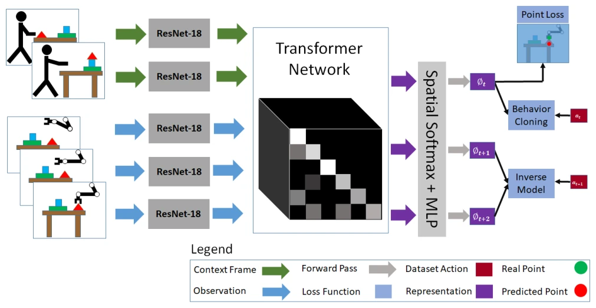

<!-- Generated by scripts/generate.py; edit data/works.json and data/media.json. -->

[← Back to the Awesome index](../../../README.md) · [Interactive website](https://chang-xinhai.github.io/Awesome-RGBDT-Manipulation/?collection=policy&item=t-osil#library)

# Transformers for One-Shot Visual Imitation (T-OSIL)

Transformers for One-Shot Visual Imitation

**2020-11-11 · CoRL 2020 · Carnegie Mellon University**

**[Paper](https://arxiv.org/abs/2011.05970)** · [Project](https://oneshotfeatures.github.io/) · [Code](https://github.com/SudeepDasari/one_shot_transformers)

A video-conditioned attention policy learns context-driven and dynamics-aware features for cross-embodiment visual imitation.

*Transformers for One-Shot Visual Imitation (T-OSIL) authors · [Figure source](https://arxiv.org/abs/2011.05970) · Original rights retained.*

| Field | Reported value and source scope |
| :-- | :-- |
| Record type | policy |
| Policy family | Transformer policy [1](https://arxiv.org/abs/2011.05970)  |
| Base model and architecture | Convolutional image encoder, spatiotemporal non-local attention and discretized action head; inverse-dynamics auxiliary objective. [1](https://arxiv.org/abs/2011.05970)  |
| Model size and component | Not reported [1](https://arxiv.org/abs/2011.05970)  |
| Deployment inputs | Demonstration video and current robot visual/state observations. [1](https://arxiv.org/abs/2011.05970)  |
| Action outputs and horizon | End-effector target position, axis-angle rotation and gripper command, discretized into 256 bins per dimension and executed through IK/PD control. [1](https://arxiv.org/abs/2011.05970)  |
| Training method | Behavior cloning with attention-based demonstration conditioning and dynamics-aware auxiliary learning. [1](https://arxiv.org/abs/2011.05970)  |
| Training data | Paired demonstrations in simulated cross-embodiment manipulation tasks. [1](https://arxiv.org/abs/2011.05970)  |
| Training duration | Not reported [1](https://arxiv.org/abs/2011.05970)  |
| Training hardware | Not reported [1](https://arxiv.org/abs/2011.05970)  |
| Inference and control rates | Not reported [1](https://arxiv.org/abs/2011.05970)  |
| Evaluation scope | Novel visual task instances and cross-morphology simulated manipulation. [1](https://arxiv.org/abs/2011.05970)  |
| Observations / modalities | RGB · Proprioception |
| Evaluation domain | Simulation |
| Embodiment | Parallel-jaw gripper |
| Release: code | Available [2](https://oneshotfeatures.github.io/) [3](https://github.com/SudeepDasari/one_shot_transformers)  |
| Release: weights | Not verified [2](https://oneshotfeatures.github.io/) [3](https://github.com/SudeepDasari/one_shot_transformers)  |
| Release: data | Not verified [2](https://oneshotfeatures.github.io/) [3](https://github.com/SudeepDasari/one_shot_transformers)  |
| Release: license | Not verified [2](https://oneshotfeatures.github.io/) [3](https://github.com/SudeepDasari/one_shot_transformers)  |
| Release: notes | Author implementation is public; do not infer action dimension from its 256 discretization bins. [2](https://oneshotfeatures.github.io/) [3](https://github.com/SudeepDasari/one_shot_transformers)  |

**Scope and qualifications**

- IK and low-level control execute predicted poses; the network does not directly predict joint torques.

**Primary evidence**

1. [Original paper / author report](https://arxiv.org/abs/2011.05970) — Original full paper and supplementary experimental / implementation details; deployment inputs are separated from supervision and benchmark state.
2. [Official project](https://oneshotfeatures.github.io/) — Author-linked project and current release checked on the catalog cutoff.
3. [Official code / release documentation](https://github.com/SudeepDasari/one_shot_transformers) — Current repository documentation; paper settings and subsequently released artifacts are distinguished.
