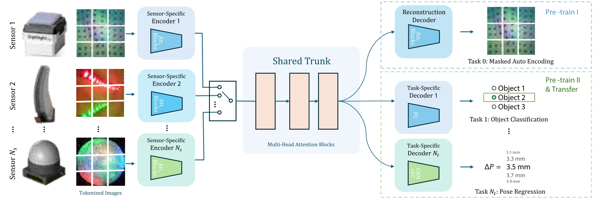

<!-- Generated by scripts/generate.py; edit data/works.json and data/media.json. -->

[← Back to the Awesome index](../../../README.md) · [Interactive website](https://chang-xinhai.github.io/Awesome-RGBDT-Manipulation/?collection=policy&item=t3#library)

# T3 / Foundation Tactile

Transferable Tactile Transformers for Representation Learning Across Diverse Sensors and Tasks

**2024-06-19 · CoRL 2024 · MIT CSAIL**

**[Paper](https://arxiv.org/abs/2406.13640)** · [Project](https://t3.alanz.info/) · [Code](https://github.com/alanzjl/t3) · [Data](https://huggingface.co/datasets/alanz-mit/FoundationTactile) · [Weights](https://huggingface.co/datasets/alanz-mit/FoundationTactile)

Learns shared tactile features with sensor-specific encoders and task-specific heads, including downstream sub-millimeter electronics insertion.

*t3 authors; original paper figure · [Figure source](https://arxiv.org/html/2406.13640#S1.F1) · Original rights retained.*

| Field | Reported value and source scope |
| :-- | :-- |
| Record type | model |
| Model role and downstream interface | Reusable representation or perception model; downstream controllers are separate systems [1](https://arxiv.org/abs/2406.13640)  |
| Model family | Tactile encoder [1](https://arxiv.org/abs/2406.13640)  |
| Model architecture | Transformer sensor encoders + shared transformer trunk + task-specific reconstruction/regression/classification decoders [1](https://arxiv.org/abs/2406.13640)  |
| Model size and component | Tiny 12M / Small 45M / Medium 174M / Large 308M, including all encoders and decoders (paper Table 1) [1](https://arxiv.org/abs/2406.13640)  |
| Model inputs | Optical tactile images from one or more sensors; sensor-specific frontend [1](https://arxiv.org/abs/2406.13640)  |
| Model outputs | Shared latent tactile tokens and task-specific perception outputs; a separately trained insertion controller consumes the encoder [1](https://arxiv.org/abs/2406.13640)  |
| Training method | Stage I masked reconstruction; Stage II multitask supervised objectives distilled from existing datasets; optional downstream fine-tuning [1](https://arxiv.org/abs/2406.13640)  |
| Training data and scale | FoTa aggregate: over 3 million data points, 13 sensors and 11 tasks; not every FoTa task is used in T3 pretraining [1](https://arxiv.org/abs/2406.13640)  |
| Training duration | Not reported [1](https://arxiv.org/abs/2406.13640)  |
| Training hardware | Not reported [1](https://arxiv.org/abs/2406.13640)  |
| Inference setting and runtime | Not reported [1](https://arxiv.org/abs/2406.13640)  |
| Downstream evaluation and scope | Cross-sensor/task prediction, fine-tuning data budgets and scaling; downstream insertion of three electronics parts, with separate policy training. [1](https://arxiv.org/abs/2406.13640)  |
| Observations / modalities | Tactile |
| Evaluation domain | Real world |
| Embodiment |  |
| Release: code | Available [2](https://t3.alanz.info/) [3](https://github.com/alanzjl/t3)  |
| Release: weights | Available — official download link [2](https://t3.alanz.info/) [3](https://github.com/alanzjl/t3)  |
| Release: data | Available — official resource link [2](https://t3.alanz.info/) [3](https://github.com/alanzjl/t3)  |
| Release: license | MIT code LICENSE; constituent FoTa datasets retain source-specific terms [2](https://t3.alanz.info/) [3](https://github.com/alanzjl/t3) [4](https://github.com/alanzjl/t3/blob/main/LICENSE)  |
| Release: notes | Code, pretrained encoders and downstream task data are separate artifacts; no policy checkpoint is implied by an encoder release. [2](https://t3.alanz.info/) [3](https://github.com/alanzjl/t3)  |

**Scope and qualifications**

- FoTa sensor/task totals describe heterogeneous source data, not 11 closed-loop manipulation environments.
- Reported parameter counts include sensor encoders and task decoders; they are not shared-trunk-only counts.

**Primary evidence**

1. [Original model paper and first submission](https://arxiv.org/abs/2406.13640) — Method, experiments and implementation sections; specifications retain component and evaluation scope.
2. [Official project](https://t3.alanz.info/) — Author project; author-reported release scope is distinguished from an executed reproduction.
3. [Official implementation and current release instructions](https://github.com/alanzjl/t3) — README and repository files inspected on 2026-10-17.
4. [Repository license file](https://github.com/alanzjl/t3/blob/main/LICENSE) — Applies to repository scope; model/data/base-model terms can differ.
