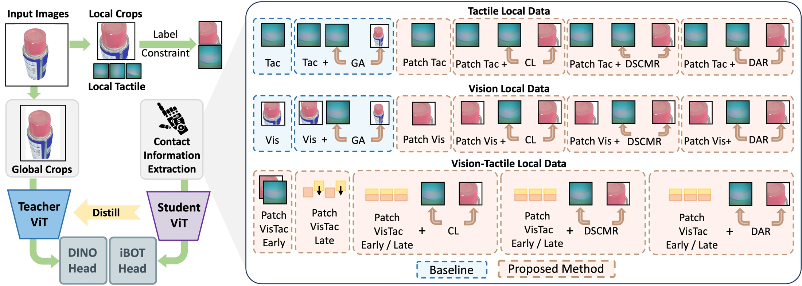

<!-- Generated by scripts/generate.py; edit data/works.json and data/media.json. -->

[← Back to the Awesome index](../../../README.md) · [Interactive website](https://chang-xinhai.github.io/Awesome-RGBDT-Manipulation/?collection=policy&item=tac-dino#library)

# Tac-DINO / VTPA

Tac-DINO: Learning Vision-Tactile Features with Patch Alignment

**2026-06-10 · arXiv preprint 2026 · Shanghai Jiao Tong University; Ant Group; Shanghai Innovation Institute**

**[Paper](https://arxiv.org/abs/2606.12069)** · [Project](https://lihongcs.github.io/tacdino/)

Patch-aligned visual/tactile representation learning uses contact-local correspondence instead of assigning every tactile observation to the whole object.

*Tac-DINO / VTPA authors · [Figure source](https://arxiv.org/abs/2606.12069) · Original rights retained.*

| Field | Reported value and source scope |
| :-- | :-- |
| Record type | model |
| Model role and downstream interface | Vision-tactile local-to-global alignment [1](https://arxiv.org/abs/2606.12069)  |
| Model family | Multimodal representation [1](https://arxiv.org/abs/2606.12069)  |
| Model architecture | DINOv2 ViT-Large student/teacher with Vision-Tactile Patch Alignment; early/late fusion and contrastive alignment variants. [1](https://arxiv.org/abs/2606.12069)  |
| Model size and component | ViT-Large architecture; complete trainable parameter count not reported. [1](https://arxiv.org/abs/2606.12069)  |
| Model inputs | Local tactile images and visual patches, depending on variant; scanned object geometry and annotated contact locations construct aligned training pairs. [1](https://arxiv.org/abs/2606.12069)  |
| Model outputs | Visual/tactile descriptors for retrieval, material/object recognition and geometric correspondence; no action output in inspected arXiv v1. [1](https://arxiv.org/abs/2606.12069)  |
| Training method | DINO-style student/teacher learning with local visual-tactile patch alignment and contrastive objectives. [1](https://arxiv.org/abs/2606.12069)  |
| Training data and scale | Touch3D: 505 objects, 20,025 tactile contacts, 18 materials; reported 4:1 train/test split. Filtered ObjectFolder Real subset: 85 objects and 2,839 contacts for additional evaluation. [1](https://arxiv.org/abs/2606.12069)  |
| Training duration | 200 epochs including 40 warmup epochs; elapsed training time not reported. [1](https://arxiv.org/abs/2606.12069)  |
| Training hardware | Four NVIDIA H200 GPUs; batch size 32 per GPU. [1](https://arxiv.org/abs/2606.12069)  |
| Inference setting and runtime | Not reported in the inspected primary manuscript [1](https://arxiv.org/abs/2606.12069)  |
| Downstream evaluation and scope | Local-to-global retrieval, object/material recognition and geometric matching on Touch3D and ObjectFolder Real; perception evaluation in the inspected v1 manuscript. [1](https://arxiv.org/abs/2606.12069)  |
| Observations / modalities | RGB · Tactile |
| Evaluation domain | Real robot |
| Embodiment |  |
| Release: code | Not verified [2](https://lihongcs.github.io/tacdino/)  |
| Release: weights | Not verified [2](https://lihongcs.github.io/tacdino/)  |
| Release: data | Not verified [2](https://lihongcs.github.io/tacdino/)  |
| Release: license | Not verified [2](https://lihongcs.github.io/tacdino/)  |
| Release: notes | Current author project provides figures and videos but no verified public implementation, checkpoint or Touch3D download destination. [2](https://lihongcs.github.io/tacdino/)  |

**Scope and qualifications**

- The current author project additionally describes GeoTAC, CoMT-Bench and simulation policies. These additions are not present in the inspected arXiv v1 and are not merged into its quantitative model fields.
- A depth camera records data collection and 3D scanning supplies alignment annotations; this does not imply a measured depth stream at a deployed action policy.

**Primary evidence**

1. [Original manuscript and first public submission history](https://arxiv.org/abs/2606.12069) — Full author method, evaluation and appendix reviewed; downstream controller probes are distinguished from the reusable model.
2. [Official author project and current artifact destinations](https://lihongcs.github.io/tacdino/) — A project button or advertised artifact does not establish a downloadable release; paper-version differences are retained.
