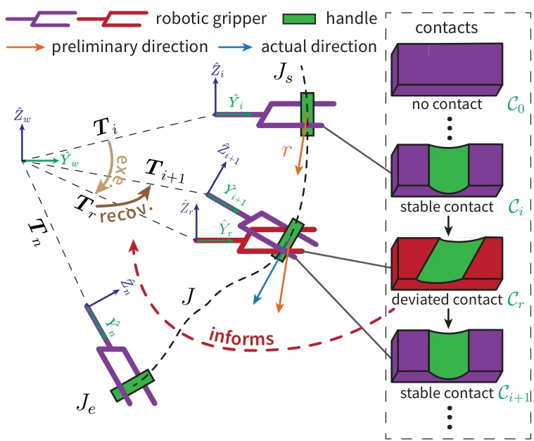

<!-- Generated by scripts/generate.py; edit data/works.json and data/media.json. -->

[← Back to the Awesome index](../../../README.md) · [Interactive website](https://chang-xinhai.github.io/Awesome-RGBDT-Manipulation/?collection=policy&item=tac-man#library)

# Tac-Man

Tac-Man: Tactile-Informed Prior-Free Manipulation of Articulated Objects

**2024-03-04 · Preprint · Not reported**

**[Paper](https://arxiv.org/abs/2403.01694)** · [Project](https://tacman-aom.github.io)

Contact-stability tactile servoing manipulates unknown articulated objects without a kinematic prior.

*Tac-Man: Tactile-Informed Prior-Free Manipulation of Articulated Objects authors · [Figure source](https://arxiv.org/abs/2403.01694) · Original rights retained.*

| Field | Reported value and source scope |
| :-- | :-- |
| Record type | policy |
| Policy family | Hybrid [1](https://arxiv.org/abs/2403.01694)  |
| Base model and architecture | Tactile contact geometry/deviation feedback and adaptive contact-preserving motion. [1](https://arxiv.org/abs/2403.01694)  |
| Model size and component | Not reported [1](https://arxiv.org/abs/2403.01694)  |
| Deployment inputs | Initial grasp/contact reference, tactile geometry and robot state. [1](https://arxiv.org/abs/2403.01694)  |
| Action outputs and horizon | Arm position/orientation updates maintaining stable contact. [1](https://arxiv.org/abs/2403.01694)  |
| Training method | Prior-free feedback execution rather than learned VLA/RL control. [1](https://arxiv.org/abs/2403.01694)  |
| Training data | No learned object kinematic model or policy training corpus required. [1](https://arxiv.org/abs/2403.01694)  |
| Training duration | Not reported [1](https://arxiv.org/abs/2403.01694)  |
| Training hardware | Not reported [1](https://arxiv.org/abs/2403.01694)  |
| Inference and control rates | Not reported [1](https://arxiv.org/abs/2403.01694)  |
| Evaluation scope | Simulated play boards and real articulated doors/drawers under ambiguity and disturbance. [1](https://arxiv.org/abs/2403.01694)  |
| Observations / modalities | Tactile · Proprioception |
| Evaluation domain | Simulation · Real world |
| Embodiment | Parallel-jaw gripper |
| Release: code | Not verified [2](https://tacman-aom.github.io)  |
| Release: weights | Not verified [2](https://tacman-aom.github.io)  |
| Release: data | Not verified [2](https://tacman-aom.github.io)  |
| Release: license | Not verified [2](https://tacman-aom.github.io)  |
| Release: notes | Original paper reviewed; claimed future releases are not treated as currently available. [2](https://tacman-aom.github.io)  |

**Scope and qualifications**

- Prior-free refers to articulated object kinematics; an initial contact/grasp state is still required.

**Primary evidence**

1. [Original paper and supplementary implementation details](https://arxiv.org/abs/2403.01694) — Primary full text reviewed; dataset, deployment modalities and training-only privileges are scoped separately.
2. [Official author project](https://tacman-aom.github.io) — Live project artifact links inspected on2026-10-17.
