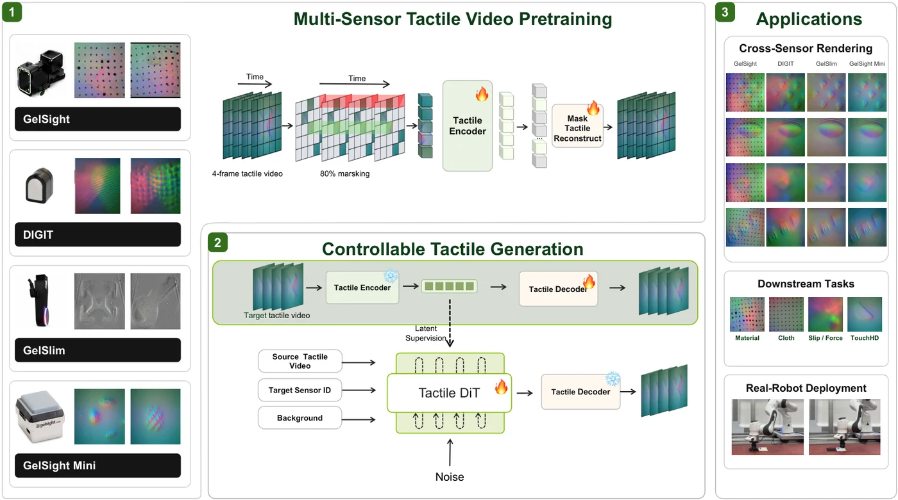

<!-- Generated by scripts/generate.py; edit data/works.json and data/media.json. -->

[← Back to the Awesome index](../../../README.md) · [Interactive website](https://chang-xinhai.github.io/Awesome-RGBDT-Manipulation/?collection=policy&item=tacbridge#library)

# TacBridge

TacBridge: Learning Unified Tactile Representations through Cross-Sensor Correspondence

**2026-11-16 · Preprint · University of Bristol and collaborators**

**[Paper](https://arxiv.org/abs/2611.20939)**

Aligns masked optical tactile videos using paired recordings of matched contact events across sensor types.

*TacBridge authors · [Figure source](https://arxiv.org/html/2611.20939v1) · Original rights retained.*

| Field | Reported value and source scope |
| :-- | :-- |
| Record type | model |
| Model role and downstream interface | Unified tactile video representations and translation [1](https://arxiv.org/html/2611.20939)  |
| Model family | Masked tactile-video model [1](https://arxiv.org/html/2611.20939)  |
| Model architecture | Spatiotemporal masked video modeling [1](https://arxiv.org/html/2611.20939)  |
| Model size and component | Not reported [1](https://arxiv.org/html/2611.20939)  |
| Model inputs | Optical tactile videos with a source sensor and an optional target sensor identity. [1](https://arxiv.org/html/2611.20939)  |
| Model outputs | Shared tactile features and target-conditioned tactile video reconstructions. [1](https://arxiv.org/html/2611.20939)  |
| Training method | Masked tactile-video pretraining with within-sensor and matched-event cross-sensor reconstruction. [1](https://arxiv.org/html/2611.20939)  |
| Training data and scale | Paired optical tactile event recordings spanning common sensor families. [1](https://arxiv.org/html/2611.20939)  |
| Training duration | Not reported [1](https://arxiv.org/html/2611.20939)  |
| Training hardware | Not reported [1](https://arxiv.org/html/2611.20939)  |
| Inference setting and runtime | Condition on target sensor for cross-sensor reconstruction or extract features for perception. [1](https://arxiv.org/html/2611.20939)  |
| Downstream evaluation and scope | Cross-sensor translation, downstream tactile perception and real-arm surface attribute classification. [1](https://arxiv.org/html/2611.20939)  |
| Observations / modalities | Tactile |
| Evaluation domain | Real world |
| Embodiment |  |
| Release: code | Not verified |
| Release: weights | Not verified |
| Release: data | Not verified |
| Release: license | Not verified |
| Release: notes | Primary paper describes synchronized paired capture and experiments. Public executable implementation, weights and data files were not verified. |

**Scope and qualifications**

- The method is a tactile representation and translation tool. The reported hardware experiment classifies surface attributes using touch.
- It learns from paired contact events, while TaF-Foundation uses a wrench reference to align signals without direct tactile pairings.

**Primary evidence**

1. [Primary paper and evaluated setting](https://arxiv.org/html/2611.20939)
