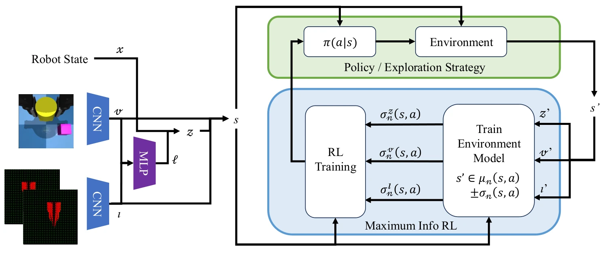

<!-- Generated by scripts/generate.py; edit data/works.json and data/media.json. -->

[← Back to the Awesome index](../../../README.md) · [Interactive website](https://chang-xinhai.github.io/Awesome-RGBDT-Manipulation/?collection=policy&item=tacex-curiosity#library)

# TacEx — tactile curiosity

Tactile Curiosity Drives Robot Interaction

**2026-09-30 · Preprint · ETH Zürich / University of California, Berkeley**

**[Paper](https://arxiv.org/abs/2609.40134)**

Modality-weighted dynamics disagreement directs exploration toward useful physical contact.

*Tactile Curiosity Drives Robot Interaction authors · [Figure source](https://arxiv.org/abs/2609.40134) · Original rights retained.*

| Field | Reported value and source scope |
| :-- | :-- |
| Record type | policy |
| Policy family | RL [1](https://arxiv.org/abs/2609.40134)  |
| Base model and architecture | Ensemble dynamics / Max Info RL; tactile diffusion steering of frozen π0 action prior in an additional setting. [1](https://arxiv.org/abs/2609.40134)  |
| Model size and component | Not reported [1](https://arxiv.org/abs/2609.40134)  |
| Deployment inputs | Visual/state/tactile observations and per-modality prediction uncertainty. [1](https://arxiv.org/abs/2609.40134)  |
| Action outputs and horizon | Exploratory robot actions or diffusion-noise steering actions. [1](https://arxiv.org/abs/2609.40134)  |
| Training method | Intrinsic tactile uncertainty maximization; offline downstream learning and constrained online steering experiments. [1](https://arxiv.org/abs/2609.40134)  |
| Training data | Reward-free robot-environment interaction for data collection, downstream offline pick-and-place learning; eight LIBERO-90 tasks in frozen-VLA post-training study. [1](https://arxiv.org/abs/2609.40134)  |
| Training duration | Not reported [1](https://arxiv.org/abs/2609.40134)  |
| Training hardware | Not reported [1](https://arxiv.org/abs/2609.40134)  |
| Inference and control rates | Not reported [1](https://arxiv.org/abs/2609.40134)  |
| Evaluation scope | Simulated parallel-jaw contact manipulation; task-dependent benefits, not fragile/deformable force-regulation evaluation. [1](https://arxiv.org/abs/2609.40134)  |
| Observations / modalities | RGB · Tactile · Proprioception |
| Evaluation domain | Simulation |
| Embodiment | Parallel-jaw gripper |
| Release: code | Not verified |
| Release: weights | Not verified |
| Release: data | Not verified |
| Release: license | Not verified |
| Release: notes | Original paper reviewed; claimed future releases are not treated as currently available. |

**Scope and qualifications**

- Distinct from the TacEx tactile simulator.
- Extrinsic-reward-free collection and later task-conditioned policy evaluation are separate phases.

**Primary evidence**

1. [Original paper and supplementary implementation details](https://arxiv.org/abs/2609.40134) — Primary full text reviewed; dataset, deployment modalities and training-only privileges are scoped separately.
