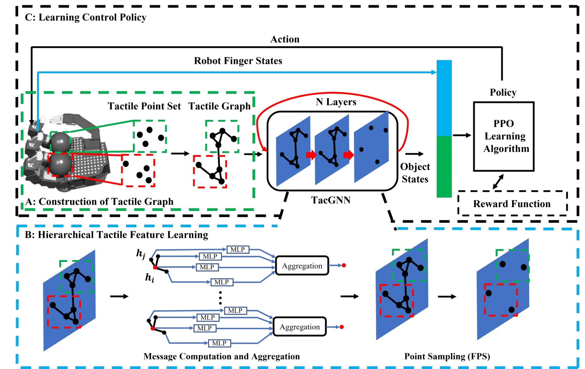

<!-- Generated by scripts/generate.py; edit data/works.json and data/media.json. -->

[← Back to the Awesome index](../../../README.md) · [Interactive website](https://chang-xinhai.github.io/Awesome-RGBDT-Manipulation/?collection=policy&item=tacgnn#library)

# TacGNN

TacGNN:Learning Tactile-based In-hand Manipulation with a Blind Robot

**2023-04-03 · Preprint · Tencent Robotics X / University of Hong Kong / Southern University of Science and Technology and collaborators**

**[Paper](https://arxiv.org/abs/2304.00736)**

A graph tactile state estimator enables vision-free PPO in-hand Bao ding manipulation.

*TacGNN:Learning Tactile-based In-hand Manipulation with a Blind Robot authors · [Figure source](https://arxiv.org/abs/2304.00736) · Original rights retained.*

| Field | Reported value and source scope |
| :-- | :-- |
| Record type | policy |
| Policy family | RL [1](https://arxiv.org/abs/2304.00736)  |
| Base model and architecture | Hierarchical graph tactile perception followed by PPO actor. [1](https://arxiv.org/abs/2304.00736)  |
| Model size and component | Not reported [1](https://arxiv.org/abs/2304.00736)  |
| Deployment inputs | Tactile contact features and hand state; no vision. [1](https://arxiv.org/abs/2304.00736)  |
| Action outputs and horizon | Hand joint commands for rotating two balls. [1](https://arxiv.org/abs/2304.00736)  |
| Training method | Tactile graph state prediction then PPO policy learning. [1](https://arxiv.org/abs/2304.00736)  |
| Training data | Simulated contact state data and RL interaction; exact budget Not reported. [1](https://arxiv.org/abs/2304.00736)  |
| Training duration | Not reported [1](https://arxiv.org/abs/2304.00736)  |
| Training hardware | V100 GPU reported for GNN experiments; full policy training budget Not reported. [1](https://arxiv.org/abs/2304.00736)  |
| Inference and control rates | Not reported [1](https://arxiv.org/abs/2304.00736)  |
| Evaluation scope | Isaac simulation Bao ding 180-degree rotation, disturbance and hold variants; real-hand transfer. [1](https://arxiv.org/abs/2304.00736)  |
| Observations / modalities | Tactile · Proprioception |
| Evaluation domain | Simulation · Real world |
| Embodiment | Dexterous hand |
| Release: code | Not verified |
| Release: weights | Not verified |
| Release: data | Not verified |
| Release: license | Not verified |
| Release: notes | Original paper reviewed; claimed future releases are not treated as currently available. |

**Scope and qualifications**

- Object states are estimated from touch at deployment; not externally tracked vision.

**Primary evidence**

1. [Original paper and supplementary implementation details](https://arxiv.org/abs/2304.00736) — Primary full text reviewed; dataset, deployment modalities and training-only privileges are scoped separately.
