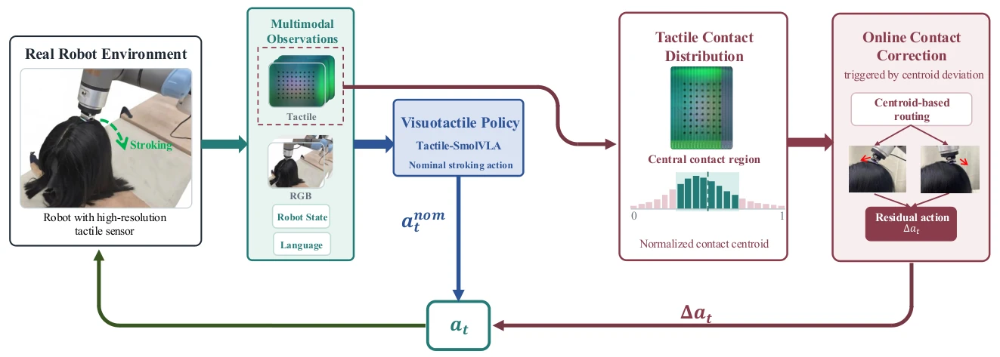

<!-- Generated by scripts/generate.py; edit data/works.json and data/media.json. -->

[← Back to the Awesome index](../../../README.md) · [Interactive website](https://chang-xinhai.github.io/Awesome-RGBDT-Manipulation/?collection=policy&item=tachair#library)

# TacHair

TacHair: Tactile Contact-Distribution Guided Online Correction for Robotic Hair Stroking and Perception

**2026-10-07 · Preprint · King's College London**

**[Paper](https://arxiv.org/abs/2610.10637)** · [Project](https://tachair.github.io/)

A visual/tactile imitation policy and separate contact-distribution residual module recenter deformable hair during stroking.

*TacHair: Tactile Contact-Distribution Guided Online Correction for Robotic Hair Stroking and Perception authors · [Figure source](https://arxiv.org/abs/2610.10637) · Original rights retained.*

| Field | Reported value and source scope |
| :-- | :-- |
| Record type | policy |
| Policy family | Hybrid [1](https://arxiv.org/abs/2610.10637)  |
| Base model and architecture | Nominal visuotactile policy; Gel Sight contact-distribution predictor and separately trained residual correction. [1](https://arxiv.org/abs/2610.10637)  |
| Model size and component | Not reported [1](https://arxiv.org/abs/2610.10637)  |
| Deployment inputs | Third-person RGB, Gel Sight Mini tactile images and robot state. [1](https://arxiv.org/abs/2610.10637)  |
| Action outputs and horizon | Nominal stroking actions with local contact deviation corrections. [1](https://arxiv.org/abs/2610.10637)  |
| Training method | Separate nominal policy, contact predictor and residual imitation training. [1](https://arxiv.org/abs/2610.10637)  |
| Training data | 97 nominal demos/7,002 frames;1,045 manually annotated tactile images;75 dedicated recentering demos. [1](https://arxiv.org/abs/2610.10637)  |
| Training duration | Not reported [1](https://arxiv.org/abs/2610.10637)  |
| Training hardware | Not reported [1](https://arxiv.org/abs/2610.10637)  |
| Inference and control rates | Not reported [1](https://arxiv.org/abs/2610.10637)  |
| Evaluation scope | SO101quantitative experiments across five head forms and three hair conditions; UR5eadditionalvalidationwithseparatelytrainedpolicies. [1](https://arxiv.org/abs/2610.10637)  |
| Observations / modalities | RGB · Tactile · Proprioception |
| Evaluation domain | Real world |
| Embodiment | Parallel-jaw gripper |
| Release: code | Not verified [2](https://tachair.github.io/)  |
| Release: weights | Not verified [2](https://tachair.github.io/)  |
| Release: data | Not verified [2](https://tachair.github.io/)  |
| Release: license | Not verified [2](https://tachair.github.io/)  |
| Release: notes | Original paper reviewed; claimed future releases are not treated as currently available. [2](https://tachair.github.io/)  |

**Scope and qualifications**

- SO101toUR5 e results use separately trained policies, not zero-shot cross-embodiment transfer.

**Primary evidence**

1. [Original paper and supplementary implementation details](https://arxiv.org/abs/2610.10637) — Primary full text reviewed; dataset, deployment modalities and training-only privileges are scoped separately.
2. [Official author project](https://tachair.github.io/) — Live artifact status reviewed separately from paper claims.
