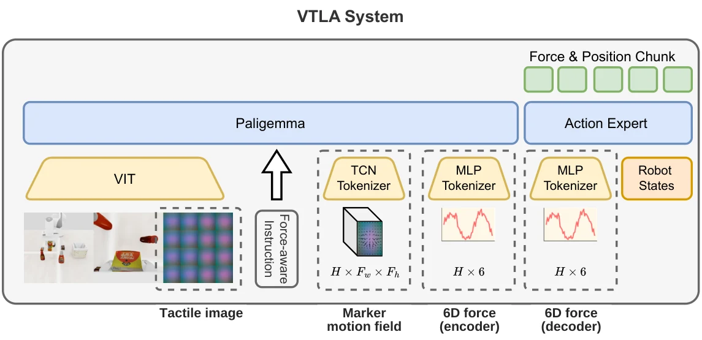

<!-- Generated by scripts/generate.py; edit data/works.json and data/media.json. -->

[← Back to the Awesome index](../../../README.md) · [Interactive website](https://chang-xinhai.github.io/Awesome-RGBDT-Manipulation/?collection=policy&item=tacinf#library)

# Tacinf-VTLA

Tacinf: A Unified Tactile Infrastructure for Robot Manipulation

**2026-11-22 · Preprint · NVIDIA; HKUST (Guangzhou); University of Cambridge**

**[Paper](https://arxiv.org/abs/2611.29240)** · [Project](https://tacinf.github.io/) · [Code](https://github.com/NathanWu7/T2-VLA) · [Data](https://huggingface.co/datasets/xiangxin0923/taco_pick_and_place_umi_current) · [Weights](https://huggingface.co/NathanWu7/pi0_lora_tacfield_tabero) · [Tabero Simulator](https://github.com/NathanWu7/Tabero)

Combines camera observations with touch to predict motion and fingertip-force targets, using Tabero simulation and Tacumi demonstrations for transfer.

*Qiwei Wu and coauthors · [Figure source](https://arxiv.org/html/2611.29240v1) · Original rights retained.*

| Field | Reported value and source scope |
| :-- | :-- |
| Record type | policy |
| Policy family | Tacinf-VTLA [1](https://arxiv.org/html/2611.29240v1)  |
| Base model and architecture | π0 and π0.5; camera and tactile input adapters [1](https://arxiv.org/html/2611.29240v1)  |
| Model size and component | Not reported [1](https://arxiv.org/html/2611.29240v1)  |
| Deployment inputs | Scene/wrist RGB, proprioception, text and interchangeable optical tactile images, marker motion fields or tactile-derived six-axis features. Depth is recorded by Tabero cameras but is not an input in the reported VTLA configuration. [1](https://arxiv.org/html/2611.29240v1)  |
| Action outputs and horizon | Joint action chunk with motion, gripper and predicted fingertip forces or wrenches; hybrid controller follows force targets. [1](https://arxiv.org/html/2611.29240v1)  |
| Training method | Fine-tune on simulated or mixed robot/handheld demonstrations with matched tactile representation and force targets. [1](https://arxiv.org/html/2611.29240v1)  |
| Training data | Tabero tactile simulation, Taco robot teleoperation and Tacumi handheld recordings. Mixture and replay recipes vary by result. [1](https://arxiv.org/html/2611.29240v1)  |
| Training duration | Not reported [1](https://arxiv.org/html/2611.29240v1)  |
| Training hardware | Not reported [1](https://arxiv.org/html/2611.29240v1)  |
| Inference and control rates | Tabero records synchronized observations at 20 Hz; policy and controller timing are protocol-specific. [1](https://arxiv.org/html/2611.29240v1)  |
| Evaluation scope | Separate simulation and xArm deployment results; the force-following physical protocol uses 20 trials per model and task, with 10 on special tasks. [1](https://arxiv.org/html/2611.29240v1)  |
| Observations / modalities | RGB · Tactile · Proprioception · Language |
| Evaluation domain | Simulation · Real world |
| Embodiment | Parallel-jaw gripper |
| Release: code | Partial — training/inference and Tabero source public; several Tacumi and later replay tooling links still unresolved [3](https://github.com/NathanWu7/T2-VLA)  |
| Release: weights | Partial — published simulation π0 checkpoint; additional physical variants linked individually [4](https://huggingface.co/NathanWu7/pi0_lora_tacfield_tabero/tree/main)  |
| Release: data | Partial — public simulator assets and subsets of UMI/replay recordings [5](https://huggingface.co/datasets/xiangxin0923/taco_pick_and_place_umi_current/tree/main)  |
| Release: license | Apache-2.0 for verified T2-VLA and Tabero repos; specific datasets/checkpoints have separate terms. |
| Release: notes | Public paper verified. Code, task weights and data are tracked separately. |

**Scope and qualifications**

- Tabero dataset RGB-D coverage is distinct from deployed policy modalities. VTLA branches do not consume a measured depth map in the reported setup.
- Fingertip contact readout and tool/wrench targets are reported by sensor and controller configuration.

**Primary evidence**

1. [Original author paper with methods, evaluation and scope](https://arxiv.org/html/2611.29240v1)
2. [Public author project with method and evaluation examples](https://tacinf.github.io/)
3. [Public tactile policy repository](https://github.com/NathanWu7/T2-VLA)
4. [Files for released simulation checkpoint](https://huggingface.co/NathanWu7/pi0_lora_tacfield_tabero/tree/main)
5. [Public parquet recording split](https://huggingface.co/datasets/xiangxin0923/taco_pick_and_place_umi_current/tree/main)
6. [Public Isaac Lab benchmark and separate release artifacts](https://github.com/NathanWu7/Tabero#readme)
