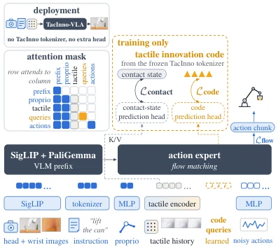

<!-- Generated by scripts/generate.py; edit data/works.json and data/media.json. -->

[← Back to the Awesome index](../../../README.md) · [Interactive website](https://chang-xinhai.github.io/Awesome-RGBDT-Manipulation/?collection=policy&item=tacinno#library)

# TacInno-VLA

TacInno: Teaching Vision-Language-Action Models the Contact Dynamics Beyond Vision and Action

**2026-11-19 · Preprint · ShanghaiTech University; Institute of AI for Industries, CAS**

**[Paper](https://arxiv.org/abs/2611.26405)** · [Project](https://tacinno.github.io/) · [Code](https://github.com/LisavilaLee/TacInno) · [Weights](https://huggingface.co/Lisavila/TacInno-VLA)

Predicts tactile-innovation codes as training targets to teach a tactile-conditioned π0.5 which contact changes matter for action.

*Weile Li and coauthors · [Figure source](https://arxiv.org/html/2611.26405v3) · Original rights retained.*

| Field | Reported value and source scope |
| :-- | :-- |
| Record type | policy |
| Policy family | TacInno-VLA [1](https://arxiv.org/html/2611.26405v3)  |
| Base model and architecture | π0.5 with tactile conditioning and separate train-only tactile-innovation heads. [1](https://arxiv.org/html/2611.26405v3)  |
| Model size and component | Not reported [1](https://arxiv.org/html/2611.26405v3)  |
| Deployment inputs | Head/wrist RGB views, robot state, language and tactile histories. Real hardware uses TacRGB image inputs in the experiment. [1](https://arxiv.org/html/2611.26405v3)  |
| Action outputs and horizon | π0.5 action chunks. The extra tokenizer/code and contact prediction heads are auxiliary training components. [1](https://arxiv.org/html/2611.26405v3)  |
| Training method | Contact tokenizer summarizes residual tactile changes conditioned on vision and executed actions; policy learns auxiliary residual-code and contact-state objectives. [1](https://arxiv.org/html/2611.26405v3)  |
| Training data | Six UniVTAC simulation tasks and four real teleoperated tasks; physical training uses 45 out of 50 demonstrations per task. [1](https://arxiv.org/html/2611.26405v3)  |
| Training duration | Not reported [1](https://arxiv.org/html/2611.26405v3)  |
| Training hardware | Not reported [1](https://arxiv.org/html/2611.26405v3)  |
| Inference and control rates | Not reported [1](https://arxiv.org/html/2611.26405v3)  |
| Evaluation scope | Paper reports 87.5% average success on six simulated tasks and 70.5% on four real tasks, with independent baselines. [1](https://arxiv.org/html/2611.26405v3)  |
| Observations / modalities | RGB · Tactile · Proprioception · Language |
| Evaluation domain | Simulation · Real world |
| Embodiment | Parallel-jaw gripper |
| Release: code | Available — training, inference and released-model evaluation [3](https://github.com/LisavilaLee/TacInno#readme)  |
| Release: weights | Available — simulation, tokenizer and four-task physical checkpoint files [4](https://huggingface.co/Lisavila/TacInno-VLA/tree/main)  |
| Release: data | Partial — repository documents preprocessing and split files; a complete demonstration-data release was not verified |
| Release: license | Apache-2.0 original source; model card uses separate terms and upstream π0.5 terms apply. |
| Release: notes | Public paper verified. Code, task weights and data are tracked separately. |

**Scope and qualifications**

- Removing the training-only innovation tokenizer and code heads leaves the tactile-observation path in deployment.

**Primary evidence**

1. [Original author paper with methods, evaluation and scope](https://arxiv.org/html/2611.26405v3)
2. [Public author project with method and evaluation examples](https://tacinno.github.io/)
3. [Public training, serving and evaluation code](https://github.com/LisavilaLee/TacInno#readme)
4. [Policy and tokenizer model files](https://huggingface.co/Lisavila/TacInno-VLA/tree/main)
