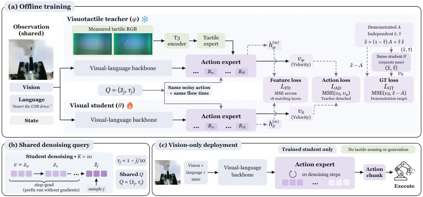

<!-- Generated by scripts/generate.py; edit data/works.json and data/media.json. -->

[← Back to the Awesome index](../../../README.md) · [Interactive website](https://chang-xinhai.github.io/Awesome-RGBDT-Manipulation/?collection=policy&item=tacittouch#library)

# TacitTouch

Distilling Touch into Vision-Only Policies for Contact-Rich Manipulation

**2026-11-21 · Preprint · Tsinghua University; Amap, Alibaba Group and collaborators**

**[Paper](https://arxiv.org/abs/2611.28697)** · [Project](https://pier-lab.github.io/tacittouch/) · [Code](https://github.com/PIER-Lab/SimpleTouch) · [Weights](https://huggingface.co/cyang203912/SimpleTouch/tree/main/tacittouch)

Distills action behavior and denoising features from a tactile teacher into an RGB deployment student.

*Chen Yang and coauthors · [Figure source](https://arxiv.org/html/2611.28697v1) · Original rights retained.*

| Field | Reported value and source scope |
| :-- | :-- |
| Record type | policy |
| Policy family | TacitTouch [1](https://arxiv.org/html/2611.28697v1)  |
| Base model and architecture | π0.5-style student and visuo-tactile SimpleTouch-style teacher. [1](https://arxiv.org/html/2611.28697v1)  |
| Model size and component | Not reported [1](https://arxiv.org/html/2611.28697v1)  |
| Deployment inputs | RGB cameras, robot state and language. Tactile RGB is supplied only to the frozen teacher during training. [1](https://arxiv.org/html/2611.28697v1)  |
| Action outputs and horizon | Executable flow-based action chunks from the student. [1](https://arxiv.org/html/2611.28697v1)  |
| Training method | Distill denoising predictions and intermediate action features along shared noisy actions and times, plus demonstrated-action supervision. [1](https://arxiv.org/html/2611.28697v1)  |
| Training data | Paired optical tactile and robot demonstrations in UniVTAC and in real setups. [1](https://arxiv.org/html/2611.28697v1)  |
| Training duration | Not reported [1](https://arxiv.org/html/2611.28697v1)  |
| Training hardware | Not reported [1](https://arxiv.org/html/2611.28697v1)  |
| Inference and control rates | Not reported [1](https://arxiv.org/html/2611.28697v1)  |
| Evaluation scope | Four simulation and four real contact-rich tasks. Author source and weights cover UniVTAC simulation students. [1](https://arxiv.org/html/2611.28697v1)  |
| Observations / modalities | RGB · Language · Proprioception |
| Evaluation domain | Simulation · Real world |
| Embodiment | Parallel-jaw gripper |
| Release: code | Available — simulation training and evaluation within the SimpleTouch repository [3](https://github.com/PIER-Lab/SimpleTouch#readme)  |
| Release: weights | Available — released UniVTAC student checkpoints [4](https://huggingface.co/cyang203912/SimpleTouch/tree/main/tacittouch)  |
| Release: data | Not verified — all physical training recordings are not part of the verified release |
| Release: license | Apache-2.0 repository; model files and upstream packages retain their own terms. |
| Release: notes | Public paper verified. Code, task weights and data are tracked separately. |

**Scope and qualifications**

- Deployment has no tactile input, tactile reconstruction, or tactile encoder. Tactile learning is accounted for in the training fields.

**Primary evidence**

1. [Original author paper with methods, evaluation and scope](https://arxiv.org/html/2611.28697v1)
2. [Public author project with method and evaluation examples](https://pier-lab.github.io/tacittouch/)
3. [Author source identifies the November TacitTouch integration](https://github.com/PIER-Lab/SimpleTouch#readme)
4. [Public simulation student files](https://huggingface.co/cyang203912/SimpleTouch/tree/main/tacittouch)
