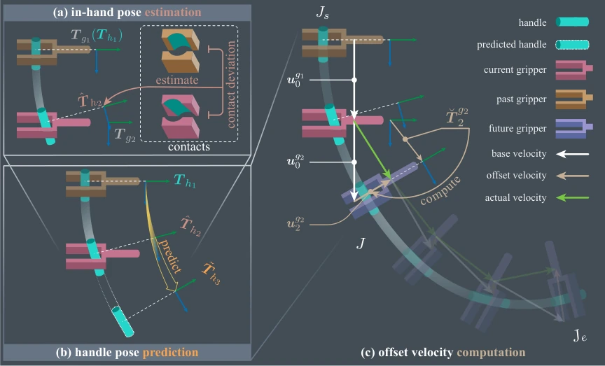

<!-- Generated by scripts/generate.py; edit data/works.json and data/media.json. -->

[← Back to the Awesome index](../../../README.md) · [Interactive website](https://chang-xinhai.github.io/Awesome-RGBDT-Manipulation/?collection=policy&item=tacman-turbo#library)

# TacMan-Turbo

TacMan-Turbo: Proactive Tactile Control for Robust and Efficient Articulated Object Manipulation

**2025-08-04 · IEEE T-ASE 2026 · Peking University / Tsinghua University / University of Chinese Academy of Sciences / Shenyang Institute of Automation, CAS / LeapZenith AI Research**

**[Paper](https://arxiv.org/abs/2508.02204)** · [Project](https://tacman-aom.github.io/tacman-turbo/) · [Code](https://github.com/YuyangLee/Tac-Man-Simulation)

An analytical tactile controller predicts local handle motion and proactively adjusts gripper velocity for articulated-object manipulation.

*TacMan-Turbo: Proactive Tactile Control for Robust and Efficient Articulated Object Manipulation authors · [Figure source](https://arxiv.org/abs/2508.02204) · Original rights retained.*

| Field | Reported value and source scope |
| :-- | :-- |
| Record type | policy |
| Policy family | Model-based planning [1](https://arxiv.org/abs/2508.02204)  |
| Base model and architecture | Analytical contact-point registration, local handle-motion prediction and constrained offset-velocity computation; no learned action backbone. [1](https://arxiv.org/abs/2508.02204)  |
| Model size and component | Not applicable to analytical controller. [1](https://arxiv.org/abs/2508.02204)  |
| Deployment inputs | Sequential bilateral GelSight-type contact-point geometry, robot/gripper pose and a rough task-direction base velocity. No external RGB-D perception is required by this controller. [1](https://arxiv.org/abs/2508.02204)  |
| Action outputs and horizon | Six-DoF gripper velocity corrections combined with a base velocity to maintain stable contact. [1](https://arxiv.org/abs/2508.02204)  |
| Training method | Training-free analytical controller; contact calibration and threshold selection are separate from learned policy training. [1](https://arxiv.org/abs/2508.02204)  |
| Training data | Not applicable: no policy demonstrations or RL training. Simulation tests use 200 objects: 50 prismatic, 50 revolute and 100 Bézier-trajectory mechanisms. [1](https://arxiv.org/abs/2508.02204)  |
| Training duration | Not applicable to analytical controller. [1](https://arxiv.org/abs/2508.02204)  |
| Training hardware | Not applicable to policy training. Runtime uses Ryzen 9 5950X and RTX 3090. [1](https://arxiv.org/abs/2508.02204)  |
| Inference and control rates | Real tactile sensing 120 Hz, offset-velocity computation 50 Hz and Kinova low-level loop 1000 Hz; Isaac Sim simulation 60 Hz, simulator version Not reported. [1](https://arxiv.org/abs/2508.02204)  |
| Evaluation scope | Franka in Isaac Sim; Kinova Gen3 / Robotiq 2F-85 with two GelSight-type sensors in real tests on drawer, microwave and vise, plus charging dock, power switch, coffee maker and sewing machine. Stable grasp is manually initialized. [1](https://arxiv.org/abs/2508.02204)  |
| Observations / modalities | Tactile · Proprioception |
| Evaluation domain | Simulation · Real world |
| Embodiment | Parallel-jaw gripper |
| Release: code | Partial [2](https://tacman-aom.github.io/tacman-turbo/) [3](https://github.com/YuyangLee/Tac-Man-Simulation)  |
| Release: weights | Not applicable [2](https://tacman-aom.github.io/tacman-turbo/) [3](https://github.com/YuyangLee/Tac-Man-Simulation)  |
| Release: data | Not verified [2](https://tacman-aom.github.io/tacman-turbo/) [3](https://github.com/YuyangLee/Tac-Man-Simulation)  |
| Release: license | Not reported in linked repository; no root LICENSE file. [2](https://tacman-aom.github.io/tacman-turbo/) [3](https://github.com/YuyangLee/Tac-Man-Simulation)  |
| Release: notes | Official Turbo page links the earlier Tac-Man simulation repository. Inspected implementation and README identify Tac-Man; a Turbo-specific predictive/velocity-controller implementation was not established. [2](https://tacman-aom.github.io/tacman-turbo/) [3](https://github.com/YuyangLee/Tac-Man-Simulation)  |

**Scope and qualifications**

- Assumes stable initial grasp, non-slipping contact and a rough interaction direction; it does not solve perception, approach or grasp acquisition.
- First public date is 2025-08-04; current journal revision and author page identify T-ASE 2026.
- The linked code release must not be presented as verified complete TacMan-Turbo code.

**Primary evidence**

1. [Original paper and reviewed full text](https://arxiv.org/abs/2508.02204) — Full primary text, including available supplementary implementation details; first public date retained separately from reviewed revision.
2. [Official author project](https://tacman-aom.github.io/tacman-turbo/) — Current project links and release claims checked independently of paper prose.
3. [Official implementation and repository files](https://github.com/YuyangLee/Tac-Man-Simulation) — Training/deployment implementation, README and actual LICENSE inspected where present.
