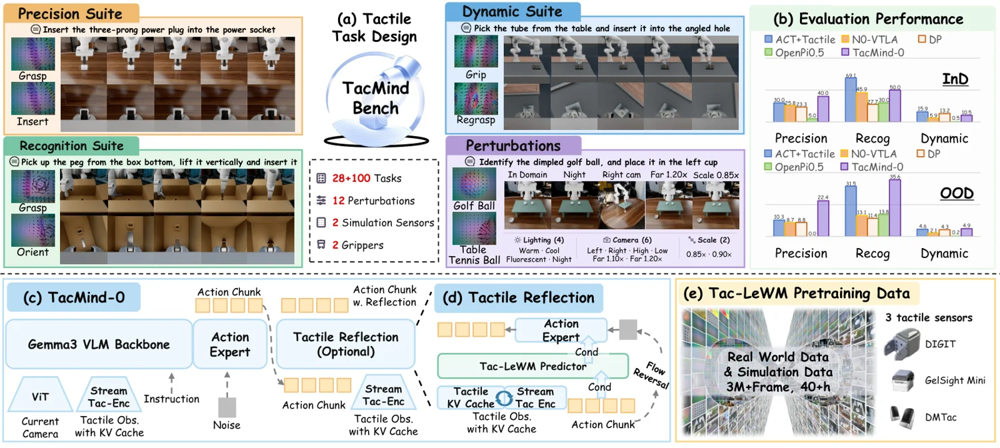

<!-- Generated by scripts/generate.py; edit data/works.json and data/media.json. -->

[← Back to the Awesome index](../../../README.md) · [Interactive website](https://chang-xinhai.github.io/Awesome-RGBDT-Manipulation/?collection=policy&item=tacmind#library)

# TacMind

TacMind: Benchmarking and Modeling Tactile Interaction States for Robotic Manipulation

**2026-10-30 · Preprint · Shanghai Jiao Tong University; Daimon Robotics**

**[Paper](https://arxiv.org/abs/2611.00455)** · [Project](https://tacmind-bench.github.io/) · [Code](https://github.com/Tacmind-Bench/TacMind) · [Data](https://huggingface.co/datasets/JiaxinShi/TacMind-Bench)

A tactile benchmark and streaming visuotactile policy for contact-rich manipulation.

*tacmind authors · [Figure source](https://arxiv.org/abs/2611.00455) · Original rights retained.*

| Field | Reported value and source scope |
| :-- | :-- |
| Record type | policy |
| Policy family | Visuotactile language-action policy [1](https://arxiv.org/html/2611.00455v1)  |
| Base model and architecture | TacMind-0 with Tac-LeWM tactile world model [1](https://arxiv.org/html/2611.00455v1)  |
| Model size and component | Not reported [1](https://arxiv.org/html/2611.00455v1)  |
| Deployment inputs | RGB, tactile observations, robot state and task instruction. [1](https://arxiv.org/html/2611.00455v1)  |
| Action outputs and horizon | Robot actions conditioned on streaming tactile state. [1](https://arxiv.org/html/2611.00455v1)  |
| Training method | Predictive tactile representation pretraining followed by tactile-conditioned action generation. [1](https://arxiv.org/html/2611.00455v1)  |
| Training data | Multi-sensor tactile manipulation demonstrations from simulation and the real world. [1](https://arxiv.org/html/2611.00455v1)  |
| Training duration | Not reported [1](https://arxiv.org/html/2611.00455v1)  |
| Training hardware | Not reported [1](https://arxiv.org/html/2611.00455v1)  |
| Inference and control rates | Not reported [1](https://arxiv.org/html/2611.00455v1)  |
| Evaluation scope | TacMind-Bench standard tasks and separate real-world contact-rich experiments. [1](https://arxiv.org/html/2611.00455v1)  |
| Observations / modalities | RGB · Tactile · Proprioception · Language |
| Evaluation domain | Simulation · Real world |
| Embodiment | Not reported |
| Release: code | Available — official benchmark and implementation [2](https://tacmind-bench.github.io/)  |
| Release: weights | Not verified [2](https://tacmind-bench.github.io/)  |
| Release: data | Available — official tactile benchmark episode archives [2](https://tacmind-bench.github.io/)  |
| Release: license | MIT for repository; dataset and component licenses are separate. [2](https://tacmind-bench.github.io/)  |
| Release: notes | Official repository contains source and assets; published dataset lists episode archives. Model checkpoint release has not been verified. [2](https://tacmind-bench.github.io/)  |

**Scope and qualifications**

- The 28 standard and 100 extra tasks are simulation benchmark counts; real-world evaluation is separate.
- Predictive tactile state and measured tactile observations are distinct.

**Primary evidence**

1. [Author paper: methods, scope, and evaluation](https://arxiv.org/html/2611.00455v1)
2. [Official project and linked releases](https://tacmind-bench.github.io/)
