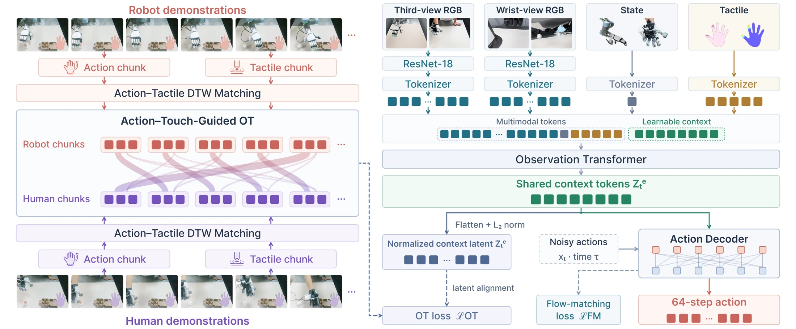

<!-- Generated by scripts/generate.py; edit data/works.json and data/media.json. -->

[← Back to the Awesome index](../../../README.md) · [Interactive website](https://chang-xinhai.github.io/Awesome-RGBDT-Manipulation/?collection=policy&item=tacot#library)

# TacOT

TacOT: Learning Contact-Rich Dexterous Manipulation from Human Demonstrations via Tactile-Guided Optimal Transport

**2026-10-03 · Preprint · Tsinghua University / Shanghai Jiao Tong University / Xspark AI / Nanyang Technological University**

**[Paper](https://arxiv.org/abs/2610.04363)**

Action–tactile temporal alignment and optimal transport transfer independently collected human demonstrations to dexterous robot policies.

*TacOT: Learning Contact-Rich Dexterous Manipulation from Human Demonstrations via Tactile-Guided Optimal Transport authors · [Figure source](https://arxiv.org/abs/2610.04363) · Original rights retained.*

| Field | Reported value and source scope |
| :-- | :-- |
| Record type | policy |
| Policy family | Flow matching [1](https://arxiv.org/abs/2610.04363)  |
| Base model and architecture | 16-layer transformer observation encoder and 8-layer action decoder with flow-matching policy; action–tactile DTW/OT during training. [1](https://arxiv.org/abs/2610.04363)  |
| Model size and component | Not reported [1](https://arxiv.org/abs/2610.04363)  |
| Deployment inputs | Wrist/third-person RGB, unified proprioceptive motion and tactile observations. [1](https://arxiv.org/abs/2610.04363)  |
| Action outputs and horizon | Robot arm–hand action chunks. [1](https://arxiv.org/abs/2610.04363)  |
| Training method | Multimodal flow imitation with action–tactile-guided latent alignment. [1](https://arxiv.org/abs/2610.04363)  |
| Training data | Per task 60 robot ID episodes+200 human episodes (100 ID,100 OOD); correspondences are inferred, not recorded paired sessions. [1](https://arxiv.org/abs/2610.04363)  |
| Training duration | Not reported [1](https://arxiv.org/abs/2610.04363)  |
| Training hardware | Not reported [1](https://arxiv.org/abs/2610.04363)  |
| Inference and control rates | 30 Hz; execute first 8 actions per chunk before replanning. [1](https://arxiv.org/abs/2610.04363)  |
| Evaluation scope | UR5–XHand:Tissue, Wiping, Egg, Block;30 ID and 15 OOD rollouts/method/task; OOD configurations excluded from robot training but represented in human data. [1](https://arxiv.org/abs/2610.04363)  |
| Observations / modalities | RGB · Tactile · Proprioception |
| Evaluation domain | Real world |
| Embodiment | Dexterous hand |
| Release: code | Not verified |
| Release: weights | Not verified |
| Release: data | Not verified |
| Release: license | Not verified |
| Release: notes | Original paper reviewed; claimed future releases are not treated as currently available. |

**Scope and qualifications**

- OOD means unseen in robot demonstrations; human demonstrations include the OOD configurations.
- DTW/OT correspondence optimization is a training procedure, not inference-time privileged access.

**Primary evidence**

1. [Original paper and supplementary implementation details](https://arxiv.org/abs/2610.04363) — Primary full text reviewed; dataset, deployment modalities and training-only privileges are scoped separately.
