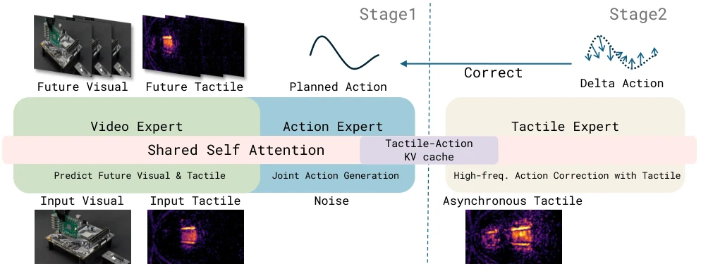

<!-- Generated by scripts/generate.py; edit data/works.json and data/media.json. -->

[← Back to the Awesome index](../../../README.md) · [Interactive website](https://chang-xinhai.github.io/Awesome-RGBDT-Manipulation/?collection=policy&item=tacpac#library)

# TacPAC

TacPAC: Tactile Prediction and Real-Time Action Correction in World-Action Models for Contact-Rich Manipulation

**2026-09-04 · Preprint · Not reported**

**[Paper](https://arxiv.org/abs/2609.05266)** · [Project](https://logosroboticsgroup.github.io/TacPAC/) · [Code](https://github.com/LogosRoboticsGroup/TacPAC)

Predicts future contact with a WAM, then corrects unexecuted actions from fresh touch using cached action/tactile context.

*TacPAC authors · [Figure source](https://arxiv.org/html/2609.05266) · Original rights retained.*

| Field | Reported value and source scope |
| :-- | :-- |
| Record type | policy |
| Policy family | World-action model [1](https://arxiv.org/abs/2609.05266)  |
| Base model and architecture | Wan2.2 TI2V backbone with video/action/tactile experts [1](https://arxiv.org/abs/2609.05266) [3](https://arxiv.org/html/2609.05266)  |
| Model size and component | Not reported [1](https://arxiv.org/abs/2609.05266) [3](https://arxiv.org/html/2609.05266)  |
| Deployment inputs | RGB, language, robot state and incoming tactile images [1](https://arxiv.org/abs/2609.05266) [3](https://arxiv.org/html/2609.05266)  |
| Action outputs and horizon | 48-step joint/gripper chunks plus asynchronous residual corrections to unexecuted suffix [1](https://arxiv.org/abs/2609.05266) [3](https://arxiv.org/html/2609.05266)  |
| Training method | Joint predictive training then cache-conditioned tactile correction training [1](https://arxiv.org/abs/2609.05266) [3](https://arxiv.org/html/2609.05266)  |
| Training data | Five real contact-rich tasks; training data size not reported [1](https://arxiv.org/abs/2609.05266) [3](https://arxiv.org/html/2609.05266)  |
| Training duration | Both training stages: 10 epochs; wall-clock not reported [1](https://arxiv.org/abs/2609.05266) [3](https://arxiv.org/html/2609.05266)  |
| Training hardware | 8 NVIDIA H100 GPUs [1](https://arxiv.org/abs/2609.05266) [3](https://arxiv.org/html/2609.05266)  |
| Inference and control rates | Chunk generation 1.59 Hz; tactile corrector 32.90 Hz (30.4 ms); commands 30 Hz [1](https://arxiv.org/abs/2609.05266) [3](https://arxiv.org/html/2609.05266)  |
| Evaluation scope | Five real tasks including chip and fruit transfer [1](https://arxiv.org/abs/2609.05266) [3](https://arxiv.org/html/2609.05266)  |
| Observations / modalities | RGB · Tactile · Proprioception · Language |
| Evaluation domain | Real world |
| Embodiment | Parallel-jaw gripper |
| Release: code | Available [2](https://github.com/LogosRoboticsGroup/TacPAC)  |
| Release: weights | Not released [2](https://github.com/LogosRoboticsGroup/TacPAC)  |
| Release: data | Not released [2](https://github.com/LogosRoboticsGroup/TacPAC)  |
| Release: license | MIT for repository; third-party terms separate [2](https://github.com/LogosRoboticsGroup/TacPAC)  |
| Release: notes | Model/training/deployment code present; author README says datasets and checkpoints are being prepared. [2](https://github.com/LogosRoboticsGroup/TacPAC)  |

**Scope and qualifications**

- Corrector rate and chunk generation rate are distinct; cache is fixed within a chunk.

**Primary evidence**

1. [Author manuscript and submission history](https://arxiv.org/abs/2609.05266) — Policy facts refer to the full manuscript available on the verification date; date is first arXiv submission.
2. [Official repository](https://github.com/LogosRoboticsGroup/TacPAC) — Release status is checked separately from paper claims; a project page alone does not imply released implementation or weights.
3. [Full paper: method and implementation details](https://arxiv.org/html/2609.05266) — Unreported specifications remain explicitly unknown; hardware/rates are scoped to training, inference or low-level control.
