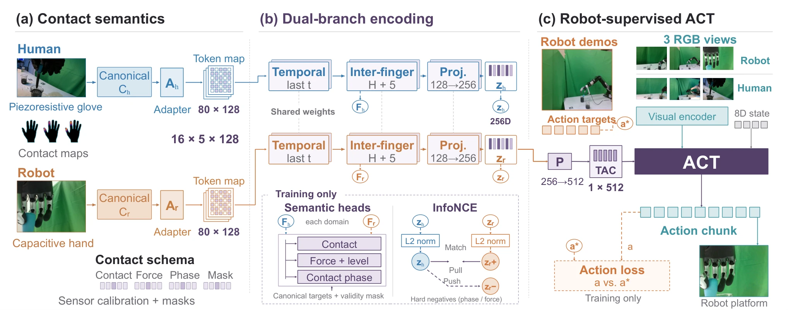

<!-- Generated by scripts/generate.py; edit data/works.json and data/media.json. -->

[← Back to the Awesome index](../../../README.md) · [Interactive website](https://chang-xinhai.github.io/Awesome-RGBDT-Manipulation/?collection=policy&item=tacross#library)

# TACROSS

TACROSS: An Efficient and Low-Cost Scalable Human Touch System Across Heterogeneous Tactile Sensors for Dexterous Robot Learning

**2026-10-08 · Preprint · University of Hong Kong / INFIFORCE / CUHK (Shenzhen) and collaborators**

**[Paper](https://arxiv.org/abs/2610.11945)** · [Project](https://tacross-touch-project.github.io/)

Contact-event semantic alignment transfers heterogeneous human-glove touch into robot tactile-conditioned imitation.

*TACROSS: An Efficient and Low-Cost Scalable Human Touch System Across Heterogeneous Tactile Sensors for Dexterous Robot Learning authors · [Figure source](https://arxiv.org/abs/2610.11945) · Original rights retained.*

| Field | Reported value and source scope |
| :-- | :-- |
| Record type | policy |
| Policy family | ACT [1](https://arxiv.org/abs/2610.11945)  |
| Base model and architecture | Domain canonicalizers, shared temporal/finger transformers and ACT. [1](https://arxiv.org/abs/2610.11945)  |
| Model size and component | Not reported [1](https://arxiv.org/abs/2610.11945)  |
| Deployment inputs | Three RGB views, robot state and robot-domain contact-semantic tactile latent. [1](https://arxiv.org/abs/2610.11945)  |
| Action outputs and horizon | 60-action chunks of 8D arm/open close or 13D arm/six hand joint targets. [1](https://arxiv.org/abs/2610.11945)  |
| Training method | Human–robot contact-event alignment; robot-ground-truth actions plus confidence-masked human hand pseudo-labels; encoder initially frozen 20k steps. [1](https://arxiv.org/abs/2610.11945)  |
| Training data | Recorded corpus 183.95 h/24,913 episodes, 22,486 valid; specific policy comparisons use smaller separately reported human/robot subsets. [1](https://arxiv.org/abs/2610.11945)  |
| Training duration | Not reported [1](https://arxiv.org/abs/2610.11945)  |
| Training hardware | Not reported [1](https://arxiv.org/abs/2610.11945)  |
| Inference and control rates | ACT15 Hz; robot touch 30 Hz; glove hardware~150 Hz. [1](https://arxiv.org/abs/2610.11945)  |
| Evaluation scope | Real contact-rich dexterous manipulation across heterogeneous tactile sensors. [1](https://arxiv.org/abs/2610.11945)  |
| Observations / modalities | RGB · Tactile · Proprioception |
| Evaluation domain | Real world |
| Embodiment | Dexterous hand |
| Release: code | Not verified [2](https://tacross-touch-project.github.io/)  |
| Release: weights | Not verified [2](https://tacross-touch-project.github.io/)  |
| Release: data | Not verified [2](https://tacross-touch-project.github.io/)  |
| Release: license | Not verified [2](https://tacross-touch-project.github.io/)  |
| Release: notes | Original paper reviewed; claimed future releases are not treated as currently available. [2](https://tacross-touch-project.github.io/)  |

**Scope and qualifications**

- 285 physical glove locations differ from 256 streamed values.
- Human hand retargets are pseudo-labels, not ground-truth robot arm actions.
- Recorded corpus and valid subset are not all used in every policy comparison.

**Primary evidence**

1. [Original paper and supplementary implementation details](https://arxiv.org/abs/2610.11945) — Primary full text reviewed; dataset, deployment modalities and training-only privileges are scoped separately.
2. [Official author project](https://tacross-touch-project.github.io/) — Live project artifact links inspected on2026-10-17.
