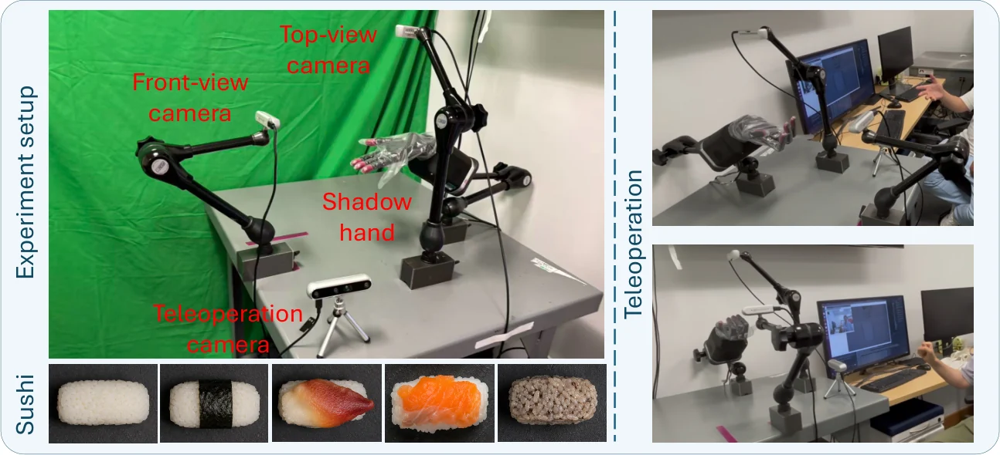

<!-- Generated by scripts/generate.py; edit data/works.json and data/media.json. -->

[← Back to the Awesome index](../../../README.md) · [Interactive website](https://chang-xinhai.github.io/Awesome-RGBDT-Manipulation/?collection=policy&item=tacsushi#library)

# TacSushi

TacSushi: Tactile-Grounded World-Action Modeling for Dexterous Sushi Manipulation

**2026-09-17 · CoRL 2026 Workshop on Dexterous Manipulation · University of Southern California and Mitsubishi Electric Research Laboratories**

**[Paper](https://arxiv.org/abs/2609.19613)**

Uses gated tactile conditioning in a food-manipulation action policy, with future visible and contact outcomes as training supervision.

*TacSushi authors · [Figure source](https://arxiv.org/html/2609.19613v2) · Original rights retained.*

| Field | Reported value and source scope |
| :-- | :-- |
| Record type | policy |
| Policy family | Tactile-conditioned world-action policy [1](https://arxiv.org/html/2609.19613)  |
| Base model and architecture | NVIDIA Cosmos3 [1](https://arxiv.org/html/2609.19613)  |
| Model size and component | Not reported [1](https://arxiv.org/html/2609.19613)  |
| Deployment inputs | Current RGB, language, hand state and tactile features. [1](https://arxiv.org/html/2609.19613)  |
| Action outputs and horizon | Dexterous hand action chunks. [1](https://arxiv.org/html/2609.19613)  |
| Training method | Gated tactile fusion plus training-only prediction of visual outcomes, progress, contact risk and tactile summaries. [1](https://arxiv.org/html/2609.19613)  |
| Training data | 340 successful and 50 failed physical trials; failed actions excluded from imitation. [1](https://arxiv.org/html/2609.19613)  |
| Training duration | Not reported [1](https://arxiv.org/html/2609.19613)  |
| Training hardware | Not reported [1](https://arxiv.org/html/2609.19613)  |
| Inference and control rates | Not reported [1](https://arxiv.org/html/2609.19613)  |
| Evaluation scope | 600 rollouts across three in-distribution tasks and two unseen ingredients. Full method reached 68.3% and 37.5% success in those groups, respectively. [1](https://arxiv.org/html/2609.19613)  |
| Observations / modalities | RGB · Tactile · Proprioception · Language |
| Evaluation domain | Real world |
| Embodiment | Shadow Hand |
| Release: code | Not verified |
| Release: weights | Not verified |
| Release: data | Not verified |
| Release: license | Not verified |
| Release: notes | MERL publishes the manuscript and workshop entry; separately downloadable policy code, weights and full rollouts were not verified. |

**Scope and qualifications**

- Future contact and vision predictions are removed at deployment. Failed trials provide auxiliary outcome labels while imitation uses successful actions.
- The 600 outcome rollouts use a terminal food-quality protocol combining human and VLM ratings, with held-out ingredient variants reported separately.

**Primary evidence**

1. [Primary paper and evaluated setting](https://arxiv.org/html/2609.19613)
2. [Institutional workshop publication and paper](https://www.merl.com/publications/TR2026-173)
