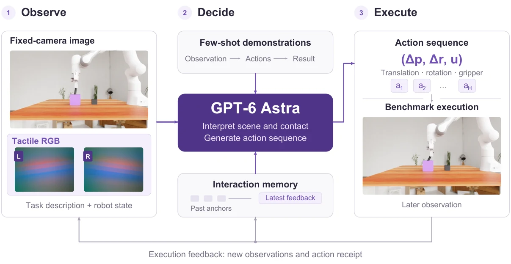

<!-- Generated by scripts/generate.py; edit data/works.json and data/media.json. -->

[← Back to the Awesome index](../../../README.md) · [Interactive website](https://chang-xinhai.github.io/Awesome-RGBDT-Manipulation/?collection=policy&item=tactalent#library)

# TacTalent

GPT-6 Astra Is a Native Visuo-Tactile Policy for Contact-Rich Manipulation

**2026-10-19 · Preprint · Tsinghua University**

**[Paper](https://arxiv.org/abs/2610.26846)** · [Project](https://tactalent.github.io/) · [Code](https://github.com/ccyydd/TacTalent) · [Rollouts](https://tactalent.github.io/records.html?lang=en)

A frozen GPT-6 Astra directly interprets scene and tactile images through RoboICL, using demonstration context and closed-loop contact feedback without task-specific weight training.

*TacTalent authors; original rights retained · [Figure source](https://arxiv.org/abs/2610.26846) · Original rights retained.*

| Field | Reported value and source scope |
| :-- | :-- |
| Record type | policy |
| Policy family | Robot agent [1](https://arxiv.org/html/2610.26846)  |
| Base model and architecture | Frozen hosted GPT-6 Astra with pinned RoboICL runtime [1](https://arxiv.org/html/2610.26846)  |
| Model size and component | Not reported [1](https://arxiv.org/html/2610.26846)  |
| Deployment inputs | Scene RGB, optional tactile RGB images, task text, robot state, few-shot demonstration blocks and recent observation/action receipts. UniVTAC camera selection is task-specific; OpenViTac uses fixed and wrist views. [1](https://arxiv.org/html/2610.26846)  |
| Action outputs and horizon | Relative end-effector translation/rotation and gripper commands, executed by benchmark-native interfaces. [1](https://arxiv.org/html/2610.26846)  |
| Training method | Frozen model weights; tactile images use the existing visual interface, without a learned tactile tokenizer or target-task fine-tuning. [1](https://arxiv.org/html/2610.26846)  |
| Training data | Benchmark training demonstrations form context; evaluation is held out by the reported seed-selection protocol. [1](https://arxiv.org/html/2610.26846)  |
| Training duration | Not reported [1](https://arxiv.org/html/2610.26846)  |
| Training hardware | Not reported [1](https://arxiv.org/html/2610.26846)  |
| Inference and control rates | Not reported [1](https://arxiv.org/html/2610.26846)  |
| Evaluation scope | 8 UniVTAC and 11 OpenViTac tasks, 210 sampled episodes per input mode. Fragile-chip scoring adaptation and exclusions retain the documented protocol. [1](https://arxiv.org/html/2610.26846)  |
| Observations / modalities | RGB · Tactile · Proprioception · Language |
| Evaluation domain | Simulation |
| Embodiment | Parallel-jaw gripper |
| Release: code | Available [2](https://github.com/ccyydd/TacTalent)  |
| Release: weights | Not applicable [2](https://github.com/ccyydd/TacTalent)  |
| Release: data | Partial — public rollout records/videos; benchmark training corpora are separate [2](https://github.com/ccyydd/TacTalent)  |
| Release: license | Apache-2.0 original adapters/evaluation; vendored RoboICL MIT and benchmark assets retain their own terms. [2](https://github.com/ccyydd/TacTalent)  |
| Release: notes | Actual src/tactalent benchmark adapters, RoboICL integration, evaluation and demonstration-preparation code are public. This is not the older SimpleTouch implementation linked by one stale README badge. Hosted-model access is external. [2](https://github.com/ccyydd/TacTalent)  |

**Scope and qualifications**

- All reported TacTalent trials are simulated; OpenViTac’s paired sim/real benchmark does not turn these into physical TacTalent experiments.
- Astra uses a 10% seed-42 stratified sample: 80 UniVTAC and 130 OpenViTac episodes per input mode. Baselines use their separately published benchmark protocols.
- V+T and V mean task success is 93.8% / 76.3% on UniVTAC and 81.8% / 80.6% on OpenViTac. These are task averages, not pooled success or full benchmark sweeps.
- A report-page date of October 17 is separate from the first arXiv submission on October 19.

**Primary evidence**

1. [Original full paper, methods and evaluation](https://arxiv.org/html/2610.26846) — Publication date is arXiv v1; implementation and deployment observations are distinguished from training supervision, generated geometry and base-model identity.
2. [Official artifact: actual source files, inventory and license](https://github.com/ccyydd/TacTalent) — 135 actual files; src/tactalent/roboicl, benchmark adapters and evaluation scripts; root Apache-2.0 LICENSE and vendored runtime reviewed.
