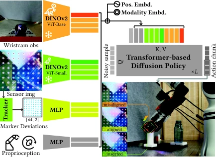

<!-- Generated by scripts/generate.py; edit data/works.json and data/media.json. -->

[← Back to the Awesome index](../../../README.md) · [Interactive website](https://chang-xinhai.github.io/Awesome-RGBDT-Manipulation/?collection=policy&item=tacthru-umi#library)

# TacThru-UMI

Simultaneous Tactile-Visual Perception for Learning Multimodal Robot Manipulation

**2025-12-10 · Preprint · Not reported**

**[Paper](https://arxiv.org/abs/2512.09851)** · [Project](https://tacthru.yuyang.li) · [Code](https://github.com/YuyangLee/TacThru) · [Data](https://huggingface.co/datasets/aidenli/tacthru_umi_tasks)

A transparent see-through-skin sensor supplies simultaneous visual/contact cues to transformer diffusion imitation.

*Simultaneous Tactile-Visual Perception for Learning Multimodal Robot Manipulation authors · [Figure source](https://arxiv.org/abs/2512.09851) · Original rights retained.*

| Field | Reported value and source scope |
| :-- | :-- |
| Record type | policy |
| Policy family | Diffusion [1](https://arxiv.org/abs/2512.09851)  |
| Base model and architecture | Transformer Diffusion Policy with Tac Thru image and marker-deviation tokens. [1](https://arxiv.org/abs/2512.09851)  |
| Model size and component | Not reported [1](https://arxiv.org/abs/2512.09851)  |
| Deployment inputs | Wrist RGB, Tac Thru fingertip RGB, tracked marker displacements and proprioception. [1](https://arxiv.org/abs/2512.09851)  |
| Action outputs and horizon | Relative end-effector poses and gripper width targets, 16-step horizon. [1](https://arxiv.org/abs/2512.09851)  |
| Training method | 150 epochs AdamW diffusion imitation; trained tactile/vision ablation variants. [1](https://arxiv.org/abs/2512.09851)  |
| Training data | 62–147 demos/task across five real tasks; same trajectories used across sensor input variants. [1](https://arxiv.org/abs/2512.09851)  |
| Training duration | 150 epochs; wall-clock Not reported. [1](https://arxiv.org/abs/2512.09851)  |
| Training hardware | Not reported [1](https://arxiv.org/abs/2512.09851)  |
| Inference and control rates | Not reported [1](https://arxiv.org/abs/2512.09851)  |
| Evaluation scope | Five real tasks including pick-and-place, sorting and insertion;20 rollouts/checkpoint except 24 for Sort Bolt. [1](https://arxiv.org/abs/2512.09851)  |
| Observations / modalities | RGB · Tactile · Proprioception |
| Evaluation domain | Real world |
| Embodiment | Parallel-jaw gripper |
| Release: code | Available [2](https://tacthru.yuyang.li) [3](https://github.com/YuyangLee/TacThru) [4](https://huggingface.co/datasets/aidenli/tacthru_umi_tasks)  |
| Release: weights | Not verified [2](https://tacthru.yuyang.li) [3](https://github.com/YuyangLee/TacThru) [4](https://huggingface.co/datasets/aidenli/tacthru_umi_tasks)  |
| Release: data | Available [2](https://tacthru.yuyang.li) [3](https://github.com/YuyangLee/TacThru) [4](https://huggingface.co/datasets/aidenli/tacthru_umi_tasks)  |
| Release: license | MIT [2](https://tacthru.yuyang.li) [3](https://github.com/YuyangLee/TacThru) [4](https://huggingface.co/datasets/aidenli/tacthru_umi_tasks)  |
| Release: notes | Author-linked repository and actual LICENSE inspected; code, checkpoints anddatasets have independent availability. [2](https://tacthru.yuyang.li) [3](https://github.com/YuyangLee/TacThru) [4](https://huggingface.co/datasets/aidenli/tacthru_umi_tasks)  |

**Scope and qualifications**

- Awesome-Touch incorrectly assigns a second Light Tact title to the same ar Xiv ID; canonical title and method are Tac Thru.

**Primary evidence**

1. [Original paper and supplementary implementation details](https://arxiv.org/abs/2512.09851) — Primary full text reviewed; dataset, deployment modalities and training-only privileges are scoped separately.
2. [Official author project](https://tacthru.yuyang.li) — Live project artifact links inspected on2026-10-17.
3. [Official released implementation and LICENSE](https://github.com/YuyangLee/TacThru) — Repository metadata,README and actualLICENSE inspected; availability scoped to the listed component.
4. [Author-linked released dataset](https://huggingface.co/datasets/aidenli/tacthru_umi_tasks) — Public repository file inventory inspected; component/data scope follows model/dataset card.
