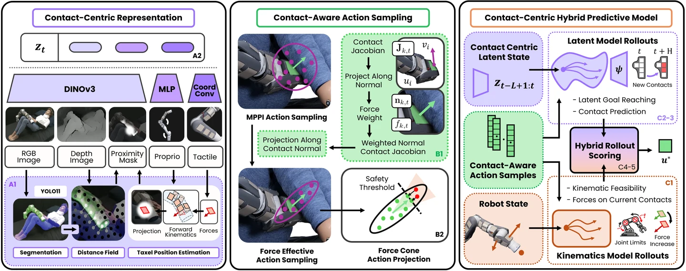

<!-- Generated by scripts/generate.py; edit data/works.json and data/media.json. -->

[← Back to the Awesome index](../../../README.md) · [Interactive website](https://chang-xinhai.github.io/Awesome-RGBDT-Manipulation/?collection=policy&item=tactic#library)

# TACTIC

TACTIC: Tactile and Vision Conditioned Contact-Centric Control for Whole-Arm Manipulation

**2026-07-10 · Preprint · Cornell University; Carnegie Mellon University; Toyota Research Institute**

**[Paper](https://arxiv.org/abs/2607.09218)** · [Project](https://emprise.cs.cornell.edu/tactic/)

Uses RGB-D and distributed whole-arm touch in a learned, action-conditioned contact model for receding-horizon control.

*Rishabh Madan and coauthors · [Figure source](https://arxiv.org/html/2607.09218v1) · Original rights retained.*

| Field | Reported value and source scope |
| :-- | :-- |
| Record type | policy |
| Policy family | TACTIC [1](https://arxiv.org/html/2607.09218v2)  |
| Base model and architecture | Not reported [1](https://arxiv.org/html/2607.09218v2)  |
| Model size and component | Not reported [1](https://arxiv.org/html/2607.09218v2)  |
| Deployment inputs | RGB image, aligned depth, 22 mapped force taxels on the physical Kinova Gen3 arm, and proprioception. Depth also supports the current proximity representation. [1](https://arxiv.org/html/2607.09218v2)  |
| Action outputs and horizon | Sampling-based receding-horizon arm commands with predicted contact/force costs. [1](https://arxiv.org/html/2607.09218v2)  |
| Training method | Predict contact-centric state evolution from exoskeleton-collected demonstrations and couple it to analytical kinematics and contact Jacobians in MPC. [1](https://arxiv.org/html/2607.09218v2)  |
| Training data | Simulation and exoskeleton-based real whole-arm demonstrations; scope is specific to demonstrated tasks. [1](https://arxiv.org/html/2607.09218v2)  |
| Training duration | Not reported [1](https://arxiv.org/html/2607.09218v2)  |
| Training hardware | Not reported [1](https://arxiv.org/html/2607.09218v2)  |
| Inference and control rates | Not reported [1](https://arxiv.org/html/2607.09218v2)  |
| Evaluation scope | Four distinct simulation environments; three physical tasks include arm navigation and manikin turning and repositioning. [1](https://arxiv.org/html/2607.09218v2)  |
| Observations / modalities | RGB · Depth · Tactile · Proprioception |
| Evaluation domain | Simulation · Real world |
| Embodiment | Embodiment-agnostic |
| Release: code | Not verified |
| Release: weights | Not verified |
| Release: data | Not verified |
| Release: license | Not verified |
| Release: notes | Public paper verified. Code, task weights and data are tracked separately. |

**Scope and qualifications**

- RGB-D and measured distributed touch are genuine control inputs. The controller is a learned dynamics model with MPC, not a language-conditioned VLA or an end-to-end action-generating WAM.
- The reported contact quantities come from distributed taxels and do not imply a wrist wrench sensor.

**Primary evidence**

1. [Original author paper with methods, evaluation and scope](https://arxiv.org/html/2607.09218v2)
2. [Public author project with method and evaluation examples](https://emprise.cs.cornell.edu/tactic/)
