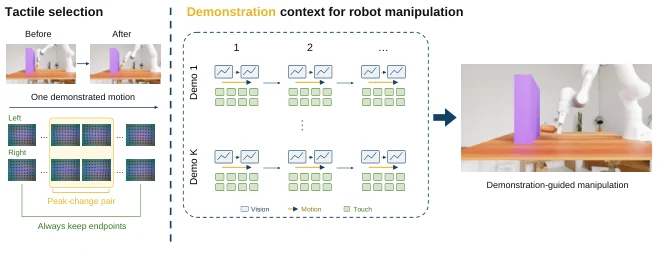

<!-- Generated by scripts/generate.py; edit data/works.json and data/media.json. -->

[← Back to the Awesome index](../../../README.md) · [Interactive website](https://chang-xinhai.github.io/Awesome-RGBDT-Manipulation/?collection=policy&item=tactile-eta#library)

# Tactile-ETA

Embodied Task Agents Can Perform Fine Manipulation through Tactile In-Context Learning

**2026-10-20 · Preprint · Fudan University**

**[Paper](https://arxiv.org/abs/2610.27613)** · [Project](https://no-518.github.io/tactile-eta/) · [Code](https://github.com/No-518/Tactile-ETA) · [Data](https://github.com/No-518/Tactile-ETA/tree/main/demonstrations)

A frozen embodied task agent conditions robot tools on action-aligned visual, tactile and motion demonstrations with selectively retained contact transitions.

*Tactile-ETA authors · [Figure source](https://arxiv.org/abs/2610.27613) · Original rights retained.*

| Field | Reported value and source scope |
| :-- | :-- |
| Record type | policy |
| Policy family | Robot agent [1](https://arxiv.org/abs/2610.27613)  |
| Base model and architecture | Frozen GPT-6 Astra via Codex CLI with low reasoning effort; other agent models compared separately. [1](https://arxiv.org/abs/2610.27613)  |
| Model size and component | Not reported [1](https://arxiv.org/abs/2610.27613)  |
| Deployment inputs | Current scene/wrist RGB, bilateral fingertip touch and proprioception; action-aligned expert context retains tactile endpoints and a neighboring high-change pair. [1](https://arxiv.org/abs/2610.27613)  |
| Action outputs and horizon | General robot-tool calls for end-effector motion, gripper control and observation; no learned action head or neural updates. [1](https://arxiv.org/abs/2610.27613)  |
| Training method | In-context conditioning only. Sim comparisons add tactile history to the same two expert episodes while current sensing and execution remain fixed. [1](https://arxiv.org/abs/2610.27613)  |
| Training data | Two successful UniVTAC demonstrations per simulated task; physical experiments use one manually recorded multimodal demonstration per task. [1](https://arxiv.org/abs/2610.27613)  |
| Training duration | Not reported [1](https://arxiv.org/abs/2610.27613)  |
| Training hardware | Not reported [1](https://arxiv.org/abs/2610.27613)  |
| Inference and control rates | Not reported [1](https://arxiv.org/abs/2610.27613)  |
| Evaluation scope | Four UniVTAC tasks, 100 trials per condition: two-demo tactile context raises mean success 15.75% to 24.00%. Two physical tasks (board wiping/chip pickup), five trials per configuration: each improves 0/5 to 3/5 with one demo. [1](https://arxiv.org/abs/2610.27613)  |
| Observations / modalities | RGB · Tactile · Proprioception · Language |
| Evaluation domain | Simulation · Real world |
| Embodiment | Parallel-jaw gripper |
| Release: code | Partial — simulation method/runtime and demonstration construction [2](https://github.com/No-518/Tactile-ETA) [3](https://github.com/No-518/Tactile-ETA/tree/main/demonstrations)  |
| Release: weights | Not applicable — hosted frozen model [2](https://github.com/No-518/Tactile-ETA) [3](https://github.com/No-518/Tactile-ETA/tree/main/demonstrations)  |
| Release: data | Partial — two packaged simulated expert episodes per task [2](https://github.com/No-518/Tactile-ETA) [3](https://github.com/No-518/Tactile-ETA/tree/main/demonstrations)  |
| Release: license | Apache-2.0 original code, verified actual LICENSE; included expert demonstrations preserve UniVTAC attribution/terms and are not silently relicensed as original data. Hosted model and simulator terms separate. [2](https://github.com/No-518/Tactile-ETA) [3](https://github.com/No-518/Tactile-ETA/tree/main/demonstrations)  |
| Release: notes | Substantive agent runtime, tactile-history selection, UniVTAC execution and expert-context generation are released, with JSON/image-strip packages for four sim tasks. Physical reBot B601-RS/vitai GF225 deployment and physical demo corpus are not established by this simulation release. [2](https://github.com/No-518/Tactile-ETA) [3](https://github.com/No-518/Tactile-ETA/tree/main/demonstrations)  |

**Scope and qualifications**

- Distinct from TacTalent and GPT-as-Tactile-Policy; demonstrations, task suites and evaluation denominators differ.
- Physical evidence is five trials per method/task with human success assessment; 60% is3/5, not a large benchmark result.
- Orbbec/RealSense camera hardware does not establish a measured depth-policy input.
- Selection/compression operates on action-aligned tactile observations without changing base-model weights.

**Primary evidence**

1. [Primary full text, Sections3–4 and AppendixE](https://arxiv.org/abs/2610.27613) — arXiv v1October20; first numbered affiliationFudan. Physical setup is reBotArmB601-RS/vitaiGF225, with wristOrbbec and externalD435i cameras; only RGB deployment input is established.
2. [Official actual simulation method source and Apache LICENSE](https://github.com/No-518/Tactile-ETA) — 50substantive Python sources, tactile selection and execution functions reviewed independently of the physical experiments.
3. [Actual packaged simulated expert context](https://github.com/No-518/Tactile-ETA/tree/main/demonstrations) — Two successful UniVTAC episodes/task packaged as JSON and image strips; not a released physical-demonstration corpus.
