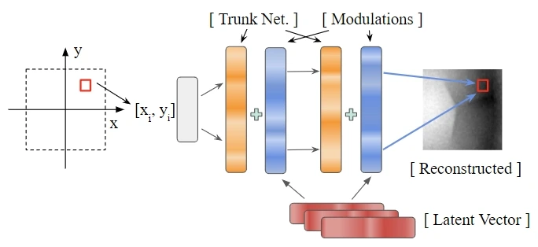

<!-- Generated by scripts/generate.py; edit data/works.json and data/media.json. -->

[← Back to the Awesome index](../../../README.md) · [Interactive website](https://chang-xinhai.github.io/Awesome-RGBDT-Manipulation/?collection=policy&item=tactile-functasets#library)

# Tactile Functasets / TactFunc

Tactile Functasets: Neural Implicit Representations of Tactile Datasets

**2024-09-22 · Preprint · University of Michigan**

**[Paper](https://arxiv.org/abs/2409.14592)** · [Project](https://www.mmintlab.com/tactile-functasets) · [Code](https://github.com/MMintLab/tactile_functasets)

Represents tactile recordings through compact modulations of a meta-learned implicit function, supporting cross-sensor in-hand pose estimation.

*tactile-functasets authors; original paper figure · [Figure source](https://arxiv.org/html/2409.14592#S3.F2) · Original rights retained.*

| Field | Reported value and source scope |
| :-- | :-- |
| Record type | model |
| Model role and downstream interface | Reusable representation or perception model; downstream controllers are separate systems [1](https://arxiv.org/abs/2409.14592)  |
| Model family | Tactile encoder [1](https://arxiv.org/abs/2409.14592)  |
| Model architecture | Meta-learned neural implicit trunk with sample-specific latent modulation vectors; downstream MLP [1](https://arxiv.org/abs/2409.14592)  |
| Model size and component | Not reported [1](https://arxiv.org/abs/2409.14592)  |
| Model inputs | GelSlim or Soft Bubble tactile observations and sample coordinates during implicit fitting [1](https://arxiv.org/abs/2409.14592)  |
| Model outputs | Compact latent modulations, reconstructed tactile signals and downstream in-hand pose estimates [1](https://arxiv.org/abs/2409.14592)  |
| Training method | Meta-learn a shared implicit function; fit per-observation latent variables; optional SGLD or nearest-neighbor inference [1](https://arxiv.org/abs/2409.14592)  |
| Training data and scale | Paired GelSlim and Soft Bubble grasping data from Touch2Touch, using normalized contact-difference images. [1](https://arxiv.org/abs/2409.14592)  |
| Training duration | Not reported [1](https://arxiv.org/abs/2409.14592)  |
| Training hardware | Not reported [1](https://arxiv.org/abs/2409.14592)  |
| Inference setting and runtime | Not reported [1](https://arxiv.org/abs/2409.14592)  |
| Downstream evaluation and scope | Reconstruction and compression, cross-sensor features, and in-hand pose estimation using compact representations. [1](https://arxiv.org/abs/2409.14592)  |
| Observations / modalities | Tactile |
| Evaluation domain | Real world |
| Embodiment |  |
| Release: code | Partial — meta-learning and functaset code public; downstream pose section marked Coming Soon [2](https://www.mmintlab.com/tactile-functasets) [3](https://github.com/MMintLab/tactile_functasets)  |
| Release: weights | Not verified [2](https://www.mmintlab.com/tactile-functasets) [3](https://github.com/MMintLab/tactile_functasets)  |
| Release: data | Not verified [2](https://www.mmintlab.com/tactile-functasets) [3](https://github.com/MMintLab/tactile_functasets)  |
| Release: license | Apache-2.0 source LICENSE; third-party tactile data retains original terms. [2](https://www.mmintlab.com/tactile-functasets) [3](https://github.com/MMintLab/tactile_functasets) [4](https://github.com/MMintLab/tactile_functasets/blob/master/LICENSE)  |
| Release: notes | Code, pretrained encoders and downstream task data are separate artifacts; no policy checkpoint is implied by an encoder release. [2](https://www.mmintlab.com/tactile-functasets) [3](https://github.com/MMintLab/tactile_functasets)  |

**Scope and qualifications**

- Latent fitting can require inference-time optimization; a compact representation is not automatically a one-forward-pass control policy.
- The official README leaves downstream pose instructions as Coming Soon; paper results do not imply a complete current reproduction release.

**Primary evidence**

1. [Original model paper and first submission](https://arxiv.org/abs/2409.14592) — Method, experiments and implementation sections; specifications retain component and evaluation scope.
2. [Official project](https://www.mmintlab.com/tactile-functasets) — Author project; author-reported release scope is distinguished from an executed reproduction.
3. [Official implementation and current release instructions](https://github.com/MMintLab/tactile_functasets) — README and repository files inspected on 2026-10-17.
4. [Actual Apache-2.0 repository license](https://github.com/MMintLab/tactile_functasets/blob/master/LICENSE) — LICENSE fetched independently of README description.
