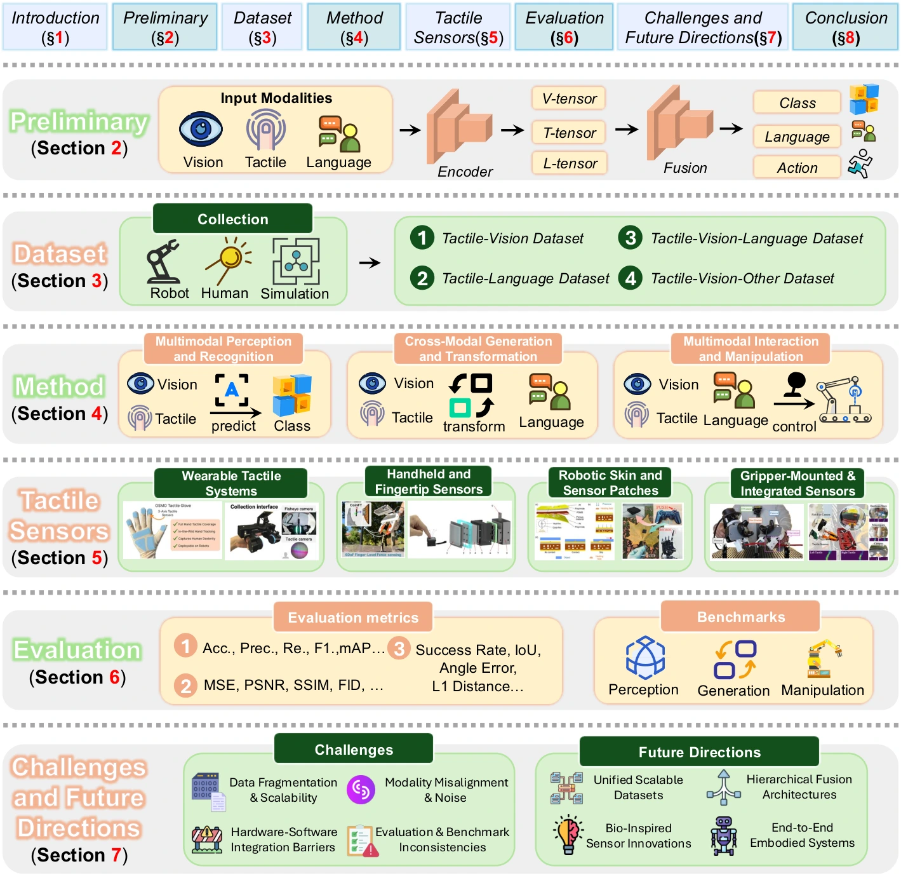

<!-- Generated by scripts/generate.py; edit data/works.json and data/media.json. -->

[← Back to the Awesome index](../../../README.md) · [Interactive website](https://chang-xinhai.github.io/Awesome-RGBDT-Manipulation/?collection=policy&item=tactile-fusion-survey#library)

# Tactile Multimodal Fusion — Survey

Tactile-based Multimodal Fusion in Embodied Intelligence: A Survey of Vision, Language, and Contact-Driven Paradigms

**2026-05-17 · Preprint · Survey · Xi’an Jiaotong University; HKUST(GZ); Nanjing University; Purple Mountain Laboratory; Wuhan University; James Cook University; BUPT; Fudan University; Linkerbot; Swinburne University of Technology**

**[Paper](https://arxiv.org/abs/2605.17336)**

Separates tactile multimodal datasets from perception, cross-modal generation and interactive manipulation methods.

*tactile-fusion-survey authors; original paper figure · [Figure source](https://arxiv.org/html/2605.17336#S1.F1) · Original rights retained.*

| Field | Reported value and source scope |
| :-- | :-- |
| Record type | Survey |
| Review scope | Tactile fusion with at least one additional modality in embodied learning, covering datasets, sensor representations, methods and evaluation through Q1 2026. [1](https://arxiv.org/abs/2605.17336) [2](https://arxiv.org/html/2605.17336)  |
| Organizing taxonomy | Data: tactile–vision, tactile–language, tactile–vision–language, tactile–vision–other · Methods: multimodal perception and recognition · Methods: cross-modal generation and transformation · Methods: multimodal interaction and manipulation [1](https://arxiv.org/abs/2605.17336) [2](https://arxiv.org/html/2605.17336)  |
| Adaptation mechanisms | Supervised and transfer learning · Contrastive shared-space alignment · Curriculum learning · Reinforcement learning and hybrid training [1](https://arxiv.org/abs/2605.17336) [2](https://arxiv.org/html/2605.17336)  |
| Context and evidence | Tactile sensing · Scene vision · Language descriptions/instructions · Additional physical or interaction modalities [1](https://arxiv.org/abs/2605.17336) [2](https://arxiv.org/html/2605.17336)  |
| Evaluation dimensions | Recognition and retrieval accuracy · Generation and alignment metrics · Interaction/task success · Generalization across objects, scenes, sensors and modalities · Dataset annotation and sensing coverage [1](https://arxiv.org/abs/2605.17336) [2](https://arxiv.org/html/2605.17336)  |
| Literature corpus and snapshot | 20-page paper with eight figures; stated literature horizon through the first quarter of 2026. The rendered bibliography is separately available in the citation audit. [1](https://arxiv.org/abs/2605.17336) [2](https://arxiv.org/html/2605.17336)  |
| Literature selection | Collects studies from robotics, computer vision, haptics and multimodal venues, selecting learning-based methods combining touch with another modality; Section II-B6 describes selection scope. [1](https://arxiv.org/abs/2605.17336) [2](https://arxiv.org/html/2605.17336)  |
| Coverage boundaries | A broad narrative overview with limited detail on reproducible search/exclusion decisions. Generated tactile images, property QA and physical closed-loop control have different validation requirements. [1](https://arxiv.org/abs/2605.17336) [2](https://arxiv.org/html/2605.17336)  |
| Review format | Literature review |
| Release: code | Not applicable — survey; no new robot implementation |
| Release: weights | Not applicable — survey |
| Release: data | Not verified — no separate coded corpus linked |
| Release: license | Paper and third-party figures retain their stated original rights |
| Release: notes | Literature inventories and review tables are not robot demonstration data or deployable model weights. |

**Scope and qualifications**

- Survey, not an executable policy or model; deployment modalities, training costs and control rates do not apply.

**Literature trail:** [Reference-to-record mappings and scope decisions](../../../data/survey-source-audit.json). Indexed methods retain their own primary evidence.

**Primary evidence**

1. [Original survey and first submission](https://arxiv.org/abs/2605.17336) — Manuscript structure, tables and bibliography inspected; underlying method specifications require their original paper.
2. [Primary full-text survey and references](https://arxiv.org/html/2605.17336) — Citation extraction preserves original bibliography identities, including background and adjacent resources.
