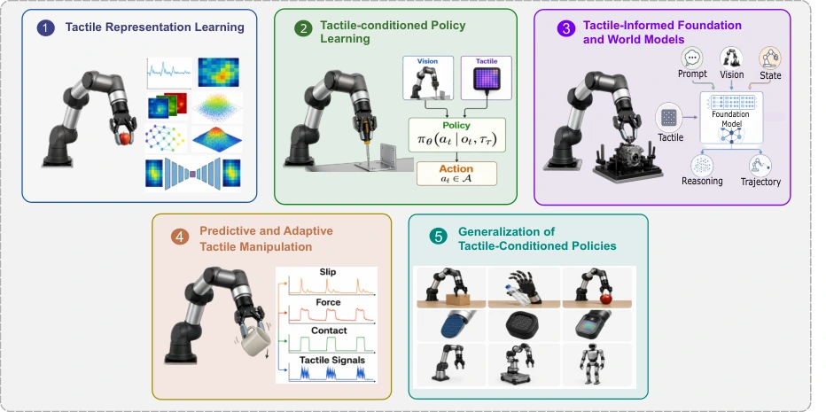

<!-- Generated by scripts/generate.py; edit data/works.json and data/media.json. -->

[← Back to the Awesome index](../../../README.md) · [Interactive website](https://chang-xinhai.github.io/Awesome-RGBDT-Manipulation/?collection=policy&item=tactile-guided-survey#library)

# Tactile-Guided Robot Learning — Survey

Tactile-Guided Robot Learning: From Representation Learning to Foundation Models

**2026-10-14 · Preprint · Survey · University College London; MIT CSAIL; University of Michigan; University of Tokyo**

**[Paper](https://arxiv.org/abs/2610.20134)** · [Project](https://sites.google.com/view/touch-in-robot-learning-review)

Connects tactile representation, executable policies, foundation/world models and adaptation through the functional role of touch in robot learning.

*tactile-guided-survey authors; original paper figure · [Figure source](https://arxiv.org/html/2610.20134#S1.F1) · Original rights retained.*

| Field | Reported value and source scope |
| :-- | :-- |
| Record type | Survey |
| Review scope | Learning-centric tactile manipulation, from reusable representations and language grounding to control and generalization. [1](https://arxiv.org/abs/2610.20134) [2](https://arxiv.org/html/2610.20134)  |
| Organizing taxonomy | Tactile representation learning · Tactile-conditioned policy learning · Tactile-informed foundation and world models · Predictive and adaptive tactile manipulation · Generalization of tactile-conditioned policies [1](https://arxiv.org/abs/2610.20134) [2](https://arxiv.org/html/2610.20134)  |
| Adaptation mechanisms | Offline self-supervised pretraining · Imitation and reinforcement learning · Language/action integration · Predictive and adaptive control · Object, task, sensor, embodiment and sim-to-real transfer [1](https://arxiv.org/abs/2610.20134) [2](https://arxiv.org/html/2610.20134)  |
| Context and evidence | Optical and non-optical tactile readings · Paired vision/language · Interaction history and predicted contact states · Privileged simulation information and real demonstrations [1](https://arxiv.org/abs/2610.20134) [2](https://arxiv.org/html/2610.20134)  |
| Evaluation dimensions | Perceptual representation quality · Policy success and contact-sensitive behavior · Cross-sensor and cross-embodiment transfer · Real-world grounding and adaptation · Data scale and physical observability [1](https://arxiv.org/abs/2610.20134) [2](https://arxiv.org/html/2610.20134)  |
| Literature corpus and snapshot | Narrative review with an author-maintained online literature/resource database; source bibliography extracted independently for citation reconciliation. [1](https://arxiv.org/abs/2610.20134) [2](https://arxiv.org/html/2610.20134)  |
| Literature selection | Functional-role synthesis of tactile-guided skill learning; comparison tables organize learning paradigms and recent tactile foundation/world models. [1](https://arxiv.org/abs/2610.20134) [2](https://arxiv.org/html/2610.20134)  |
| Coverage boundaries | The categories combine encoders, perceptual reasoning and action-generating systems. A shared table does not establish that every model emits robot actions, has a released checkpoint or supports the same sensors. [1](https://arxiv.org/abs/2610.20134) [2](https://arxiv.org/html/2610.20134)  |
| Review format | Literature review |
| Release: code | Not applicable — survey; no new robot implementation |
| Release: weights | Not applicable — survey |
| Release: data | Available — author-maintained literature database [3](https://sites.google.com/view/touch-in-robot-learning-review)  |
| Release: license | Paper and third-party figures retain their stated original rights |
| Release: notes | Literature inventories and review tables are not robot demonstration data or deployable model weights. |

**Scope and qualifications**

- Survey, not an executable policy or model; deployment modalities, training costs and control rates do not apply.

**Literature trail:** [Reference-to-record mappings and scope decisions](../../../data/survey-source-audit.json). Indexed methods retain their own primary evidence.

**Primary evidence**

1. [Original survey and first submission](https://arxiv.org/abs/2610.20134) — Manuscript structure, tables and bibliography inspected; underlying method specifications require their original paper.
2. [Primary full-text survey and references](https://arxiv.org/html/2610.20134) — Citation extraction preserves original bibliography identities, including background and adjacent resources.
3. [Author-maintained review database](https://sites.google.com/view/touch-in-robot-learning-review) — Literature database; no claim of robot training data.
