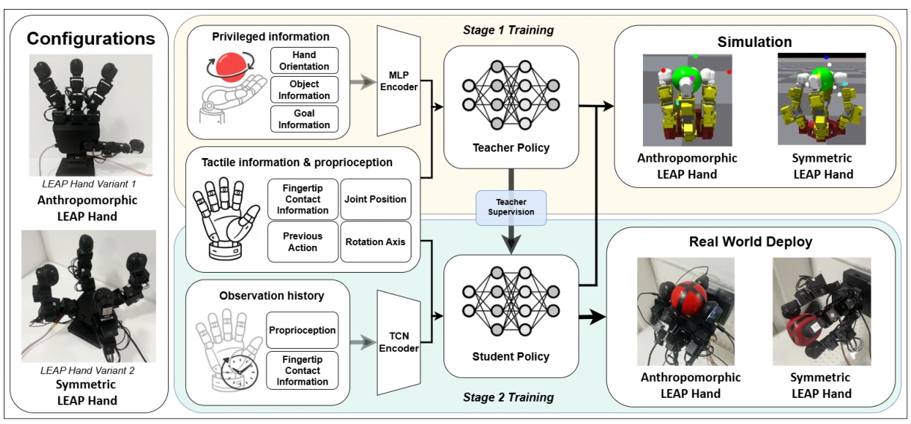

<!-- Generated by scripts/generate.py; edit data/works.json and data/media.json. -->

[← Back to the Awesome index](../../../README.md) · [Interactive website](https://chang-xinhai.github.io/Awesome-RGBDT-Manipulation/?collection=policy&item=tactile-hand-morphology#library)

# Tactile rotation — hand morphology

Tactile In-Hand Object Rotation: A Comparative Study of Hand Morphology in Simulation and Hardware

**2026-10-19 · Preprint · University of Bristol**

**[Paper](https://arxiv.org/abs/2610.26759)**

A shared teacher–student RL protocol compares continuous rotation and contact-load distribution on anthropomorphic and symmetric TacTip-equipped LEAP hands.

*Tactile rotation — hand morphology authors; original rights retained · [Figure source](https://arxiv.org/abs/2610.26759) · Original rights retained.*

| Field | Reported value and source scope |
| :-- | :-- |
| Record type | policy |
| Policy family | Reinforcement learning [1](https://arxiv.org/html/2610.26759)  |
| Base model and architecture | AnyRotate-style PPO teacher, history-TCN latent student and TacTip contact estimators. [1](https://arxiv.org/html/2610.26759)  |
| Model size and component | Not reported [1](https://arxiv.org/html/2610.26759)  |
| Deployment inputs | Joint positions, previous commands, rotation axis and optional fingertip contact/pose/force features. [1](https://arxiv.org/html/2610.26759)  |
| Action outputs and horizon | 16 joint-target increments per LEAP hand, filtered and tracked with PD control. [1](https://arxiv.org/html/2610.26759)  |
| Training method | PPO privileged teacher with curricula/domain randomization; student latent/action distillation on its own rollouts. [1](https://arxiv.org/html/2610.26759)  |
| Training data | Cuboid/ellipsoid simulation objects, system-identification joint traces and TacTip contact calibration. [1](https://arxiv.org/html/2610.26759)  |
| Training duration | Not reported [1](https://arxiv.org/html/2610.26759)  |
| Training hardware | Not reported [1](https://arxiv.org/html/2610.26759)  |
| Inference and control rates | Policy20 Hz; simulation timestep 1/60 s. [1](https://arxiv.org/html/2610.26759)  |
| Evaluation scope | 12 unseen simulation objects across 3 observation conditions;10 hardware objects with varied orientations and contact/load analysis. [1](https://arxiv.org/html/2610.26759)  |
| Observations / modalities | Tactile · Proprioception |
| Evaluation domain | Simulation · Real world |
| Embodiment | Dexterous hand |
| Release: code | Not verified |
| Release: weights | Not verified |
| Release: data | Not verified |
| Release: license | Not verified |
| Release: notes | The inspected primary sources do not establish a public implementation, model checkpoint or dataset download. Paper figures retain their original rights. |

**Scope and qualifications**

- Privileged simulator object/hand information is teacher-only; student estimates its latent from a 30-step deployable history.
- Hardware tactile channels are contact-pose and force estimates from TacTip deformation images, not external scene vision.
- Full/binary/proprioception comparison is simulated; hardware evaluates full-tactile policies on ten objects.

**Primary evidence**

1. [Original full paper, methods and evaluation](https://arxiv.org/html/2610.26759) — Publication date is arXiv v1; implementation and deployment observations are distinguished from training supervision, generated geometry and base-model identity.
