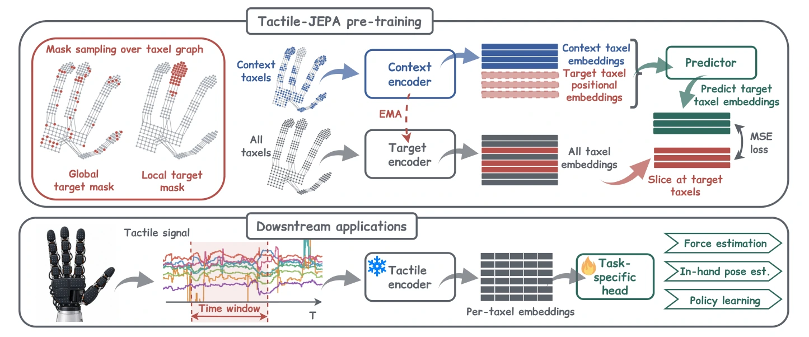

<!-- Generated by scripts/generate.py; edit data/works.json and data/media.json. -->

[← Back to the Awesome index](../../../README.md) · [Interactive website](https://chang-xinhai.github.io/Awesome-RGBDT-Manipulation/?collection=policy&item=tactile-jepa#library)

# Tactile-JEPA

Tactile-JEPA: Topology-Aware Self-Supervised Representation Learning for Distributed Tactile Sensors

**2026-09-21 · Preprint · Sber AI; Skoltech; HSE University**

**[Paper](https://arxiv.org/abs/2609.24385)** · [Code](https://github.com/E-Kovtun/tactile) · [Weights](https://huggingface.co/Tactile-JEPA)

Predicts masked electronic-skin embeddings using local/global masks sampled on the sensor graph, with topology-aware representations across hand skins.

*tactile-jepa authors; original paper figure · [Figure source](https://arxiv.org/html/2609.24385#S1.F2) · Original rights retained.*

| Field | Reported value and source scope |
| :-- | :-- |
| Record type | model |
| Model role and downstream interface | Reusable representation or perception model; downstream controllers are separate systems [1](https://arxiv.org/abs/2609.24385) [4](https://huggingface.co/Tactile-JEPA)  |
| Model family | Tactile encoder [1](https://arxiv.org/abs/2609.24385) [4](https://huggingface.co/Tactile-JEPA)  |
| Model architecture | ViT-Tiny-style encoder (12 blocks, width 192, 3 heads) and 4-block predictor; taxel graph controls masking [1](https://arxiv.org/abs/2609.24385) [4](https://huggingface.co/Tactile-JEPA)  |
| Model size and component | Not reported [1](https://arxiv.org/abs/2609.24385) [4](https://huggingface.co/Tactile-JEPA)  |
| Model inputs | Short multichannel taxel time windows, taxel connectivity/coordinates where available [1](https://arxiv.org/abs/2609.24385) [4](https://huggingface.co/Tactile-JEPA)  |
| Model outputs | Per-taxel latent tactile features for classification, force/pose estimation or a separate visuotactile action decoder [1](https://arxiv.org/abs/2609.24385) [4](https://huggingface.co/Tactile-JEPA)  |
| Training method | EMA teacher/student joint-embedding prediction; local and global graph masks; frozen-feature downstream probes [1](https://arxiv.org/abs/2609.24385) [4](https://huggingface.co/Tactile-JEPA)  |
| Training data and scale | Sparsh-skin/Xela/Allegro (1.7M frames,4.6h), tactile socks (298K,5.9h), and DECO-50 Inspire-hand data; policy experiment is Task 4 Assembly subset [1](https://arxiv.org/abs/2609.24385) [4](https://huggingface.co/Tactile-JEPA)  |
| Training duration | Pretraining: Xela 6.1h; socks action 0.7h / pose 2.0h; DECO 5.5h; task-specific reported timings [1](https://arxiv.org/abs/2609.24385) [4](https://huggingface.co/Tactile-JEPA)  |
| Training hardware | 4 NVIDIA A100 80GB for pretraining; downstream heads on 1 GPU [1](https://arxiv.org/abs/2609.24385) [4](https://huggingface.co/Tactile-JEPA)  |
| Inference setting and runtime | Not reported [1](https://arxiv.org/abs/2609.24385) [4](https://huggingface.co/Tactile-JEPA)  |
| Downstream evaluation and scope | Force, object identity and in-hand pose probes; human socks activity/pose and DECO assembly action prediction are distinct evaluation settings. [1](https://arxiv.org/abs/2609.24385) [4](https://huggingface.co/Tactile-JEPA)  |
| Observations / modalities | Tactile |
| Evaluation domain | Real world |
| Embodiment | Allegro hand · Bimanual Inspire hands |
| Release: code | Available [2](https://github.com/E-Kovtun/tactile) [4](https://huggingface.co/Tactile-JEPA)  |
| Release: weights | Available — official download link [2](https://github.com/E-Kovtun/tactile) [4](https://huggingface.co/Tactile-JEPA)  |
| Release: data | Not verified [2](https://github.com/E-Kovtun/tactile) [4](https://huggingface.co/Tactile-JEPA)  |
| Release: license | CC BY-NC 4.0 repository LICENSE.md and official model cards; third-party datasets keep original licenses [2](https://github.com/E-Kovtun/tactile) [3](https://github.com/E-Kovtun/tactile/blob/main/LICENSE.md) [4](https://huggingface.co/Tactile-JEPA)  |
| Release: notes | Code, pretrained encoders and downstream task data are separate artifacts; no policy checkpoint is implied by an encoder release. [2](https://github.com/E-Kovtun/tactile) [4](https://huggingface.co/Tactile-JEPA)  |

**Scope and qualifications**

- Repository README still lists pretrained-model links as TBD, but the official Tactile-JEPA Hugging Face organization exposes four model releases.
- Socks experiments concern human feet; they are not additional robot manipulation tasks.
- DECO policy experiment learns an action decoder on top of features; the representation model is not counted as a standalone executable policy.

**Primary evidence**

1. [Original model paper and first submission](https://arxiv.org/abs/2609.24385) — Method, experiments and implementation sections; specifications retain component and evaluation scope.
2. [Official implementation and current release instructions](https://github.com/E-Kovtun/tactile) — README and repository files inspected on 2026-10-17.
3. [Repository license file](https://github.com/E-Kovtun/tactile/blob/main/LICENSE.md) — Applies to repository scope; model/data/base-model terms can differ.
4. [Official organization with four released encoder checkpoints](https://huggingface.co/Tactile-JEPA) — Official artifact metadata inspected separately from code.
