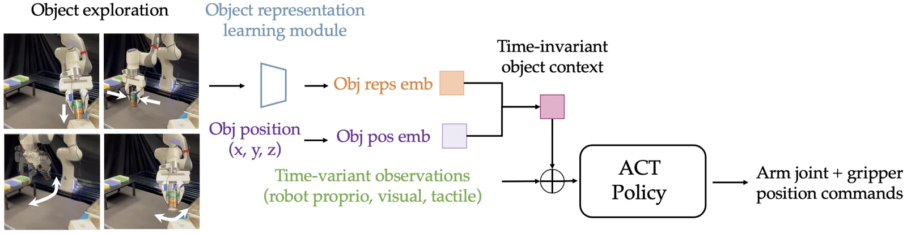

<!-- Generated by scripts/generate.py; edit data/works.json and data/media.json. -->

[← Back to the Awesome index](../../../README.md) · [Interactive website](https://chang-xinhai.github.io/Awesome-RGBDT-Manipulation/?collection=policy&item=tactile-object-centric#library)

# Object-centric Tactile Interactive Perception

Learning with Object-centric Representations of Tactile Interactive Perception for Robot Manipulation

**2026-09-27 · CoRL2026 · Carnegie Mellon University**

**[Paper](https://arxiv.org/abs/2609.33235)** · [Project](https://xinyiyxyx.github.io/tactile-object-centric/)

Active tactile exploration infers object properties as semantic context for subsequent reactive manipulation.

*Object-centric Tactile Interactive Perception authors · [Figure source](https://arxiv.org/abs/2609.33235) · Original rights retained.*

| Field | Reported value and source scope |
| :-- | :-- |
| Record type | policy |
| Policy family | Diffusion [1](https://arxiv.org/abs/2609.33235)  |
| Base model and architecture | Tactile/force/velocity encoder with top-K token selection and language-aligned object context; ACT downstream policy. [1](https://arxiv.org/abs/2609.33235)  |
| Model size and component | Not reported [1](https://arxiv.org/abs/2609.33235)  |
| Deployment inputs | Exploration vibrotactile contact-microphone signals, forces and end-effector velocity; downstream vision and optional live vibrotactile feedback. [1](https://arxiv.org/abs/2609.33235)  |
| Action outputs and horizon | Object-context-conditioned ACT action chunks for grasp/placement, pouring and dexterous box opening. [1](https://arxiv.org/abs/2609.33235)  |
| Training method | Learn physical-property representations from exploration; behavior-clone policies using inferred tactile/text context, with oracle labels separated. [1](https://arxiv.org/abs/2609.33235)  |
| Training data | 136exploration trajectories over 23 property configurations; 180 rearrangement, 80 pouring and 50 box-opening demonstrations. [1](https://arxiv.org/abs/2609.33235)  |
| Training duration | Not reported [1](https://arxiv.org/abs/2609.33235)  |
| Training hardware | Not reported [1](https://arxiv.org/abs/2609.33235)  |
| Inference and control rates | ACT predicts 64-step chunks and executes 32 actions at 15 Hz. [1](https://arxiv.org/abs/2609.33235)  |
| Evaluation scope | Three real tasks on Franka gripper and DeltaHand. Aggregate text-context+touch policy 154/167 seen and 43/64 unseen trials; baseline 69/167 and 12/64. [1](https://arxiv.org/abs/2609.33235)  |
| Observations / modalities | RGB · Tactile · Force/Torque · Proprioception |
| Evaluation domain | Real world |
| Embodiment | Parallel-jaw gripper · Dexterous hand |
| Release: code | Not released [2](https://xinyiyxyx.github.io/tactile-object-centric/)  |
| Release: weights | Not verified [2](https://xinyiyxyx.github.io/tactile-object-centric/)  |
| Release: data | Not verified [2](https://xinyiyxyx.github.io/tactile-object-centric/)  |
| Release: license | Not verified [2](https://xinyiyxyx.github.io/tactile-object-centric/)  |
| Release: notes | Official project marks Code coming soon; no author checkpoint or complete dataset release verified. [2](https://xinyiyxyx.github.io/tactile-object-centric/)  |

**Scope and qualifications**

- Tactile evidence is vibrotactile sensing, not gel-image deformation or external scene depth.
- Unseen-object manipulation split differs from representation-learning held-out objects.
- Exploration-derived semantic context is not a general-purpose online coding agent.

**Primary evidence**

1. [Primary manuscript and first-submission history](https://arxiv.org/abs/2609.33235) — Current primary manuscript reviewed; first-public date uses arXiv v1. Observations, training privileges and deployed interfaces retain their separate scopes.
2. [Official project source and actual artifact inventory](https://xinyiyxyx.github.io/tactile-object-centric/) — Reviewed 26 October 2026. Availability and licensing apply only to the described released component, independently of paper results.
