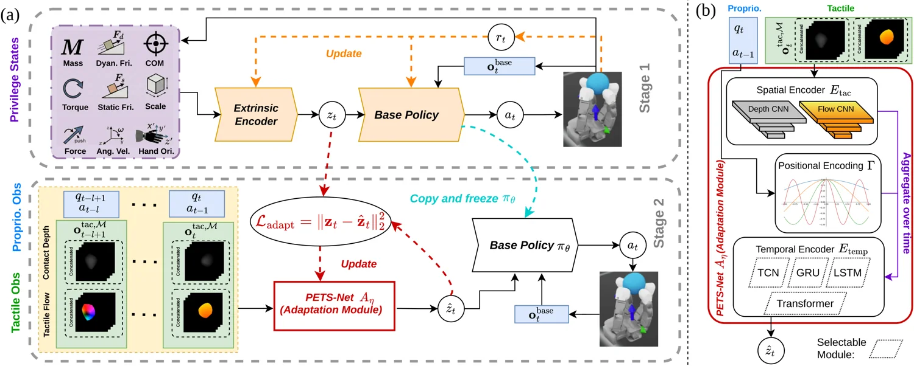

<!-- Generated by scripts/generate.py; edit data/works.json and data/media.json. -->

[← Back to the Awesome index](../../../README.md) · [Interactive website](https://chang-xinhai.github.io/Awesome-RGBDT-Manipulation/?collection=policy&item=tactilelab#library)

# TactileLab

TactileLab: Sim-to-Real Dexterous Robot Manipulation with Efficient Shear-Sensitive Tactile Simulation

**2026-11-05 · Preprint · Not reported**

**[Paper](https://arxiv.org/abs/2611.07881)** · [Project](https://yijionglin.github.io/tactilelab/)

Shear-sensitive tactile simulation and real-to-sim tactile translation enable sim-to-real manipulation.

*TactileLab authors · [Figure source](https://yijionglin.github.io/tactilelab/) · Original rights retained.*

| Field | Reported value and source scope |
| :-- | :-- |
| Record type | policy |
| Policy family | Multimodal tactile RL [1](https://arxiv.org/html/2611.07881v1)  |
| Base model and architecture | See original paper [1](https://arxiv.org/html/2611.07881v1)  |
| Model size and component | Not reported [1](https://arxiv.org/html/2611.07881v1)  |
| Deployment inputs | Simulated tactile flow and contact depth with robot state histories; real tactile images translated to simulated representations. [1](https://arxiv.org/html/2611.07881v1)  |
| Action outputs and horizon | Robot actions for dexterous in-hand and bimanual manipulation. [1](https://arxiv.org/html/2611.07881v1)  |
| Training method | Reinforcement learning in Isaac Lab with real-to-sim tactile translation. [1](https://arxiv.org/html/2611.07881v1)  |
| Training data | See original paper [1](https://arxiv.org/html/2611.07881v1)  |
| Training duration | Not reported [1](https://arxiv.org/html/2611.07881v1)  |
| Training hardware | Not reported [1](https://arxiv.org/html/2611.07881v1)  |
| Inference and control rates | Not reported [1](https://arxiv.org/html/2611.07881v1)  |
| Evaluation scope | Dual-arm object following and dexterous in-hand manipulation in simulation and real robot experiments. [1](https://arxiv.org/html/2611.07881v1)  |
| Observations / modalities | Tactile · Proprioception |
| Evaluation domain | Simulation · Real world |
| Embodiment |  |
| Release: code | Not verified |
| Release: weights | Not verified |
| Release: data | Not verified |
| Release: license | Not verified |
| Release: notes | Model, source and data availability are tracked separately. |

**Scope and qualifications**

- Simulated optical flow captures shear-related contact motion under a no-slip modelling assumption; it is not direct force measurement.

**Primary evidence**

1. [Author paper and first submission](https://arxiv.org/html/2611.07881v1)
