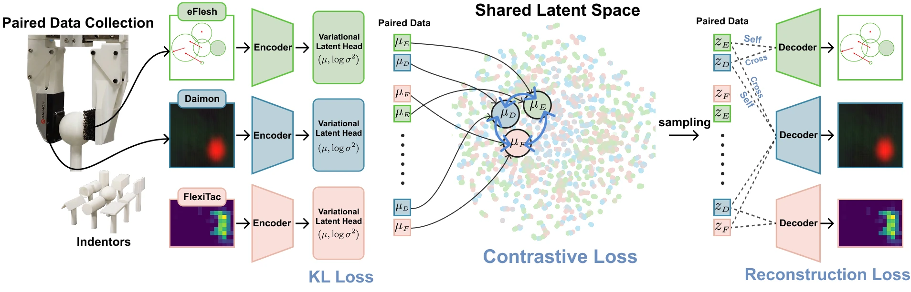

<!-- Generated by scripts/generate.py; edit data/works.json and data/media.json. -->

[← Back to the Awesome index](../../../README.md) · [Interactive website](https://chang-xinhai.github.io/Awesome-RGBDT-Manipulation/?collection=policy&item=tactx#library)

# TactX

TactX: Learning Shared Tactile Representations Across Diverse Sensors

**2026-06-30 · arXiv preprint 2026 (submitted to CoRL 2026) · UC San Diego; Seoul National University; Amazon FAR**

**[Paper](https://arxiv.org/abs/2606.31236)** · [Project](https://tactx-project.github.io/)

Sensor-specific encoders map optical, magnetic and resistive touch to one transferable latent, evaluated through frozen-encoder ACT policy transfer.

*TactX authors · [Figure source](https://arxiv.org/abs/2606.31236) · Original rights retained.*

| Field | Reported value and source scope |
| :-- | :-- |
| Record type | model |
| Model role and downstream interface | Cross-sensor tactile representation [1](https://arxiv.org/abs/2606.31236)  |
| Model family | Tactile encoder [1](https://arxiv.org/abs/2606.31236)  |
| Model architecture | Sensor-specific ResNet-18, MLP or residual-CNN encoders/decoders with a shared 16D variational latent; downstream ACT uses frozen tactile latents. [1](https://arxiv.org/abs/2606.31236)  |
| Model size and component | Not reported in the inspected primary manuscript [1](https://arxiv.org/abs/2606.31236)  |
| Model inputs | Daimon optical contact composites, eFlesh magnetic vectors or FlexiTac resistive grids; paired quasi-static contacts supply training alignment. [1](https://arxiv.org/abs/2606.31236)  |
| Model outputs | Shared 16D tactile posterior mean; downstream ACT separately outputs robot action chunks. [1](https://arxiv.org/abs/2606.31236)  |
| Training method | Joint pairwise contrastive alignment, self/cross reconstruction and KL regularization; encoders remain frozen for downstream imitation learning. [1](https://arxiv.org/abs/2606.31236)  |
| Training data and scale | Representation: 2,670 paired-contact trajectories / approximately 145K frames across ten printed objects and six mounting configurations. Downstream ACT: approximately 50 GELLO demonstrations per task. [1](https://arxiv.org/abs/2606.31236)  |
| Training duration | Representation: 300 epochs. Downstream ACT: 50K steps with 64-step chunks. Wall-clock times not reported. [1](https://arxiv.org/abs/2606.31236)  |
| Training hardware | Not reported in the inspected primary manuscript [1](https://arxiv.org/abs/2606.31236)  |
| Inference setting and runtime | Not reported in the inspected primary manuscript [1](https://arxiv.org/abs/2606.31236)  |
| Downstream evaluation and scope | Sensor invariance, transitive alignment and object/contact preservation; frozen-latent ACT evaluated on pick-and-place, plug insertion, board wiping and reorientation, plus a color-shift pick-and-place setting. [1](https://arxiv.org/abs/2606.31236)  |
| Observations / modalities | Tactile |
| Evaluation domain | Real robot |
| Embodiment |  |
| Release: code | Not verified [2](https://tactx-project.github.io/)  |
| Release: weights | Not verified [2](https://tactx-project.github.io/)  |
| Release: data | Not verified [2](https://tactx-project.github.io/)  |
| Release: license | Not verified [2](https://tactx-project.github.io/)  |
| Release: notes | Official project advertises code, dataset and checkpoints, but its inspected resource elements have no usable download destinations. Public artifacts remain unverified. [2](https://tactx-project.github.io/)  |

**Scope and qualifications**

- Primary contribution is the transferable tactile representation; ACT is a downstream control probe, so this record is counted as a Model.
- The 16D tactile latent differs from ACT’s 32D action-CVAE latent; sensors are sampled separately from the action-chunk horizon.

**Primary evidence**

1. [Original manuscript and first public submission history](https://arxiv.org/abs/2606.31236) — Full author method, evaluation and appendix reviewed; downstream controller probes are distinguished from the reusable model.
2. [Official author project and current artifact destinations](https://tactx-project.github.io/) — A project button or advertised artifact does not establish a downloadable release; paper-version differences are retained.
