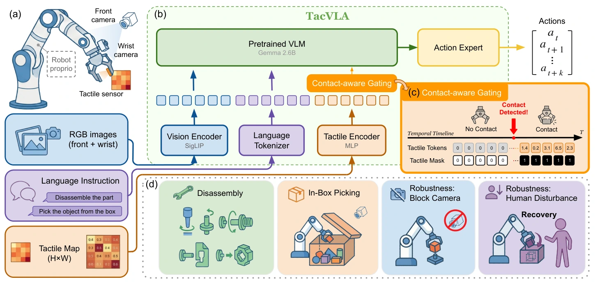

<!-- Generated by scripts/generate.py; edit data/works.json and data/media.json. -->

[← Back to the Awesome index](../../../README.md) · [Interactive website](https://chang-xinhai.github.io/Awesome-RGBDT-Manipulation/?collection=policy&item=tacvla#library)

# TacVLA

TacVLA: Contact-Aware Tactile Fusion for Robust Vision-Language-Action Manipulation

**2026-03-13 · Preprint · Purdue University / Istituto Italiano di Tecnologia / Università di Genova**

**[Paper](https://arxiv.org/abs/2603.12665)** · [Project](https://sites.google.com/view/tacvla)

A contact-gated tactile prefix adapts π0.5 to constrained disassembly and picking under occlusion.

*TacVLA authors · [Figure source](https://arxiv.org/abs/2603.12665) · Original rights retained.*

| Field | Reported value and source scope |
| :-- | :-- |
| Record type | policy |
| Policy family | VLA [1](https://arxiv.org/abs/2603.12665)  |
| Base model and architecture | OpenPI pi05_base (π0.5) with SigLIP visual encoding and a flow-matching action expert. [1](https://arxiv.org/abs/2603.12665)  |
| Model size and component | Not reported for the augmented policy. [1](https://arxiv.org/abs/2603.12665)  |
| Deployment inputs | Front and wrist RGB, instruction, robot state and one finger-mounted 15×8 array of normal contact force readings; tactile encoder produces 36 tokens. [1](https://arxiv.org/abs/2603.12665)  |
| Action outputs and horizon | Continuous robot action chunks from a flow-matching expert; action dimensionality Not reported. [1](https://arxiv.org/abs/2603.12665)  |
| Training method | Task-specific LoRA fine-tuning for 10k steps with the tactile encoder jointly optimized; threshold-based contact detection gates tactile embeddings and attention. [1](https://arxiv.org/abs/2603.12665)  |
| Training data | Five real tasks, 50 teleoperated demonstrations each: tight-shaft removal, press-clip removal, shaft rotation, slide-pull disassembly and in-box picking. All streams recorded at 10 Hz. [1](https://arxiv.org/abs/2603.12665)  |
| Training duration | 10,000 gradient steps per task; wall-clock time Not reported. [1](https://arxiv.org/abs/2603.12665)  |
| Training hardware | Not reported. [1](https://arxiv.org/abs/2603.12665)  |
| Inference and control rates | Synchronized demonstrations at 10 Hz; achieved policy control frequency Not reported. [1](https://arxiv.org/abs/2603.12665)  |
| Evaluation scope | Franka Panda with one 120-taxel normal-force array and two RGB cameras; 20 trials per task, plus blocked-camera disassembly and qualitative human disturbance recovery. [1](https://arxiv.org/abs/2603.12665)  |
| Observations / modalities | RGB · Tactile · Pressure · Proprioception · Language |
| Evaluation domain | Real world |
| Embodiment | Parallel-jaw gripper |
| Release: code | Not verified [2](https://sites.google.com/view/tacvla)  |
| Release: weights | Not verified [2](https://sites.google.com/view/tacvla)  |
| Release: data | Not verified [2](https://sites.google.com/view/tacvla)  |
| Release: license | Not verified [2](https://sites.google.com/view/tacvla)  |
| Release: notes | No retrievable official policy code/checkpoint/data release was verified. [2](https://sites.google.com/view/tacvla)  |

**Scope and qualifications**

- Reviewed arXiv v4; original date remains 2026-03-13.
- Fixed tactile-token topology is gated by a binary contact heuristic; it does not dynamically add/remove tokens.
- No measured depth is reported for TacVLA, irrespective of its 3D-Diffusion-Policy baseline.

**Primary evidence**

1. [Original paper and reviewed full text](https://arxiv.org/abs/2603.12665) — Full primary text, including available supplementary implementation details; first public date retained separately from reviewed revision.
2. [Official author project](https://sites.google.com/view/tacvla) — Current project links and release claims checked independently of paper prose.
