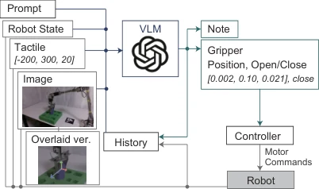

<!-- Generated by scripts/generate.py; edit data/works.json and data/media.json. -->

[← Back to the Awesome index](../../../README.md) · [Interactive website](https://chang-xinhai.github.io/Awesome-RGBDT-Manipulation/?collection=policy&item=taczero#library)

# TacZero

TacZero: Training-Free Peg Insertion Using a General-Purpose Vision-Language Model with Tactile Feedback

**2026-10-06 · arXiv preprint · OMRON SINIC X**

**[Paper](https://arxiv.org/abs/2610.07621)** · [Project](https://omron-sinicx.github.io/taczero/)

Uses a frozen general-purpose VLM to interpret tactile observations and choose insertion actions.

*Taczero authors; original rights retained. · [Figure source](https://arxiv.org/html/2610.07621v1) · Original rights retained.*

| Field | Reported value and source scope |
| :-- | :-- |
| Record type | policy |
| Policy family | Hybrid [2](https://arxiv.org/html/2610.07621v1)  |
| Base model and architecture | GPT-6 Astra via API with structured robot tools; no task-specific VLM weight updates. [2](https://arxiv.org/html/2610.07621v1)  |
| Model size and component | Not reported [2](https://arxiv.org/html/2610.07621v1)  |
| Deployment inputs | Task instruction, RGB workspace image, robot state and three-axis fingertip tactile responses, supplied numerically or graphically. [2](https://arxiv.org/html/2610.07621v1)  |
| Action outputs and horizon | Absolute XYZ end-effector targets and gripper commands with a fixed end-effector orientation. [2](https://arxiv.org/html/2610.07621v1)  |
| Training method | Frozen-VLM action selection using observation/action history. [2](https://arxiv.org/html/2610.07621v1)  |
| Training data | Not applicable — no additional tactile/manipulation training. [2](https://arxiv.org/html/2610.07621v1)  |
| Training duration | Not applicable [2](https://arxiv.org/html/2610.07621v1)  |
| Training hardware | Not applicable — hosted API inference [2](https://arxiv.org/html/2610.07621v1)  |
| Inference and control rates | Sequential API-mediated action selection; API waiting time and action execution time are reported separately, not a real-time tactile control rate. [2](https://arxiv.org/html/2610.07621v1)  |
| Evaluation scope | Physical cylindrical and square peg insertion with numerical/graphical tactile variants. [2](https://arxiv.org/html/2610.07621v1)  |
| Observations / modalities | RGB · Tactile · Proprioception · Language |
| Evaluation domain | Real world |
| Embodiment | Parallel-jaw gripper |
| Release: code | Not verified [3](https://omron-sinicx.github.io/taczero/)  |
| Release: weights | Not verified [3](https://omron-sinicx.github.io/taczero/)  |
| Release: data | Not verified [3](https://omron-sinicx.github.io/taczero/)  |
| Release: license | Not verified [3](https://omron-sinicx.github.io/taczero/)  |
| Release: notes | Paper and public presentation verified; no implementation, weight or data release is inferred from a publication or demonstration. [3](https://omron-sinicx.github.io/taczero/)  |

**Scope and qualifications**

- The overhead RGB-D camera supplies RGB to the VLM; no depth stream is claimed as a VLM input.
- One action is followed by an API wait; contact changes cannot trigger immediate VLM-directed correction during that interval.

**Primary evidence**

1. [Canonical author manuscript and arXiv submission history](https://arxiv.org/abs/2610.07621) — Date retains the initial v1 submission, independently of revisions or current artifact releases.
2. [Full author paper: method, observations and evaluation scope](https://arxiv.org/html/2610.07621v1) — Physical sensors, predicted signals, training labels and policy inputs are recorded separately; undisclosed quantities remain unknown.
3. [Official paper-linked project page; release review on 19 October 2026](https://omron-sinicx.github.io/taczero/) — Current artifacts are checked separately from paper experiments. A project-only link is not proof of an implementation release.
