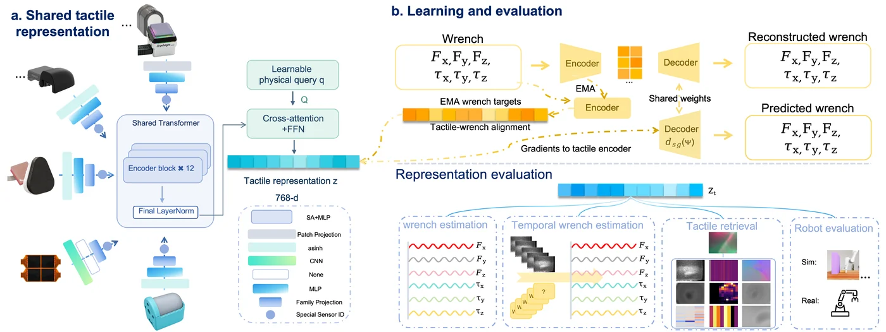

<!-- Generated by scripts/generate.py; edit data/works.json and data/media.json. -->

[← Back to the Awesome index](../../../README.md) · [Interactive website](https://chang-xinhai.github.io/Awesome-RGBDT-Manipulation/?collection=policy&item=taf-foundation#library)

# TaF-Foundation

TaF-Foundation: Wrench-Grounded Cross-Sensor Tactile Representations

**2026-11-16 · Preprint · ShanghaiTech University and collaborators**

**[Paper](https://arxiv.org/abs/2611.20718)** · [Project](https://mrjiangjm.github.io/TaF-Foundation/)

Uses a common six-axis wrench target to align touch features from sensors with different transduction principles.

*TaF-Foundation authors · [Figure source](https://arxiv.org/html/2611.20718v1) · Original rights retained.*

| Field | Reported value and source scope |
| :-- | :-- |
| Record type | model |
| Model role and downstream interface | Cross-sensor tactile representation [1](https://arxiv.org/html/2611.20718)  |
| Model family | Wrench-supervised tactile encoder [1](https://arxiv.org/html/2611.20718)  |
| Model architecture | Sensor-specific adapters and a shared feature extractor [1](https://arxiv.org/html/2611.20718)  |
| Model size and component | Not reported [1](https://arxiv.org/html/2611.20718)  |
| Model inputs | Native tactile signals from heterogeneous sensors. [1](https://arxiv.org/html/2611.20718)  |
| Model outputs | Continuous tactile features and a wrench reconstruction head at training. [1](https://arxiv.org/html/2611.20718)  |
| Training method | Shared six-dimensional wrench targets provide physically aligned supervision. [1](https://arxiv.org/html/2611.20718)  |
| Training data and scale | More than 100 million synchronized touch/wrench observations across 24 sensors and four sensing families; values count observations, not trajectories. [1](https://arxiv.org/html/2611.20718)  |
| Training duration | Not reported [1](https://arxiv.org/html/2611.20718)  |
| Training hardware | Not reported [1](https://arxiv.org/html/2611.20718)  |
| Inference setting and runtime | Encode native tactile signals with sensor-specific input adapters and a common backbone. [1](https://arxiv.org/html/2611.20718)  |
| Downstream evaluation and scope | Held-out tactile sensing/transfer and downstream robot manipulation experiments. [1](https://arxiv.org/html/2611.20718)  |
| Observations / modalities | Tactile |
| Evaluation domain | Real world |
| Embodiment |  |
| Release: code | Not verified [2](https://mrjiangjm.github.io/TaF-Foundation/)  |
| Release: weights | Not verified [2](https://mrjiangjm.github.io/TaF-Foundation/)  |
| Release: data | Dataset described; public file access not verified [2](https://mrjiangjm.github.io/TaF-Foundation/)  |
| Release: license | Not verified [2](https://mrjiangjm.github.io/TaF-Foundation/)  |
| Release: notes | Author portal provides the paper and demonstrations. Downloadable encoder weights, acquisition files and training corpus were not verified. [2](https://mrjiangjm.github.io/TaF-Foundation/)  |

**Scope and qualifications**

- Wrench labels come from synchronized force/torque supervision during pretraining. The encoder maps native tactile signals to features and does not require co-located source–target tactile pairs.
- The shared encoder and downstream TaF-Policy experiments have distinct roles.

**Primary evidence**

1. [Primary paper and evaluated setting](https://arxiv.org/html/2611.20718)
2. [Author project and artifact status](https://mrjiangjm.github.io/TaF-Foundation/)
