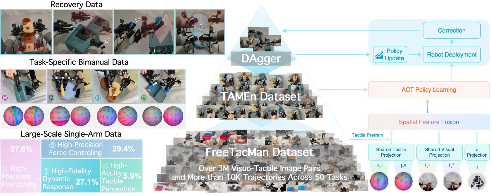

<!-- Generated by scripts/generate.py; edit data/works.json and data/media.json. -->

[← Back to the Awesome index](../../../README.md) · [Interactive website](https://chang-xinhai.github.io/Awesome-RGBDT-Manipulation/?collection=policy&item=tamen#library)

# TAMEn

TAMEn: Tactile-Aware Manipulation Engine for Closed-Loop Data Collection in Contact-Rich Tasks

**2026-04-08 · Preprint · Fudan University / Shanghai Innovation Institute / OpenDriveLab, HKU / Shanghai Jiao Tong University and collaborators**

**[Paper](https://arxiv.org/abs/2604.07335)** · [Project](https://opendrivelab.com/TAMEn)

Feasibility-aware bimanual data collection and tactile recovery interventions refine contact-rich policies.

*TAMEn: Tactile-Aware Manipulation Engine for Closed-Loop Data Collection in Contact-Rich Tasks authors · [Figure source](https://arxiv.org/abs/2604.07335) · Original rights retained.*

| Field | Reported value and source scope |
| :-- | :-- |
| Record type | policy |
| Policy family | ACT [1](https://arxiv.org/abs/2604.07335)  |
| Base model and architecture | ACT with separate Res Net 18 encoders, 4-layer encoder/7-layer decoder; contrastive tactile pretraining. [1](https://arxiv.org/abs/2604.07335)  |
| Model size and component | Not reported [1](https://arxiv.org/abs/2604.07335)  |
| Deployment inputs | Two wrist RGB views and two tactile observations. [1](https://arxiv.org/abs/2604.07335)  |
| Action outputs and horizon | 16 Ddual-arm joint/gripper commands. [1](https://arxiv.org/abs/2604.07335)  |
| Training method | Tactile representation pretraining, supervised bimanual imitation and DAgger-style AR recovery refinement. [1](https://arxiv.org/abs/2604.07335)  |
| Training data | Free Tac Man base&gt;10k trajectories/50 tasks; separate task-specific bimanual demonstrations and recovery interventions. [1](https://arxiv.org/abs/2604.07335)  |
| Training duration | Not reported [1](https://arxiv.org/abs/2604.07335)  |
| Training hardware | Not reported [1](https://arxiv.org/abs/2604.07335)  |
| Inference and control rates | Not reported [1](https://arxiv.org/abs/2604.07335)  |
| Evaluation scope | Four real bimanual contact-rich tasks with nominal/recovery ablation. [1](https://arxiv.org/abs/2604.07335)  |
| Observations / modalities | RGB · Tactile · Proprioception |
| Evaluation domain | Real world |
| Embodiment | Parallel-jaw gripper · Bimanual |
| Release: code | Not verified [2](https://opendrivelab.com/TAMEn)  |
| Release: weights | Not verified [2](https://opendrivelab.com/TAMEn)  |
| Release: data | Not verified [2](https://opendrivelab.com/TAMEn)  |
| Release: license | Not verified [2](https://opendrivelab.com/TAMEn)  |
| Release: notes | Original paper reviewed; claimed future releases are not treated as currently available. [2](https://opendrivelab.com/TAMEn)  |

**Scope and qualifications**

- Reused Free Tac Man prior and new bimanual/recovery data are distinct stages, not one uniform dataset.

**Primary evidence**

1. [Original paper and supplementary implementation details](https://arxiv.org/abs/2604.07335) — Primary full text reviewed; dataset, deployment modalities and training-only privileges are scoped separately.
2. [Official author project](https://opendrivelab.com/TAMEn) — Live artifact status reviewed separately from paper claims.
