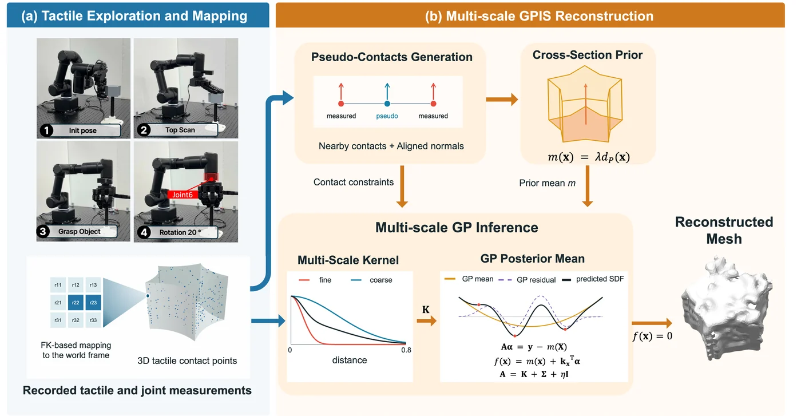

<!-- Generated by scripts/generate.py; edit data/works.json and data/media.json. -->

[← Back to the Awesome index](../../../README.md) · [Interactive website](https://chang-xinhai.github.io/Awesome-RGBDT-Manipulation/?collection=policy&item=taptactouch#library)

# TapTacTouch

TapTacTouch: Shape Completion from Sparse Tactile Contacts with Geometric Priors

**2026-11-18 · Preprint · Gachon University and collaborators**

**[Paper](https://arxiv.org/abs/2611.24207)**

Reconstructs 3D object meshes from sparse physical fingertip contacts without camera input or a pretrained shape model.

*TapTacTouch authors · [Figure source](https://arxiv.org/html/2611.24207v1) · Original rights retained.*

| Field | Reported value and source scope |
| :-- | :-- |
| Record type | model |
| Model role and downstream interface | Tactile-only object shape completion [1](https://arxiv.org/html/2611.24207)  |
| Model family | Multi-scale Gaussian process implicit surface [1](https://arxiv.org/html/2611.24207)  |
| Model architecture | Model-free geometric fit [1](https://arxiv.org/html/2611.24207)  |
| Model size and component | Not reported [1](https://arxiv.org/html/2611.24207)  |
| Model inputs | Sparse fingertip pressure and robot kinematics transformed into 3D contact points. [1](https://arxiv.org/html/2611.24207)  |
| Model outputs | Implicit surface and reconstructed object mesh. [1](https://arxiv.org/html/2611.24207)  |
| Training method | No model training; contact confidence, pseudo-surface constraints and observation-derived geometric priors guide fitting. [1](https://arxiv.org/html/2611.24207)  |
| Training data and scale | Not applicable for model training. [1](https://arxiv.org/html/2611.24207)  |
| Training duration | Not reported [1](https://arxiv.org/html/2611.24207)  |
| Training hardware | Not reported [1](https://arxiv.org/html/2611.24207)  |
| Inference setting and runtime | Fuse sparse contacts and use a multi-scale GP implicit surface to extract a mesh. [1](https://arxiv.org/html/2611.24207)  |
| Downstream evaluation and scope | Six physical objects evaluated against reference shapes and tactile reconstruction baselines. [1](https://arxiv.org/html/2611.24207)  |
| Observations / modalities | Tactile · Proprioception |
| Evaluation domain | Real world |
| Embodiment | ROBOTIS OMY + HX5-D20-MRT |
| Release: code | Not verified |
| Release: weights | Not applicable — optimization-based method |
| Release: data | Not verified |
| Release: license | Not verified |
| Release: notes | Paper and figures describe the pipeline; implementation and raw contact corpus were not verified. |

**Scope and qualifications**

- Pressure arrays and robot kinematics generate geometry constraints. No RGB, visual depth, class template or action rollout is required by the reconstruction solver.
- Shape error on six physical objects does not establish downstream policy success.

**Primary evidence**

1. [Primary paper and evaluated setting](https://arxiv.org/html/2611.24207)
