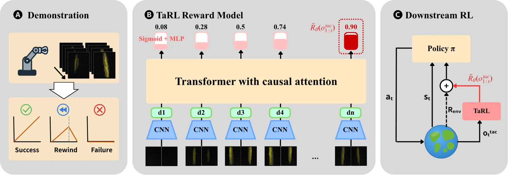

<!-- Generated by scripts/generate.py; edit data/works.json and data/media.json. -->

[← Back to the Awesome index](../../../README.md) · [Interactive website](https://chang-xinhai.github.io/Awesome-RGBDT-Manipulation/?collection=policy&item=tarl#library)

# TaRL

TaRL: Learning General and Physical Rewards from Tactile Demonstrations

**2026-09-29 · Preprint · National Taiwan University**

**[Paper](https://arxiv.org/abs/2609.36785)** · [Project](https://embodiedai-ntu.github.io/tarl)

A tactile progress-reward model learned from successful and failed interactions shapes separately trained contact-rich RL policies.

*TaRL authors · [Figure source](https://arxiv.org/abs/2609.36785) · Original rights retained.*

| Field | Reported value and source scope |
| :-- | :-- |
| Record type | model |
| Model role and downstream interface | A tactile progress-reward model learned from successful and failed interactions shapes separately trained contact-rich RL policies. [1](https://arxiv.org/abs/2609.36785)  |
| Model family | Predictive representation [1](https://arxiv.org/abs/2609.36785)  |
| Model architecture | Tactile reward encoder; downstream SAC/IQL control is a separate component. [1](https://arxiv.org/abs/2609.36785)  |
| Model size and component | Not reported [1](https://arxiv.org/abs/2609.36785)  |
| Model inputs | Tactile deformation observations and demonstration progress/context; camera/proprioceptive policy inputs are separately scoped. [1](https://arxiv.org/abs/2609.36785)  |
| Model outputs | Dense task-progress rewards, not direct robot motor commands. [1](https://arxiv.org/abs/2609.36785)  |
| Training method | Learn reward from successful, failed and temporally rewound demonstrations; combine dense tactile reward with sparse completion reward for RL. [1](https://arxiv.org/abs/2609.36785)  |
| Training data and scale | Real reward model: 40 successful+40 failed teleoperated trajectories at one position; downstream offline RL: 90 successful+90 failed at new positions. [1](https://arxiv.org/abs/2609.36785)  |
| Training duration | Not reported [1](https://arxiv.org/abs/2609.36785)  |
| Training hardware | Not reported [1](https://arxiv.org/abs/2609.36785)  |
| Inference setting and runtime | Not reported [1](https://arxiv.org/abs/2609.36785)  |
| Downstream evaluation and scope | Four simulated tasks and two real tasks. Real cube pickup37% to 97%; real peg pickup/insertion improve under matched fixed offline datasets. [1](https://arxiv.org/abs/2609.36785)  |
| Observations / modalities | Tactile |
| Evaluation domain | Simulation · Real world |
| Embodiment | Parallel-jaw gripper |
| Release: code | Not released [2](https://embodiedai-ntu.github.io/tarl)  |
| Release: weights | Not verified [2](https://embodiedai-ntu.github.io/tarl)  |
| Release: data | Not verified [2](https://embodiedai-ntu.github.io/tarl)  |
| Release: license | Not verified [2](https://embodiedai-ntu.github.io/tarl)  |
| Release: notes | Official project provides manuscript and videos but no substantive method source, trained reward checkpoint or full trajectory inventory. [2](https://embodiedai-ntu.github.io/tarl)  |

**Scope and qualifications**

- Reward prediction and the downstream learned action policy are different interfaces.
- Peg pickup and peg insertion are phases of one physical task, not two independent tasks.
- Dense progress reward is not a wrist F/T stream.

**Primary evidence**

1. [Primary manuscript and first-submission history](https://arxiv.org/abs/2609.36785) — Current primary manuscript reviewed; first-public date uses arXiv v1. Observations, training privileges and deployed interfaces retain their separate scopes.
2. [Official project source and actual artifact inventory](https://embodiedai-ntu.github.io/tarl) — Reviewed 26 October 2026. Availability and licensing apply only to the described released component, independently of paper results.
