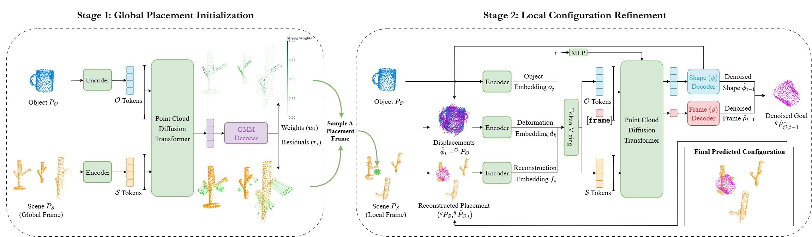

<!-- Generated by scripts/generate.py; edit data/works.json and data/media.json. -->

[← Back to the Awesome index](../../../README.md) · [Interactive website](https://chang-xinhai.github.io/Awesome-RGBDT-Manipulation/?collection=policy&item=tax-dpd#library)

# TAX-DPD

Disentangled Point Diffusion for Precise Object Placement

**2026-04-13 · arXiv preprint · Carnegie Mellon University; ABB Inc.**

**[Paper](https://arxiv.org/abs/2604.11793)**

Hierarchical point diffusion separates global placement location from local object/frame geometry for precise placement.

*TAX-DPD authors · [Figure source](https://arxiv.org/html/2604.11793) · Original rights retained.*

| Field | Reported value and source scope |
| :-- | :-- |
| Record type | policy |
| Policy family | Diffusion [1](https://arxiv.org/abs/2604.11793)  |
| Base model and architecture | Dense Gaussian-mixture global placement prior and disentangled point-cloud diffusion. [1](https://arxiv.org/abs/2604.11793)  |
| Model size and component | Not reported in the inspected primary-source sections [1](https://arxiv.org/abs/2604.11793)  |
| Deployment inputs | Segmented scene/object point clouds and placement context. [1](https://arxiv.org/abs/2604.11793)  |
| Action outputs and horizon | Object placement configuration converted to executable robot poses. [1](https://arxiv.org/abs/2604.11793)  |
| Training method | Supervised placement-goal learning with global and local geometric objectives. [1](https://arxiv.org/abs/2604.11793)  |
| Training data | RPDiff-style placement demonstrations and task-specific industrial insertion data; exact scope in manuscript. [1](https://arxiv.org/abs/2604.11793)  |
| Training duration | Not reported in the inspected primary-source sections [1](https://arxiv.org/abs/2604.11793)  |
| Training hardware | Not reported in the inspected primary-source sections [1](https://arxiv.org/abs/2604.11793)  |
| Inference and control rates | Not reported in the inspected primary-source sections [1](https://arxiv.org/abs/2604.11793)  |
| Evaluation scope | Simulated multimodal placement, physical industrial insertion and simulated cloth hanging. [1](https://arxiv.org/abs/2604.11793)  |
| Observations / modalities | Depth · Point cloud |
| Evaluation domain | Simulation · Real world |
| Embodiment | Parallel-jaw gripper |
| Release: code | Not verified |
| Release: weights | Not verified |
| Release: data | Not verified |
| Release: license | Not verified |
| Release: notes | Code, data and weights are checked independently; an upstream pretrained model is not a released task policy. |

**Scope and qualifications**

- The placement predictor is modular and requires object/scene segmentation and downstream motion execution.

**Primary evidence**

1. [Original manuscript and first submission history](https://arxiv.org/abs/2604.11793) — Full author HTML method/evaluation/appendix inspected; depth observations, pseudo-labels and generated outputs retain distinct roles.
