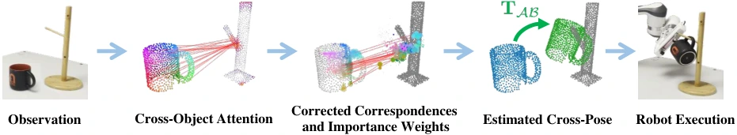

<!-- Generated by scripts/generate.py; edit data/works.json and data/media.json. -->

[← Back to the Awesome index](../../../README.md) · [Interactive website](https://chang-xinhai.github.io/Awesome-RGBDT-Manipulation/?collection=policy&item=tax-pose#library)

# TAX-Pose

TAX-Pose: Task-Specific Cross-Pose Estimation for Robot Manipulation

**2022-11-17 · CoRL 2022 · Carnegie Mellon University**

**[Paper](https://arxiv.org/abs/2211.09325)** · [Project](https://sites.google.com/view/tax-pose/home) · [Code](https://github.com/r-pad/taxpose)

Task-specific cross-object correspondence predicts a relative placement pose for a downstream motion planner.

*TAX-Pose authors · [Figure source](https://arxiv.org/html/2211.09325) · Original rights retained.*

| Field | Reported value and source scope |
| :-- | :-- |
| Record type | policy |
| Policy family | Geometric transfer [1](https://arxiv.org/abs/2211.09325)  |
| Base model and architecture | DGCNN/transformer cross-object attention, residual correspondences and differentiable weighted SVD. [1](https://arxiv.org/abs/2211.09325)  |
| Model size and component | Not reported in the inspected primary-source sections [1](https://arxiv.org/abs/2211.09325)  |
| Deployment inputs | Segmented action/anchor object point clouds. [1](https://arxiv.org/abs/2211.09325)  |
| Action outputs and horizon | Task-specific SE(3) cross-pose and planned robot placement trajectory. [1](https://arxiv.org/abs/2211.09325)  |
| Training method | Supervised cross-pose learning with displacement/correspondence/consistency losses. [1](https://arxiv.org/abs/2211.09325)  |
| Training data | Simulation and real demonstrations, including low-data ten-demonstration settings. [1](https://arxiv.org/abs/2211.09325)  |
| Training duration | Not reported in the inspected primary-source sections [1](https://arxiv.org/abs/2211.09325)  |
| Training hardware | Not reported in the inspected primary-source sections [1](https://arxiv.org/abs/2211.09325)  |
| Inference and control rates | Not reported in the inspected primary-source sections [1](https://arxiv.org/abs/2211.09325)  |
| Evaluation scope | Unseen-object relative placement in simulation and physical mug/pan-style manipulation. [1](https://arxiv.org/abs/2211.09325)  |
| Observations / modalities | Depth · Point cloud |
| Evaluation domain | Simulation · Real world |
| Embodiment | Parallel-jaw gripper |
| Release: code | Available [2](https://sites.google.com/view/tax-pose/home) [3](https://github.com/r-pad/taxpose) [5](https://github.com/r-pad/taxpose/tree/main)  |
| Release: weights | Not verified [2](https://sites.google.com/view/tax-pose/home) [3](https://github.com/r-pad/taxpose)  |
| Release: data | Not verified [2](https://sites.google.com/view/tax-pose/home) [3](https://github.com/r-pad/taxpose)  |
| Release: license | MIT for repository code; pretrained models, data and figure rights remain separate [2](https://sites.google.com/view/tax-pose/home) [3](https://github.com/r-pad/taxpose) [4](https://github.com/r-pad/taxpose/blob/main/LICENSE)  |
| Release: notes | Code, data and weights are checked independently; an upstream pretrained model is not a released task policy. [2](https://sites.google.com/view/tax-pose/home) [3](https://github.com/r-pad/taxpose)  |

**Scope and qualifications**

- Uses segmented object pairs and a downstream planner; placement prediction alone does not address all contact dynamics.

**Primary evidence**

1. [Original manuscript and first submission history](https://arxiv.org/abs/2211.09325) — Full author HTML method/evaluation/appendix inspected; depth observations, pseudo-labels and generated outputs retain distinct roles.
2. [Official author project](https://sites.google.com/view/tax-pose/home) — Public author-linked project; figure and downstream scope verified separately.
3. [Official current implementation linked by author project](https://github.com/r-pad/taxpose) — Actual runnable release and model artifacts checked independently.
4. [Actual license file in released source](https://github.com/r-pad/taxpose/blob/main/LICENSE) — Only source code covered by this file; not a blanket license for paper figures or upstream weights.
5. [Actual repository content inventory](https://github.com/r-pad/taxpose/tree/main) — 705 tracked paths inspected; code release is distinguished from a README/project/figure-only repository.
