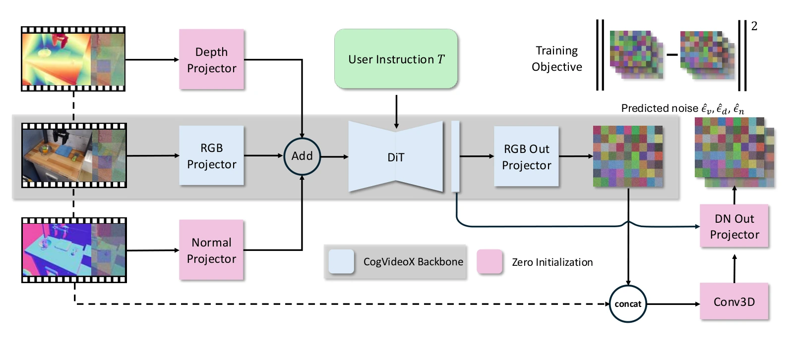

<!-- Generated by scripts/generate.py; edit data/works.json and data/media.json. -->

[← Back to the Awesome index](../../../README.md) · [Interactive website](https://chang-xinhai.github.io/Awesome-RGBDT-Manipulation/?collection=policy&item=tesseract-world#library)

# TesserAct

TesserAct: Learning 4D Embodied World Models

**2025-04-29 · ICCV 2025 · UMass Amherst; HKUST; Harvard University**

**[Paper](https://arxiv.org/abs/2504.20995)** · [Project](https://tesseractworld.github.io/) · [Code](https://github.com/UMass-Embodied-AGI/TesserAct) · [Weights](https://huggingface.co/anyeZHY/tesseract)

Joint RGB/depth/normal video generation provides 4D forecasts that can be paired with task-trained inverse dynamics.

*TesserAct authors · [Figure source](https://arxiv.org/html/2504.20995) · Original rights retained.*

| Field | Reported value and source scope |
| :-- | :-- |
| Record type | policy |
| Policy family | World-action model [1](https://arxiv.org/abs/2504.20995)  |
| Base model and architecture | CogVideoX-based multistream video diffusion, geometric consistency and inverse-dynamics action extraction. [1](https://arxiv.org/abs/2504.20995)  |
| Model size and component | Not reported in the inspected primary-source sections [1](https://arxiv.org/abs/2504.20995)  |
| Deployment inputs | Initial image and language; estimated geometry prepares depth/normal conditions where required. [1](https://arxiv.org/abs/2504.20995)  |
| Action outputs and horizon | RGB/depth/normal video and actions from a separate inverse-dynamics module. [1](https://arxiv.org/abs/2504.20995)  |
| Training method | 4D world-model training; task-specific keyframe adaptation and inverse-dynamics learning. [1](https://arxiv.org/abs/2504.20995)  |
| Training data | Robot videos augmented with estimated depth/normals; 500 samples per task for inverse dynamics. [1](https://arxiv.org/abs/2504.20995)  |
| Training duration | Not reported in the inspected primary-source sections [1](https://arxiv.org/abs/2504.20995)  |
| Training hardware | Not reported in the inspected primary-source sections [1](https://arxiv.org/abs/2504.20995)  |
| Inference and control rates | Not reported in the inspected primary-source sections [1](https://arxiv.org/abs/2504.20995)  |
| Evaluation scope | Embodied video prediction and RLBench policy execution. [1](https://arxiv.org/abs/2504.20995)  |
| Observations / modalities | RGB · Language |
| Evaluation domain | Simulation · Real world |
| Embodiment | Parallel-jaw gripper |
| Release: code | Available [2](https://tesseractworld.github.io/) [3](https://github.com/UMass-Embodied-AGI/TesserAct) [5](https://github.com/UMass-Embodied-AGI/TesserAct/tree/main)  |
| Release: weights | Not verified [2](https://tesseractworld.github.io/) [3](https://github.com/UMass-Embodied-AGI/TesserAct) [6](https://huggingface.co/anyeZHY/tesseract)  |
| Release: data | Not verified [2](https://tesseractworld.github.io/) [3](https://github.com/UMass-Embodied-AGI/TesserAct)  |
| Release: license | MIT for repository code; pretrained models, data and figure rights remain separate [2](https://tesseractworld.github.io/) [3](https://github.com/UMass-Embodied-AGI/TesserAct) [4](https://github.com/UMass-Embodied-AGI/TesserAct/blob/main/LICENSE)  |
| Release: notes | Code, data and weights are checked independently; an upstream pretrained model is not a released task policy. [2](https://tesseractworld.github.io/) [3](https://github.com/UMass-Embodied-AGI/TesserAct)  |

**Scope and qualifications**

- Generated future geometry is not measured sensory feedback.
- Public world-model code/checkpoints and the task-specific inverse-dynamics release are separate; the latter is not verified.

**Primary evidence**

1. [Original manuscript and first submission history](https://arxiv.org/abs/2504.20995) — Full author HTML method/evaluation/appendix inspected; depth observations, pseudo-labels and generated outputs retain distinct roles.
2. [Official author project](https://tesseractworld.github.io/) — Public author-linked project; figure and downstream scope verified separately.
3. [Official implementation and release scope](https://github.com/UMass-Embodied-AGI/TesserAct) — Availability of research implementation does not establish public task-policy checkpoints.
4. [Actual license file in released source](https://github.com/UMass-Embodied-AGI/TesserAct/blob/main/LICENSE) — Only source code covered by this file; not a blanket license for paper figures or upstream weights.
5. [Actual repository content inventory](https://github.com/UMass-Embodied-AGI/TesserAct/tree/main) — 51 tracked paths inspected; code release is distinguished from a README/project/figure-only repository.
6. [Official weights release destination](https://huggingface.co/anyeZHY/tesseract) — Destination linked by the official project/repository; component release scope is retained in release notes.
